# 灵境造物 · 图片转 3D 创作平台

**面向角色、建筑与物品的 AI 创作应用：把参考图准备、异步推理、质量检查和模型交付串成完整业务流程。**

[GitHub 仓库](https://github.com/lionOvO/lingjing-3d) · [Gitee 仓库](https://gitee.com/huaihua-university_1_0/3d-toolchain) · [功能截图导览](docs/FEATURE_TOUR.md)

`Python / FastAPI` · `Celery / Redis` · `LangGraph` · `SQLAlchemy / MySQL` · `MinIO` · `Vue 3 / Three.js` · `Docker Compose`

本项目基于开源 3D 模型建设应用与推理接入层。工程重点是：让耗时、依赖 GPU 且可能失败的模型推理，成为可提交、可追踪、可诊断、可归档的业务任务，同时提供可操作的网页工作台。

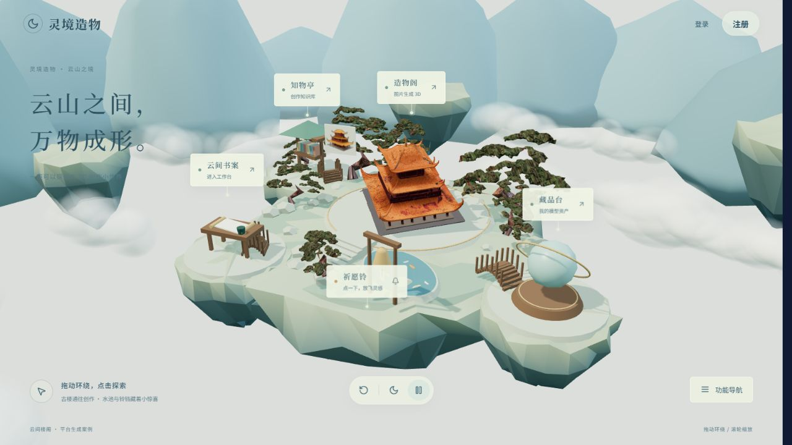

> 本文以**当前公开仓库源码**为准。默认入口接入本地 ComfyUI / Pixal3D 高质量路线，输出带纹理的 GLB。权重、私人数据和机器配置不随仓库发布；实验能力及本地后续进展在文末单独说明。

## 快速了解

| 想了解什么 | 建议入口 |
| --- | --- |
| 先看产品能做什么 | [下方功能图文导览](#功能图文导览) · [全部功能截图与说明](docs/FEATURE_TOUR.md) |
| 产品流程、技术栈与实现范围 | 下方功能与架构介绍 |
| 后端难点、方案选择与代码证据 | [工程案例与代码导读](docs/ENGINEERING_CASE_STUDIES.md) |
| 完整业务流程与设计细节 | [项目技术文档](docs/灵境造物_项目技术文档.md) |
| 文件组织与模块职责 | [项目结构](PROJECT_STRUCTURE.md) |
| GPU 环境、权重和复现条件 | [引擎下载与复现](docs/引擎下载与复现.md) |
| 页面及业务流程图 | [功能业务分析](功能业务分析/README.md) |

## 功能图文导览

下面按一次实际创作的顺序展示界面。点击图片可查看原尺寸；[完整图文导览](docs/FEATURE_TOUR.md)还包含任务中心、基础修复和本地后续功能。

> 图片来自开发与验证过程的真实界面，部分使用隔离测试样例；账号信息已隐藏。截图用于说明操作流程，任务数量、质量分和模型结果不代表效果保证。前九项对应公开源码已有功能，修复 Agent 的新界面在文末标明本地版本范围。

### 上传图片，配置本次生成

从本地文件或图片链接准备输入，选择角色 / 物品类型，再配置当前引擎支持的纹理尺寸、网格密度与种子。参数可以保存为预设，下一次复用。

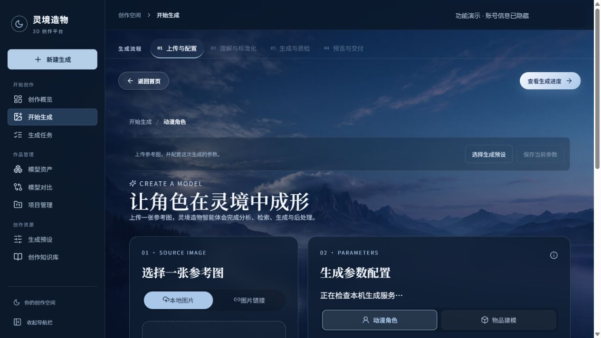

### 先整理参考图，再提交 GPU 任务

对照原图与抠图结果，检查屋檐、立柱、底座等细节是否完整；可调整裁剪和留白、恢复误删像素。用户确认实际输入后才创建生成任务，减少把错误输入送去长时间推理。

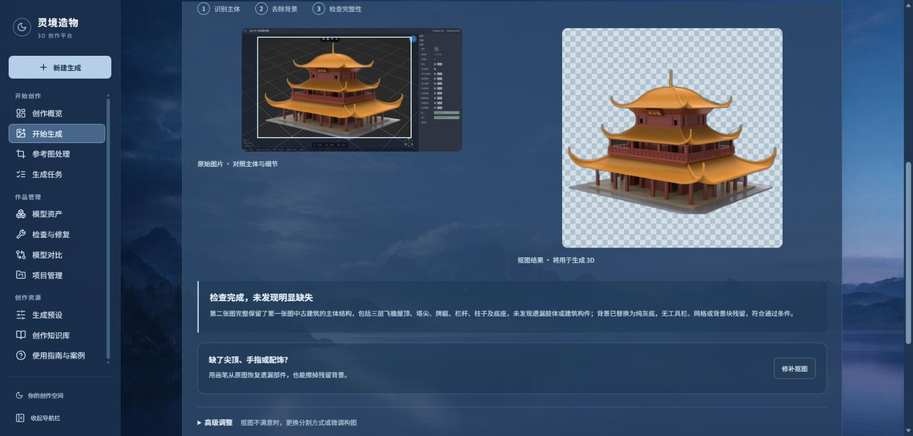

### 查看任务走到哪一步，保留真实输入与结果

任务页展示输入确认、参数准备、3D 生成、质检和交付阶段，并保留这次真正使用的参考图。任务完成后进入预览或下载 GLB；失败时保留错误和重试入口。[任务中心与状态筛选](docs/FEATURE_TOUR.md#3-任务中心与执行追踪)。

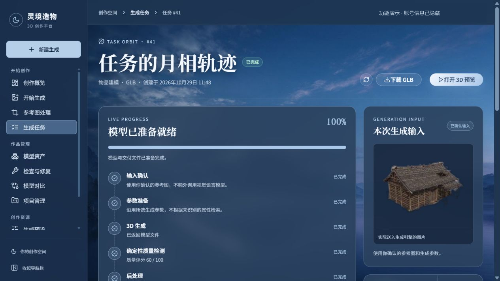

### 把生成结果管理成资产

资产库以卡片展示模型，支持搜索、名称和标签整理、下载、批量管理，以及移入回收站后恢复。截图中的记录为隔离验证样例。

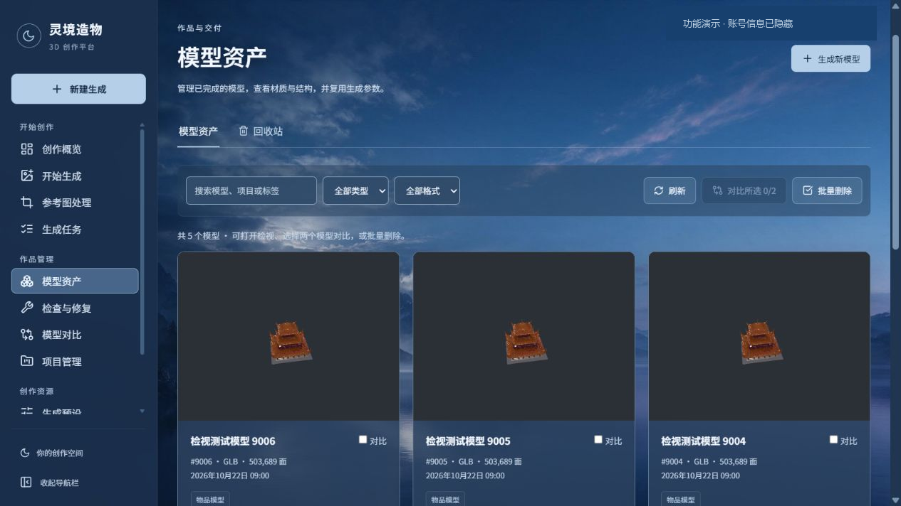

### 直接在浏览器里检查模型

GLB 在 Three.js 中加载，可旋转、平移、缩放，切换材质 / 轮廓 / 线框并调整展示光照。模型信息、下载、参数复用及检查修复入口与任务关联；原始 PBR 贴图随 GLB 交付。

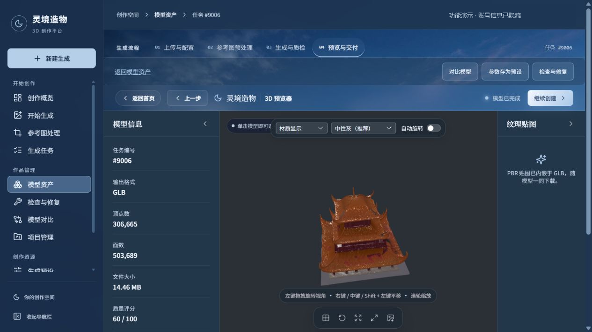

### 对比结果，复用生成参数

两个候选可并排检视，分别观察角度与细节；生成预设保存的是明确参数，便于做对照和重复尝试。对比视口独立控制，不用单张截图的姿态差异判断模型是否变形。

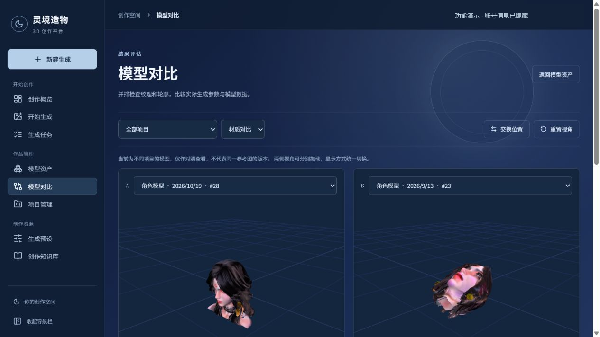

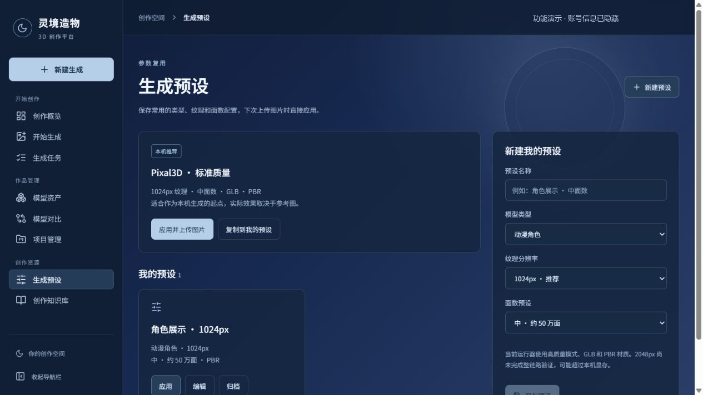

### 检查结构，在副本上保守修复

公开快照已有原模型 / 修复版本双侧预览、结构检查和有限网格清理，结果另存。结构指标减少不等于外观已经修好；[查看基础修复界面与能力边界](docs/FEATURE_TOUR.md#8-基础检查与修复)。

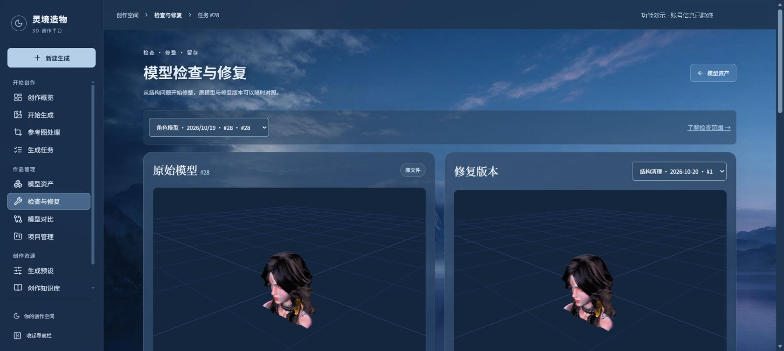

### 本地后续演进：由修复助手组织检查

**以下为本地后续版本预览，尚未同步到本仓库源码快照。** 助手根据真实模型视图、结构报告和规则提出受限方案，保留执行及对照记录；后续已在本机验证共用参考图和明确面选区。它们不代表通用大洞、缺件或人物五官恢复已经解决。

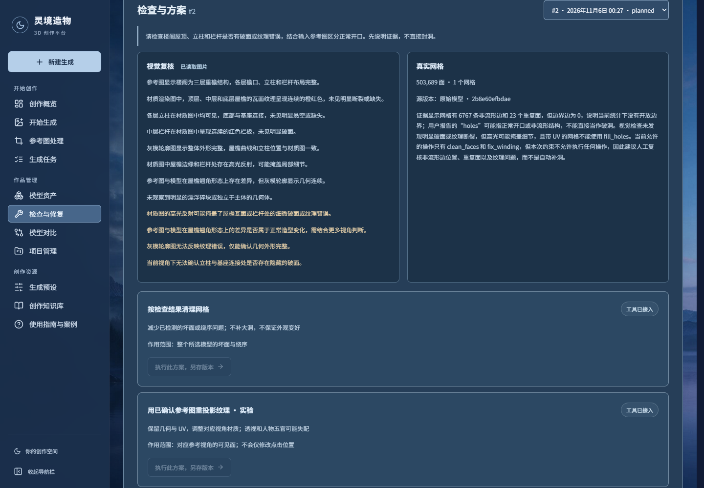

[继续看共用参考图与局部选区截图](docs/FEATURE_TOUR.md#9-本地后续版本预览) · [阅读后端工程案例](docs/ENGINEERING_CASE_STUDIES.md)

## 1. 项目解决什么问题

直接运行一个图生 3D 工作流，通常只能得到模型文件。要做成可用产品，还需要处理：

- **输入可靠性**：背景可能被一起建模，自动抠图可能删掉四肢、饰品和建筑底座，需要预览、修补与确认。
- **长任务执行**：推理远慢于普通请求，需要后台队列、状态持久化与失败反馈。
- **模型服务适配**：页面参数要映射到真实节点，运行能力、超时与产物路径需要校验。
- **结果可交付**：模型需要关联任务和用户，并支持网页检视、下载、比较和修复版本留存。
- **质量判断**：推理成功、结构检查通过、外观符合参考图，是三个不同的判断。

项目围绕以下业务流程组织：

```text
上传与配置 → 参考图预处理与确认 → 后台生成与质检 → 网页检视 → 资产归档与交付
```

## 2. 已实现的功能

| 模块 | 实现内容 | 代码入口 |
| --- | --- | --- |
| 用户与权限 | 密码登录、JWT access/refresh、账号设置、验证码相关流程、资源归属校验 | [security.py](backend/app/security.py)、[account.py](backend/app/account.py)、[sms_auth.py](backend/app/sms_auth.py) |
| 图片准备 | 上传/拖拽/粘贴/URL 输入、格式大小校验、裁剪构图、抠图、像素恢复/擦除、人工确认 | [ImagePreparation.vue](frontend/src/components/ImagePreparation.vue)、[reference_tools.py](backend/app/reference_tools.py) |
| 异步生成 | 接收任务、Celery 后台执行、保存参数/阶段/错误/结果/重试次数 | [routers.py](backend/app/routers.py)、[worker.py](backend/app/worker.py) |
| AI 工作流 | 可选分析、参数准备、生成、质检、知识参考与有限重试 | [agents.py](backend/app/agents.py) |
| 推理适配 | 统一请求/结果协议、能力查询、ComfyUI 工作流调用和 GLB 工件交付 | [generation.py](backend/app/generation.py)、[适配服务](services/trellis/app.py) |
| 故障诊断 | 按错误与适用条件检索知识，结合当前状态给出证据、建议和未知项 | [failure_diagnosis.py](backend/app/failure_diagnosis.py) |
| 检查与修复 | 真实 GLB 的重复面/退化面/边界/绕序/UV 检查，保守清理及独立修复版本 | [creation_tools.py](backend/app/creation_tools.py)、[mesh_tools.py](backend/app/mesh_tools.py) |
| 模型交付 | Three.js 检视、材质/线框、相机/灯光调整、截图和 GLB 下载 | [ThreePreview.vue](frontend/src/components/ThreePreview.vue) |
| 资产与项目 | 命名标签、回收站与恢复、项目历史、双模型比较、生成参数预设 | [studio.py](backend/app/studio.py)、[前端页面](frontend/src/views) |
| 产品入口 | 全 3D 交互首页、生成模型展示、地点导航、云层及风摆动画、移动端降级 | [ProductHomeView.vue](frontend/src/views/ProductHomeView.vue) |

短信、外部视觉及向量服务需要单独配置。页面按推理服务能力开放参数，不会因为存在某个适配器就自动开放对应模式。

## 3. 系统架构

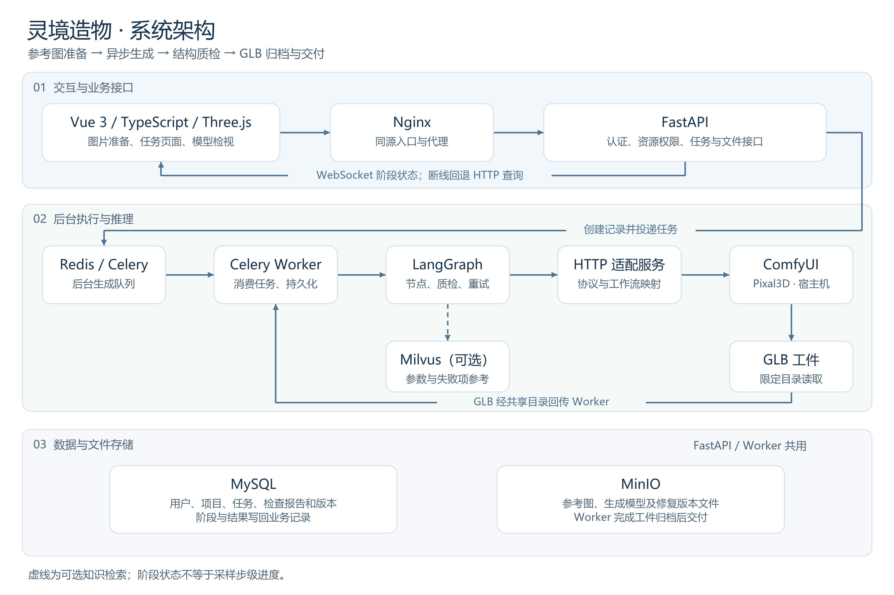

[查看高清图](docs/images/system-architecture.png) · [Mermaid 源文件](docs/images/system-architecture.mmd) · [图片生成脚本](scripts/render_architecture.py)

- **FastAPI** 处理请求与权限，不在请求处理过程中等待整个 GPU 推理。
- **Celery Worker** 执行长任务，阶段与结果写入数据库。
- **LangGraph** 负责工作流内部的状态传递、条件分支及质量重试；Celery 负责队列，两者解决不同问题。
- **推理适配服务** 对接具体运行器，隔离业务协议与工作流细节。
- **MySQL / MinIO / Redis** 分别承担业务状态、二进制文件与任务消息。

## 4. 后端与 AI 应用设计

### 4.1 持久化长任务，而非同步等待模型

任务提交后返回编号，后台执行推理。项目与任务关联输入对象；任务表保存生成参数、`celery_task_id`、分析与检索结果、质量信息、错误和重试次数。前端订阅状态变化，连接断开后回退查询。

Worker 使用延迟确认、单任务预取与本地串行消费；通过任务级异步数据库会话与 `NullPool` 避免跨事件循环复用连接。**这些措施不等于端到端恰好执行一次**，消息幂等与断点恢复仍有完善空间。

实现：[worker.py](backend/app/worker.py)、[任务接口](backend/app/routers.py)。

### 4.2 用状态图组织 AI 流程

LangGraph 节点围绕分析、归一化、检索、生成、质检和条件重试拆分。模型调用失败、质检不通过和任务最终失败沿不同分支处理，节点状态可回写业务记录。

默认路线直接使用用户确认的参考图，可以跳过文字分析及生成前特征检索。主图由代码定义执行顺序，**不是大模型自主规划、任意执行工具的通用 Agent**。

实现：[agents.py](backend/app/agents.py)，取舍见[工程案例](docs/ENGINEERING_CASE_STUDIES.md)。

### 4.3 让页面参数真正进入推理工作流

业务层定义 `GenerationRequest` / `GenerationResult`，适配层映射种子、纹理尺寸及网格密度，核对运行能力、限定工件读取范围并检查输出文件。

已确认输入带预处理标记，避免引擎重复裁剪或抠图。当前本地路线重点验证 1024px 纹理和中密度配置；2048px 是实验选项。**纹理尺寸不等于几何采样分辨率，文件名变化不应改变采样种子。**

实现：[generation.py](backend/app/generation.py)、[app.py](services/trellis/app.py)、[workflow_6gb.json](services/trellis/workflow_6gb.json)。

### 4.4 让知识检索服务于可解释的故障诊断

项目保留可选 Milvus 参数检索分支，同时实现面向故障的版本化知识检索：按错误类型、引擎、提供方和适用条件筛选条目，结合当前运行状态展示证据与建议。

诊断区分失败时保存的错误与当前状态，不把连接拒绝直接归因为显存不足。当前故障诊断是规则与知识驱动，**不包装成完整语义 RAG**；向量服务降级时的占位向量，也不作为有效语义检索成果。

实现：[failure_diagnosis.py](backend/app/failure_diagnosis.py)、[故障知识条目](backend/app/knowledge_data/generation_failures.json)、[向量集合](backend/app/milvus_schema.py)。

### 4.5 分离文件产出、结构质量与外观质量

Trimesh 检查真实 GLB，在满足条件时清理坏面与绕序。结果保存为独立 `ModelRevision`，保留原文件及前后报告；含 UV 的模型跳过基础封孔以保护贴图。

质量分是规则检查项通过比例，不是人物相似度或审美评分。文件成功导出，不代表五官、纹理和建筑部件已还原。

实现：[mesh_tools.py](backend/app/mesh_tools.py)、[creation_tools.py](backend/app/creation_tools.py)、[models.py](backend/app/models.py)。

## 5. 技术栈及选型

| 层次 | 技术 | 用途 |
| --- | --- | --- |
| 后端接口 | Python、FastAPI、Pydantic | 异步 I/O、请求校验、依赖注入、错误处理 |
| 数据持久化 | SQLAlchemy async、MySQL | 业务实体、事务、资源归属与任务结果 |
| 长任务 | Celery、Redis | 任务分发、后台消费与执行记录 |
| AI 应用编排 | LangGraph | 显式状态、条件路由、质量重试 |
| 模型集成 | ComfyUI、Pixal3D、HTTP 适配 | 开源模型推理与参数映射 |
| 文件与检索 | MinIO、Milvus | 图片/模型归档，可选向量参考检索 |
| 前端 | Vue 3、TypeScript、Pinia、Element Plus | 创作流程、表单与页面状态 |
| Web 3D | Three.js、GLTFLoader、OrbitControls | 交互首页与模型检视 |
| 部署与测试 | Docker Compose、Nginx、pytest、httpx | 服务编排、同源代理、接口与规则回归 |

版本以[后端依赖](backend/requirements.txt)、[前端锁文件](frontend/package-lock.json)和[引擎说明](docs/引擎下载与复现.md)为准。

## 6. 测试与演示

现有测试覆盖认证、持久化、资源隔离、上传与队列、推理协议、能力约束、预处理、视觉服务失败、网格修复、知识检索和故障诊断。使用外部服务替身的用例不代表重新执行 GPU 推理。

2026-11-06 对公开源码副本执行后端测试：**122 项通过、14 项跳过**。跳过项未计入通过；本次验证不包含真实 GPU 推理与全新机器验收。详情见[验证记录](docs/ENGINEERING_CASE_STUDIES.md#7-验证记录与如何阅读测试)。

```powershell
# 安装 backend/requirements.txt 中的依赖后，在仓库根目录执行
python -m pytest backend/tests -q

# 前端生产构建
npm --prefix frontend ci
npm --prefix frontend run build

# 发布前检查常见密钥、私人文件及大文件
python scripts/check_publication.py
```

**建议演示顺序**：3D 首页 → 图片预处理与确认 → 提交任务并查看阶段状态 → GLB 检视与下载 → 对比/修复版本 → 失败任务的证据和建议。现场推理耗时较长，可以先用已有结果演示交付，再展示真实任务的参数及执行记录。

## 7. 本地运行

仓库不附带用户数据库、上传图片、生成历史、模型权重或 Python 环境。当前面向本地开发与演示。

1. 准备 Docker Desktop、Python；本机前端开发另需 Node.js。按[引擎说明](docs/引擎下载与复现.md)安装 ComfyUI、节点、依赖和权重。
2. 在仓库根目录配置本机引擎：

   ```powershell
   python scripts/configure_local.py --comfy-root "E:\ComfyUI\ComfyUI"
   git config core.hooksPath .githooks
   ```

   非便携版用 `--comfy-python` 指定解释器。工具在 `.env` 不存在时生成随机数据库、对象存储和 JWT 密钥，创建 `local-stack.json`；不会覆盖已有 `.env` 或打印密钥。

3. 双击 `一键启动.bat`，或执行：

   ```powershell
   python scripts/start_local.py --build
   ```

4. 按脚本输出的实际地址访问。默认前端端口 `8080`，端口冲突由启动脚本处理。停止服务使用 `一键停止.bat`。

首次构建和权重下载需要联网。完整推理依赖兼容 GPU、CUDA 扩展、系统内存与页面文件。本机 6GB 显存下的适配经验不能替代全新机器验收；公开副本尚未在全新机器完整复现 GPU 推理。

## 8. 实现边界与后续方向

| 状态 | 内容 |
| --- | --- |
| 公开源码已有 | 预处理确认、异步生成、状态反馈、GLB 交付、资产管理、保守网格修复、故障知识诊断 |
| 依赖配置的可选能力 | 视觉辅助、短信、Milvus / 嵌入服务和其他推理适配路径 |
| 后续工程方向 | 完整任务幂等、持久化图断点恢复、可靠取消引擎任务、全新机器完整复现 |
| 未验收的模型能力 | 通用大洞/缺件补全、人物身份还原、稳定的多视图几何融合 |
| 本地后续验证，尚未同步此快照 | 修复助手、共用参考图集、明确面选区及 NS / Telea 局部颜色候选；图文导览已展示本地演进，不作为当前仓库可复现功能 |

当前页面反馈的是阶段状态，不能当作采样步级进度或剩余耗时预测。历史 TripoSR 适配不意味着快速/平衡档已开放；交付重点为 GLB，旧格式字段更新接口不代表已实现通用格式转换。

## 9. 第三方与发布说明

- 基础模型、量化节点及算法来自上游；本项目不声称训练或原创基础模型。
- [第三方来源](THIRD_PARTY_NOTICES.md) · [引擎来源与版本](docs/引擎下载与复现.md)
- [敏感文件保护](SECURITY.md)：真实配置、个人数据、权重和生成历史保持本地。
- `frontend/public/showcase/` 中的小型模型属于页面静态资源；完整权重和业务产物另行存储。

---

图文介绍更新于 **2026-11-10**；上文公开源码测试记录保留其原始验证日期。继续阅读[工程案例](docs/ENGINEERING_CASE_STUDIES.md)与[完整技术文档](docs/灵境造物_项目技术文档.md)。
