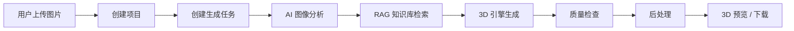
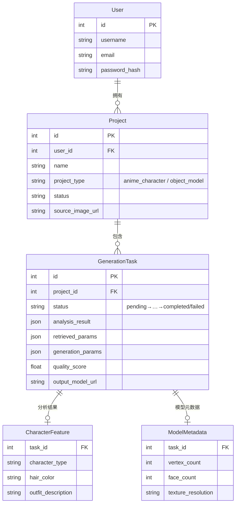
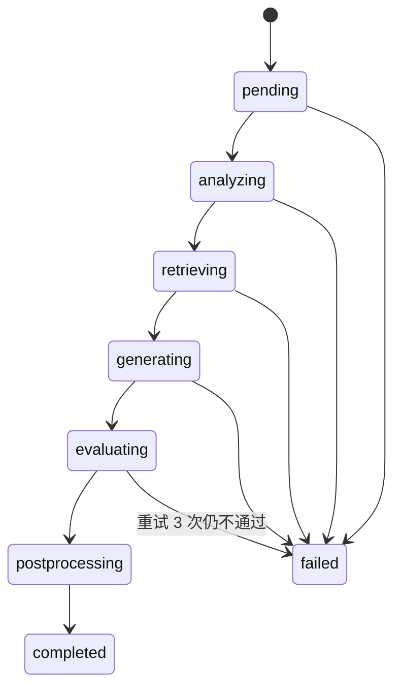
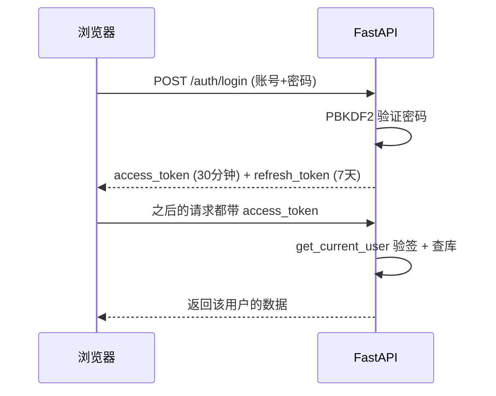
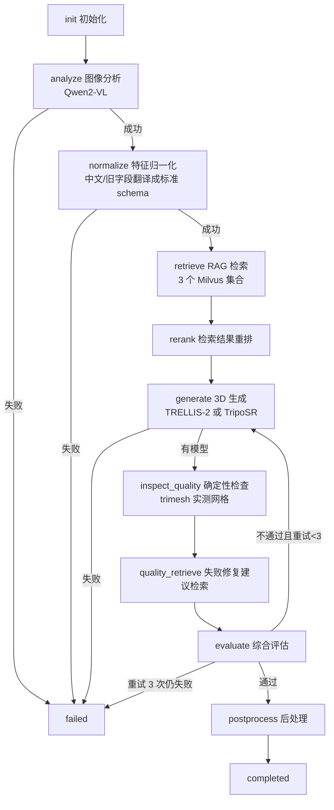
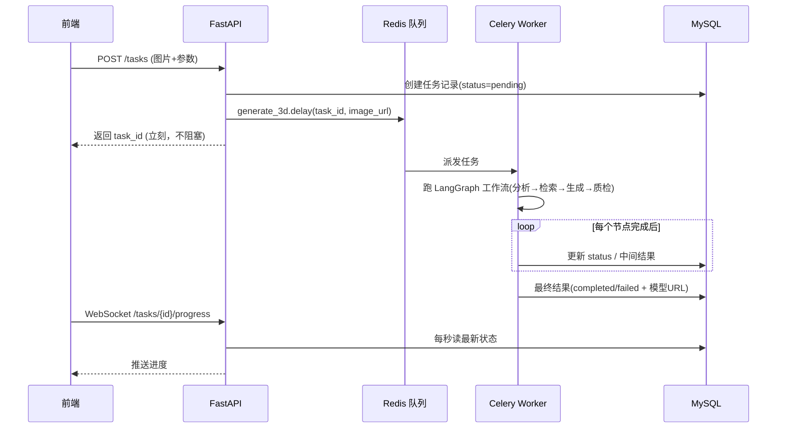
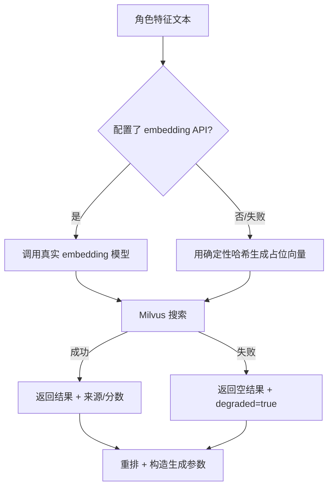
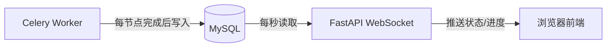
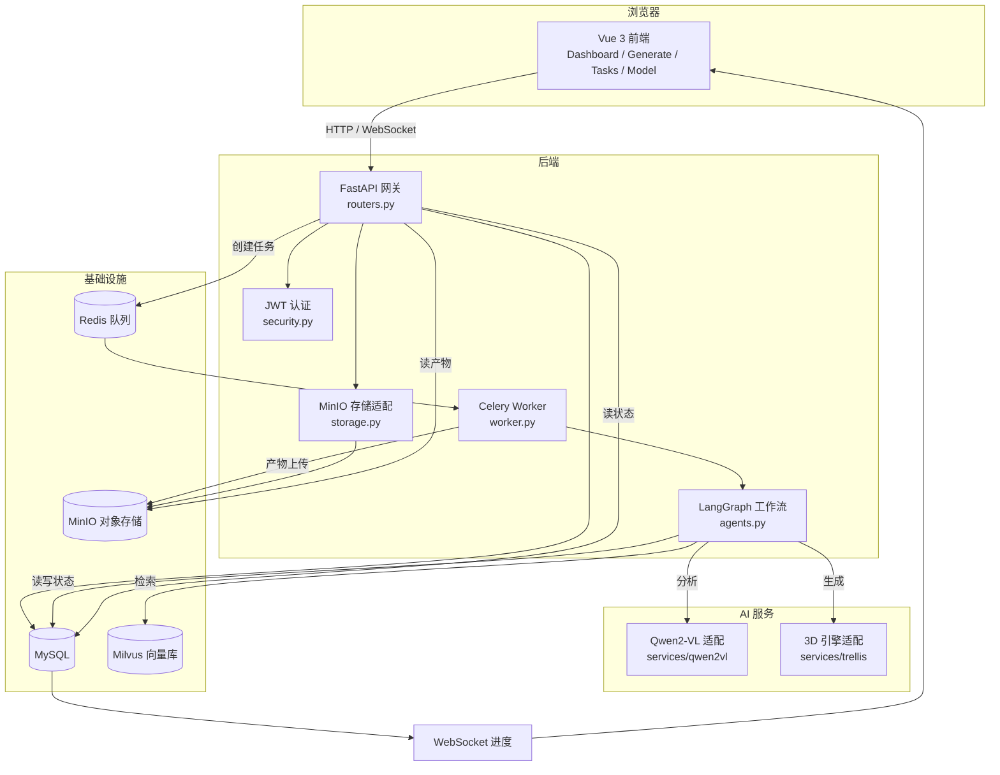

# AI 3D 数字人开发工具链 - 项目学习笔记

> 用途：按"实际实现的先后顺序"记录这个项目做了什么、每个功能怎么跑起来、中间踩了哪些坑、最后怎么解决的。
>
> 说明：这是目前阶段（项目骨架 + 后端主流程 + 前端页面 + AI/3D 服务适配）的阶段性笔记，后续每完成一个新功能就继续往里加。
>
> 读者假设：你刚接触 Python，所以遇到新概念时会用一句大白话先解释，再看代码。

---

## 0. 项目一句话介绍

用户上传一张动漫角色或物品的图片，系统自动完成 **图像分析 -> 知识库检索 -> 3D 模型生成 -> 质量检查 -> 后处理 -> 预览/下载**，最终交付一个可用的 3D 模型文件（如 GLB）。

整体可以想象成一条"3D 模型工厂流水线"：



---

## 1. 第一阶段：项目骨架与一键部署

### 做了什么

最先搭的不是业务代码，而是"整台工厂的厂房"，也就是 `docker-compose.yml`。它一次性编排了 9 个服务：

| 服务 | 用大白话说是什么 | 作用 |
|---|---|---|
| frontend | 网站前台 | Vue 3 写的用户界面 |
| api | 总服务台 | FastAPI 写的后端，所有请求从这进 |
| worker | 后厨 | Celery 写的后台干活进程，跑 AI 和 3D 生成 |
| mysql | 档案室 | 存用户、项目、任务等数据 |
| redis | 传菜窗口 | 任务队列的"中转站" |
| minio | 仓库 | 存上传的图片和生成的 3D 模型文件 |
| etcd + milvus | 图书馆索引 + 图书馆 | 向量数据库，RAG 知识检索用 |
| trellis | 3D 生成车间 | 跑 TRELLIS-2 / TripoSR 模型 |
| qwen2vl | 视觉分析车间 | 调 Qwen2-VL 模型"看图说话" |

命令只有一条：`docker compose up -d --build`，访问 `http://localhost:8080`。

### 踩坑与解法

| 问题 | 原因 | 解法 |
|---|---|---|
| 服务启动顺序不对，api 起来时 mysql 还没就绪 | 容器是并行启动的，不会天然排队 | 用 `depends_on` + 健康检查（healthcheck），比如 mysql 要 `mysqladmin ping` 通过，api 才启动 |
| 构建时拉依赖很慢/失败 | 网络需要代理 | 把 `HTTP_PROXY` / `HTTPS_PROXY` 作为 build 参数传入 compose，只在构建时生效 |
| worker 和 api 对数据库的连接要求不同 | Celery 每个任务用独立的事件循环，普通连接池会"串池子" | worker 单独用 `NullPool`（用完即关，不复用连接） |

> 小知识：`healthcheck` 就是 Docker 定期去"戳一下"服务，确认它真的活着，而不是只是进程启动了。

---

## 2. 第二阶段：数据库设计（SQLAlchemy 模型）

### 做了什么

用 SQLAlchemy 2.0 的 async ORM 定义了 6 张核心表（`backend/app/models.py`）。ORM 的意思是：**用 Python 类来代表数据库表，用对象来代表一行数据**，不用手写 SQL 也能读写数据库。

核心表和关系：



任务状态机（`GenerationTask.status`）是这个项目的"进度条灵魂"：



### 踩坑与解法

| 问题 | 原因 | 解法 |
|---|---|---|
| 删除项目时报外键错误 | `GenerationTask` 等子表没有设置数据库级 `ON DELETE CASCADE`，直接删父表被挡住 | 删除接口里**显式**先删子表（特征、元数据、任务），再删项目；并用行锁 `with_for_update()` 防止并发竞争 |
| 枚举值存进了 Python 成员名 | SQLAlchemy 默认存枚举的 `name`（如 `ANIME_CHARACTER`），与数据库 schema 定义不符 | 写了 `EnumType()` 辅助函数，用 `values_callable` 强制存 `value`（如 `anime_character`） |

> 小知识：外键（FK）就是"A 表的某列指向 B 表的主键"，保证数据之间能对得上号。

---

## 3. 第三阶段：后端 API（FastAPI 路由）

### 做了什么

`backend/app/routers.py` 是所有接口的集中地，按功能分组：

| 接口组 | 主要功能 |
|---|---|
| `/auth/*` | 注册、登录、刷新 token、查看当前用户 |
| `/projects/*` | 项目的增删改查 + 获取项目参考图 + 项目的任务历史 |
| `/uploads` | 上传图片（文件或 URL 两种方式） |
| `/tasks/*` | 创建任务、查状态、重试、取消、进度 WebSocket |
| `/models/*` | 模型预览、下载、格式转换 |
| `/rag/*` | 知识库的增删查、搜索、反馈 |
| `/agents/*` | 查询/手动触发智能体工作流 |

FastAPI 是 Python 的 Web 框架，写起来像这样：

```python
@router.post("/projects")
async def create_project(payload: ProjectCreate, db: AsyncSession = Depends(get_db_session)):
    ...
```

- `@router.post("/projects")`：声明"POST /projects 这个网址由我处理"
- `payload: ProjectCreate`：用 Pydantic 模型自动校验请求体
- `Depends(get_db_session)`：依赖注入，FastAPI 自动给你一个数据库会话，用完自动还

### 踩坑与解法

| 问题 | 原因 | 解法 |
|---|---|---|
| 浏览器打不开 MinIO 的图片 URL | Docker 内部 `minio` 是容器间的主机名，浏览器（在你电脑上）解析不了 | 加了 `GET /projects/{id}/source-image` 接口，由后端**代理**读取 MinIO 里的图，再转发给浏览器 |
| 任务创建接口既要收 JSON 又要收"图片+表单" | 前端上传模式是 multipart 表单 | 同一接口里判断 `content-type`，表单就走文件上传分支，JSON 就走 URL 分支 |
| 删除项目时如果刚好有任务在更新，可能出现"删了又复活" | 并发读写没有隔离 | 删除前用 `with_for_update()` 锁住项目行，收集完子任务 ID 后一次性清理 |

---

## 4. 第四阶段：认证与安全（security.py）

### 做了什么

两件核心事：

1. **密码不存明文**：用 PBKDF2 算法加盐（salt）哈希 24 万轮后存库。登录时用同样的算法重算一遍对比，全程不碰原密码。
2. **登录后发"通行证"（JWT）**：一个签了名的字符串，里面写着"这是用户 42，30 分钟内有效"。之后每个请求带 `Authorization: Bearer <token>` 头，后端验签即可知道你是谁。



### 小知识

- JWT = JSON Web Token，像一张防伪工牌：内容谁都能看（用户 ID、过期时间），但没有服务器密钥伪造不出来。
- `hmac.compare_digest` 用恒定时间比较，防止"猜密码猜得越接近响应越快"这类侧信道攻击。

---

## 5. 第五阶段：文件存储（MinIO 适配层）

### 做了什么

`backend/app/storage.py` 封装了 `ObjectStorage` 类，统一管理文件上传：

- 上传：限制类型（PNG/JPG/WEBP）、限制大小（默认 20MB）、生成随机文件名防止冲突
- 下载：从 MinIO 读出文件字节流，通过 API 转发给浏览器
- 生成的 3D 模型也走同样通道，MinIO 保持**私有**，不给浏览器直连

### 踩坑与解法

| 问题 | 原因 | 解法 |
|---|---|---|
| 用户传了个 `.exe` 改名 `.png` | 只看文件名不可靠 | 同时校验文件扩展名 **和** HTTP `Content-Type`，两者都要通过 |
| 超大文件把内存撑爆 | 一次性读入 | 边读边计数，超过限制立刻中断并报错 |
| 同名文件互相覆盖 | 用户可能上传同名图 | 文件名用 `uuid4().hex` 随机生成 |

---

## 6. 第六阶段：AI 服务适配层（两个独立小服务）

### 做了什么

`services/` 下有两个独立的 FastAPI 小服务，是后端和"真模型"之间的翻译官：

#### qwen2vl（看图说话服务）

- 接收：图片 URL + 提示词
- 调用：Qwen2-VL 视觉模型（可接云端 API）
- 返回：角色的结构化描述（发型、服装、姿势、风格标签等）

#### trellis（3D 生成服务）

- 接收：图片 + 生成参数（引擎、模式、分辨率等）
- 调用：`TRELLIS_INFERENCE_COMMAND` 指定的真实推理程序（TRELLIS-2 或 TripoSR）
- 返回：生成的模型文件路径 + 元数据（面数、是否水密等）

### 踩坑与解法（这阶段坑最多）

| 问题 | 原因 | 解法 |
|---|---|---|
| 云端视觉模型访问不了 Docker 内网的 `minio` 地址 | 云模型跑在公网，看不到私有容器网络 | qwen2vl 服务**先把图下载下来转成 base64 data URI** 再发给云模型；且只信任配置过的内部主机名，防止被当"任意代理"滥用 |
| 模型服务没配好时后端悄悄造了个假模型 | 早期占位实现会返回 mock | 明确改成"绝不伪造"：没配 `TRELLIS_INFERENCE_COMMAND` 就直接报错，让任务失败并显示原因 |
| 适配器返回的 JSON 格式五花八门（字符串/嵌套/列表混着来） | 不同引擎版本字段不一致 | 后端 `GenerationResult` 用 Pydantic 严格解析，兼容多种格式但内部统一成一套对象 |

---

## 7. 第七阶段：智能体工作流（LangGraph 编排）

### 做了什么

`backend/app/agents.py` 是整个项目的"大脑"，用 LangGraph 把各个智能体串成一张有向图。**每个智能体就是一个类，图的每个节点就是它的一次 `run(state)`**——接收共享状态字典，改完再还回去。

完整工作流图：



几个关键智能体的"人话说明书"：

| 智能体 | 干什么 |
|---|---|
| `CharacterAnalysisAgent` | 调视觉模型分析图片，返回角色描述 |
| `CharacterNormalizationAgent` | 把中文/旧格式的分析结果翻译成标准 schema（如 `"女"→"female"`、`"双马尾"→"twintails"`），并标记不确定字段 |
| `RAGRetrievalAgent` | 把角色特征转成文本 → 变向量 → 去 Milvus 三个集合搜相似案例 |
| `RetrievalRerankAgent` | 把搜到的结果按相似度+成功率排序，给出置信度 |
| `ModelGenerationAgent` | 根据模式选引擎，构造请求，调 3D 服务 |
| `DeterministicQualityCheckAgent` | 用 trimesh 真实测网格：面数、水密性、退化面、纹理分辨率 |
| `QualityCheckAgent` | 汇总检查结果打分；不通过就调整参数重试（最多 3 次） |
| `PostProcessAgent` | 收尾，标记完成 |

### 生成模式与引擎选择

用户看到的是三档模式，后端映射到真实引擎（RTX 3060 6GB 本地跑得动的是 TripoSR）：

| 用户模式 | 真实引擎 | 纹理 | 面数 | PBR |
|---|---|---|---|---|
| fast（快速） | TripoSR（本地） | 512 | 低 | 关 |
| balanced（均衡） | TripoSR（本地） | 1024 | 中 | 关 |
| high_quality（高质量） | TRELLIS-2（远程） | 2048 | 中 | 开 |

### 踩坑与解法

| 问题 | 原因 | 解法 |
|---|---|---|
| 视觉模型返回的字段名/格式不统一（有的给 `hair_color`，有的给嵌套 `hair.color`；中文英文混着来） | 不同模型/版本的输出习惯不同 | 写了 `CharacterNormalizationAgent` 统一翻译 + 归一化，并标记 `uncertain_fields` 让 UI 能提示 |
| 早期质量检查有"恒真检查"（列表长度等于自身，永远通过） | 检查逻辑写错了 | 改成 `DeterministicQualityCheckAgent`：真用 trimesh 打开网格实测，不通过就是不通过 |
| RAG 检索挂了整个流程就断 | Milvus/embedding 服务不稳定 | 全链路降级设计：搜不到就用默认参数继续，标记 `retrieval_degraded=true` 让前端知道 |
| 质量修复 RAG 在"没有失败项"时也会白白搜一次 | 空列表被当成"需要检索" | 加了守卫：只在存在失败项且该节点确实没跑过时才触发 |
| 质量不过时盲目重试 | 没有针对性 | 重试前根据失败的检查项**定向调整参数**（面数不够→提高 mesh_density，纹理不够→提高分辨率） |

---

## 8. 第八阶段：3D 生成引擎客户端（generation.py）

### 做了什么

`GenerationEngineClient` 是和 3D 服务对话的"外交官"：

- **统一协议**：无论背后是 TRELLIS-2 还是 TripoSR，都用同一套 `GenerationRequest` / `GenerationResult` 对象
- **自动重试**：网络超时、连接失败时自动重试（默认 2 次），带指数退避（0.25s → 0.5s → 1s）
- **严格校验**：引擎返回的 JSON 先过 Pydantic，格式不对就抛清晰错误，不让脏数据流进工作流
- **格式白名单**：只允许 `glb / obj / ply / fbx / stl`

### 踩坑与解法

| 问题 | 原因 | 解法 |
|---|---|---|
| 引擎偶尔超时但服务其实还活着 | 单次请求失败 ≠ 服务挂了 | 重试 + 指数退避，只有连续失败才判定不可用并让任务失败 |
| 引擎返回字段名不统一（`model_url` / `url` 混用） | 不同引擎适配器实现差异 | 解析时做字段兼容映射，内部只认一套 |

---

## 9. 第九阶段：异步任务队列（Celery Worker）

### 做了什么

3D 生成可能要跑几分钟甚至更久，不能让 HTTP 请求傻等。于是用 Celery（Python 最流行的任务队列库）+ Redis 把任务丢到后台慢慢跑：



### 踩坑与解法（这阶段是可靠性重灾区）

| 问题 | 原因 | 解法 |
|---|---|---|
| worker 重启后，正在跑的任务消失了（数据库里状态卡在 analyzing） | Celery 默认"接到任务就确认"，worker 一崩任务就丢 | `task_acks_late=True` + `task_reject_on_worker_lost=True`：任务**跑完才确认**，worker 挂了任务自动回队列重跑 |
| 任务状态在 LangGraph 流式输出中"倒退"（从 analyzing 跳回 pending） | 图的初始快照在 API 已经置 analyzing 之后才到达 | 加守卫：如果当前状态不是 pending，就忽略迟到的 pending 快照，防止进度条回跳 |
| worker 跑多个任务后数据库连接报错 | aiomysql 连接跨 Celery 事件循环复用导致失效 | worker 用 `NullPool`（不池化，每次新建，用完释放） |
| 真引擎生成的文件在容器本地磁盘，API 容器看不到 | 两个容器文件系统不同 | 生成产物写到共享卷 `/artifacts` → worker 读出字节上传 MinIO → API 通过自己的 `/models/{id}/content` 接口转发给浏览器 |
| 旧的 mock:// 模型任务下载不了 | 历史任务没有真实文件 | 加了 `_ensure_model_artifact()` 兼容层：遇到旧格式任务，现场生成一个占位网格补上去，不要求用户重跑 |
| trimesh 不支持导出 FBX | 库没有 FBX 导出器 | 手写了一个最小合法的 ASCII FBX 三角形作为兜底产物 |
| 恶意路径攻击（引擎返回 `../../etc/passwd`） | 直接信任引擎给的路径 | `_read_engine_artifact()` 强制校验路径必须在 `/artifacts` 共享卷内，且后缀合法、文件头合法 |

---

## 10. 第十阶段：RAG 知识库（Milvus）

### 做了什么

`backend/app/milvus_schema.py` 定义了 3 个向量集合。**向量**就是把一段文字变成一串数字，"意思接近"的文字向量距离也接近，这就是语义搜索的基础。

| 集合 | 存什么 | 向量维度 | 用途 |
|---|---|---|---|
| `character_style_collection` | 角色风格案例 | 1024 | 分析完角色后搜"相似风格的成功案例" |
| `generation_params_collection` | 生成参数经验 | 768 | 推荐/修复生成参数 |
| `material_reference_collection` | PBR 材质参考 | 512 | 材质推荐 |

API 启动时 `ensure_collections()` 会自动建集合、建索引、加载数据。

### 检索降级策略



---

## 11. 第十一阶段：前端页面（Vue 3）

### 做了什么

技术栈：Vue 3（Composition API）+ TypeScript + Pinia（状态管理）+ Element Plus（UI 组件）+ Three.js（3D 预览）。

页面清单和职责：

| 路由 | 页面 | 职责 |
|---|---|---|
| `/` | DashboardView | 首页仪表盘：最近项目、当前任务、工作流概览 |
| `/auth` | AuthView | 登录/注册 |
| `/generate` 与 `/workflow/:taskId?` | WorkflowView | 上传图片、选参数、创建任务、看进度（两个入口复用同一页面） |
| `/projects` | ProjectsView | 项目列表 |
| `/projects/:id` | ProjectDetailView | 项目详情 + 历史任务 |
| `/tasks/:taskId?` | TasksView | 任务中心 |
| `/model` | ModelView | 3D 预览器（Three.js） |
| `/knowledge` | KnowledgeView | 知识库管理 |
| `/standardize/:taskId` | StandardizeView | 生成结果标准化/确认 |

路由守卫：非公开页面没有 token 就自动跳到 `/auth`。

### API 层的三个贴心设计（`services/api.ts`）

1. **启动重试**：Docker 刚启动那几秒后端没就绪，GET 请求和登录请求会自动重试 6 次（间隔递增），避免用户看到"网络错误"吓一跳。
2. **错误翻译**：把后端英文报错（如 `Invalid credentials`）映射成中文提示，Pydantic 校验错误也逐条翻译。
3. **登录过期处理**：收到 401 自动清 token 并发全局事件，页面跳转登录页。

### 踩坑与解法

| 问题 | 原因 | 解法 |
|---|---|---|
| 二级页面颜色偏绿，和主页冷蓝色不统一 | Element Plus 默认成功态是绿色 + 部分旧样式残留 | 以主页 `brand.css` 的 token（`--night` `--blue` `--violet` `--pink` `--mist` `--white`）为唯一基准，二级页面用页面级覆盖统一；后续禁止硬编码绿色 |
| 从项目详情回到任务，可能串到别的项目的任务 | 全局"最近任务"缓存跨项目污染 | `GET /projects/{id}/tasks` 直接按项目查库，前端不再依赖全局缓存推断 |
| Docker 首次启动时前端报"服务正在启动" | 后端数据库/API 有几秒初始化窗口 | API 层加启动重试（见上） |

---

## 12. 第十二阶段：WebSocket 实时进度

### 做了什么

任务进度不用前端傻轮询，后端开了 `/api/v1/tasks/{task_id}/progress` WebSocket，每秒读一次数据库里任务的真实状态，有变化才推送：

| 状态 | 进度 |
|---|---|
| pending | 0% |
| analyzing | 15% |
| retrieving | 35% |
| generating | 60% |
| evaluating | 82% |
| postprocessing | 94% |
| completed | 100% |

### 关键设计决策

**WebSocket 读数据库，不读 worker 的内存。** 这样即使 API 容器中途重启，进度照样正确（Celery 拥有执行，FastAPI 拥有浏览器连接，数据库是两者的"公共账本"）。



---

## 13. 第十三阶段：测试与验证

### 做了什么

后端 pytest 覆盖（`backend/tests/`）：

| 测试文件 | 测什么 |
|---|---|
| `test_database.py` | ORM 建表、认证 API、数据持久化 |
| `test_agents.py` | 各智能体节点、归一化、质量重试、服务降级 |
| `test_generation.py` | 引擎协议解析、引擎选择、HTTP 重试 |
| `test_upload_queue.py` | MinIO 上传和上传接口 |
| `test_knowledge_seed.py` | 知识库种子数据 |
| `test_milvus_schema.py` | 集合 schema 定义 |

服务也有独立测试：`services/trellis/test_app.py`、`services/qwen2vl/tests/`。

前端验证方式：`npm run build`（生产构建通过）+ 手工主链路验证。

### 测试思想小结

1. **mock 外部依赖**：测试时不真调 Qwen/Milvus/3D 引擎，用假客户端返回预设结果，跑得快且稳定。
2. **测行为不测实现**：比如"归一化支持中文和旧字段"，就是喂它一个中文输入，断言输出是标准 schema。
3. **边界值**：空列表、超长字符串、非法格式、服务挂掉，都是最容易出 bug 的地方。

---

## 14. Bug 与难点速查表（按主题归档）

### 部署类

| 现象 | 根因 | 修法 |
|---|---|---|
| 服务启动顺序错乱 | 容器并行启动无天然依赖 | compose `depends_on` + healthcheck |
| 构建拉依赖失败 | 网络代理 | build args 传代理，不入镜像 |
| worker 数据库连接跨事件循环失效 | 默认连接池复用 | NullPool |

### 数据一致性类

| 现象 | 根因 | 修法 |
|---|---|---|
| 删项目报外键错误 | 子表无级联删除 | 显式删子表 + 行锁 |
| 枚举入库变成成员名 | SQLAlchemy 默认行为 | `values_callable` 强制存 value |
| 任务状态倒退 | 流式快照乱序 | 状态守卫，禁止向 pending 回退 |

### 可靠性类

| 现象 | 根因 | 修法 |
|---|---|---|
| worker 重启任务丢失 | 默认先确认后执行 | acks_late + reject_on_worker_lost |
| 网络抖动导致引擎调用失败 | 无重试 | 指数退避重试 |
| RAG 挂了全流程断 | 无降级 | 降级为默认参数 + degraded 标记 |

### 安全类

| 现象 | 根因 | 修法 |
|---|---|---|
| 密码明文风险 | 错误做法 | PBKDF2 24 万轮加盐哈希 |
| 恶意 artifact 路径 | 信任引擎输出 | 严格白名单目录 + 后缀 + 文件头校验 |
| 适配器被当任意代理 | URL 校验过松 | 只允许配置的内部主机名 |

### 视觉/前端类

| 现象 | 根因 | 修法 |
|---|---|---|
| 二级页面偏绿 | 组件默认成功色 + 旧样式 | 主页 token 为基准，页面级冷蓝覆盖 |
| 跨项目任务串扰 | 全局"最近任务"缓存 | 按项目查询接口 |
| Docker 冷启动报错 | 后端未就绪 | 前端启动重试 + 错误翻译 |

---

## 15. 一页看懂：当前项目全貌



---

## 16. 待补充区（后续笔记继续写这里）

- [ ] 前端各页面的具体交互细节（上传、参数面板、3D 控制器）
- [ ] 生产部署的完整排错手册
- [ ] RAG 知识库的数据治理与反馈闭环
- [ ] 批量生成 / 模型对比 / 风格迁移（PRD 规划功能）
- [ ] Playwright 前端自动化测试
