# 灵境造物 · 功能图文导览

从准备参考图，到取得、比较与管理 3D 资产。这里把页面里能做的事、操作衔接和实现边界放在一起，便于快速演示产品。

[返回项目介绍](../README.md) · [工程案例与代码导读](ENGINEERING_CASE_STUDIES.md) · [完整技术文档](灵境造物_项目技术文档.md)

截图说明：采用 2026-10-19 至 2026-11-10 开发过程中保存的真实界面截图，部分记录为隔离验证样例；已隐藏截图账号栏。截图的数值不作为质量承诺，未把失败任务或未验收能力改写为成功。布局可能随版本调整，点击图片查看原尺寸。第 1–8 节为公开源码已有功能，第 9 节单独展示尚未同步公开源码的本地后续版本。

## 1. 上传与生成配置

先选参考图，再确定当前引擎支持的参数。支持本地文件、拖拽、粘贴及图片链接输入，页面检查类型与大小。高质量本地路线使用 ComfyUI / Pixal3D，交付带纹理的 GLB；历史适配器存在，不代表快速 / 平衡模式都向页面开放。

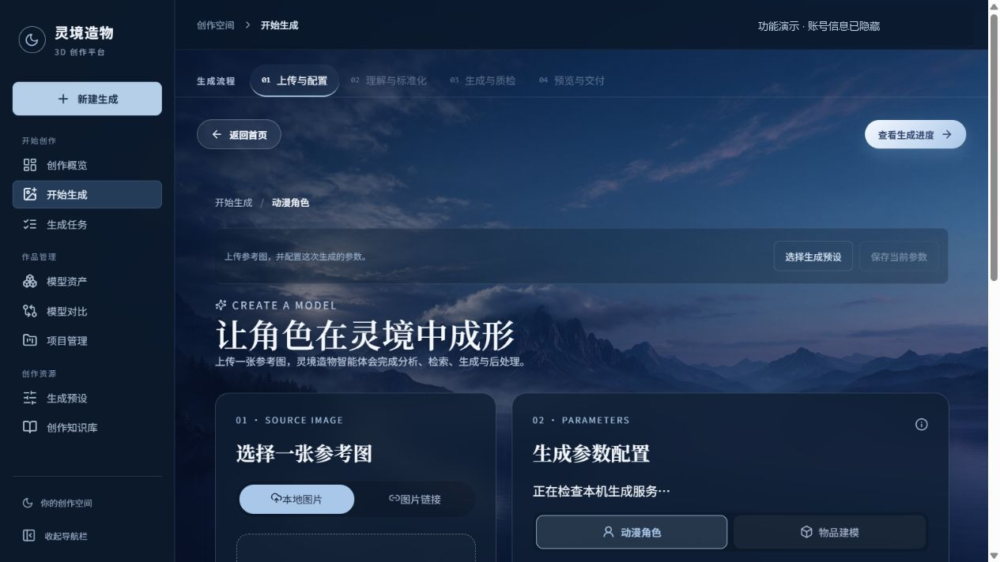

**下一步**：进入参考图预处理；当前确认图与参数会与后续任务关联。代码：[GenerateView.vue](../frontend/src/views/GenerateView.vue)、[推理协议](../backend/app/generation.py)。

## 2. 参考图预处理与确认

建筑示例展示原图、透明前景和完整性检查。背景、网格线、原图里的工具界面不应成为重建主体；自动抠图也可能误删檐角、细柱或底座，因此提供裁剪、留白、恢复与擦除，并保留人工确认。

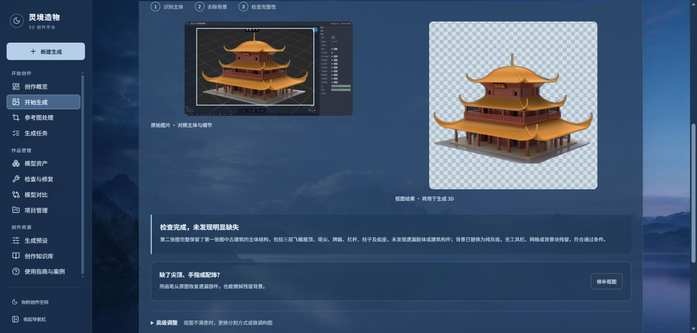

**使用时看什么**：主体轮廓是否完整、细长部件是否保留、实际交给引擎的图片是否正确。像素恢复使用原图已有信息，不是生成背面或补出原图没有的结构。代码：[ImagePreparation.vue](../frontend/src/components/ImagePreparation.vue)、[预处理接口](../backend/app/creation_tools.py)。

## 3. 任务中心与执行追踪

任务中心聚合进行中、完成和失败记录，支持筛选及进入详情。长任务由后台处理，刷新页面不会把业务任务记录清掉；连接异常时使用查询恢复状态。

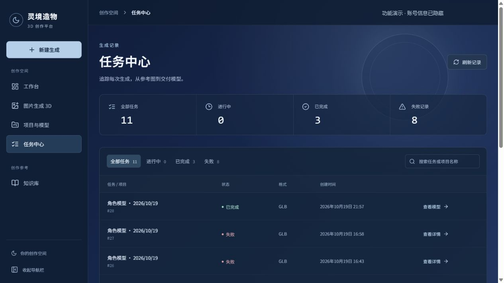

详情页保存实际生成输入、参数与阶段，完成后提供预览和 GLB 下载。下面为木屋样例的完成记录；展示百分比应按该版本阶段定义理解，不代表精确剩余时间预测。

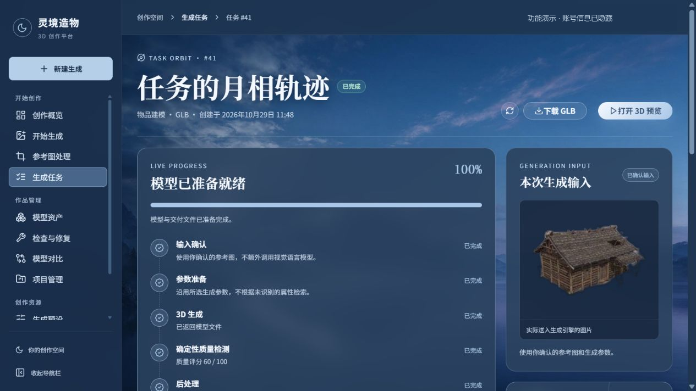

**演示建议**：先用已完成任务展示交付，再展示任务参数与阶段；现场生成耗时与模型、输入和设备有关。代码：[任务页](../frontend/src/views/TasksView.vue)、[队列 Worker](../backend/app/worker.py)。

## 4. 模型资产管理

生成结果以任务关联资产保存，支持卡片预览、搜索与筛选、名称和标签、模型下载、批量操作。移入回收站后可以恢复，避免误操作立即永久丢失结果。

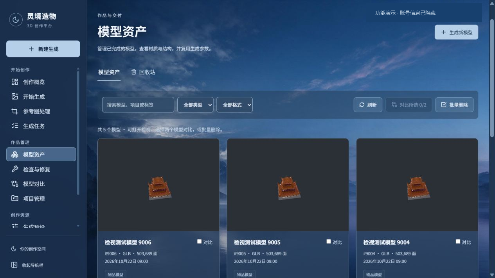

截图为隔离交互验证样例，三个相似的建筑卡片用于检查列表与操作，不是宣称三次高质量生成。代码：[AssetsView.vue](../frontend/src/views/AssetsView.vue)、[studio.py](../backend/app/studio.py)。

## 5. 网页模型检视与交付

模型在浏览器内通过 GLTFLoader 加载，支持旋转、平移、缩放、显示模式与光照调整、截图和下载；旁栏展示任务与文件元数据。参数可保存为预设，也可转入模型对比、检查修复。

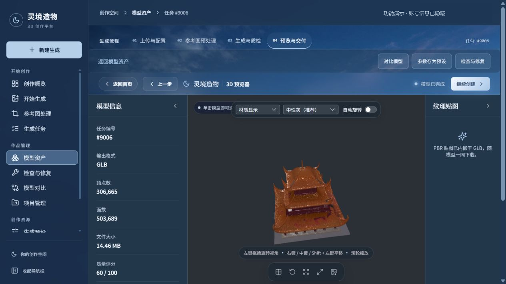

**需要区分**：改变展示光照不会重训模型或修复贴图；质量分来自规则检查，不是人物身份相似度。原始内嵌 PBR 图片随 GLB 下载。代码：[ModelView.vue](../frontend/src/views/ModelView.vue)、[ThreePreview.vue](../frontend/src/components/ThreePreview.vue)。

## 6. 双模型对比

选择两个结果并排观察，比较局部形状、材质与参数。两个视口独立控制，便于分别检查正面、背面或侧面；如果要判断算法改动，还需要一致的相机、灯光和受控输入。

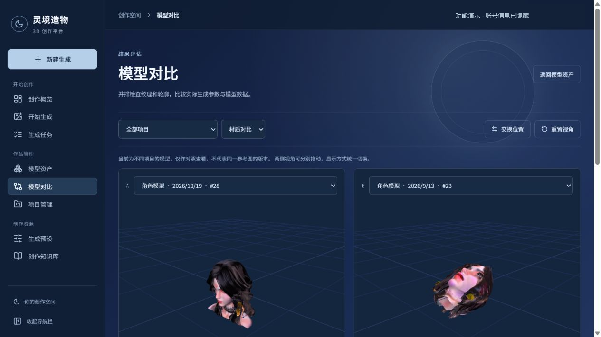

截图用于展示对比交互，不表示其中一个结果质量更高，也不是自动相似度评测。代码：[CompareView.vue](../frontend/src/views/CompareView.vue)。

## 7. 生成参数预设

把已明确的生成模式、纹理尺寸、密度、种子等参数保存为预设，新建任务时复用。预设的价值是保存可检查的配置，避免只记住“高质量”这样的模糊描述。

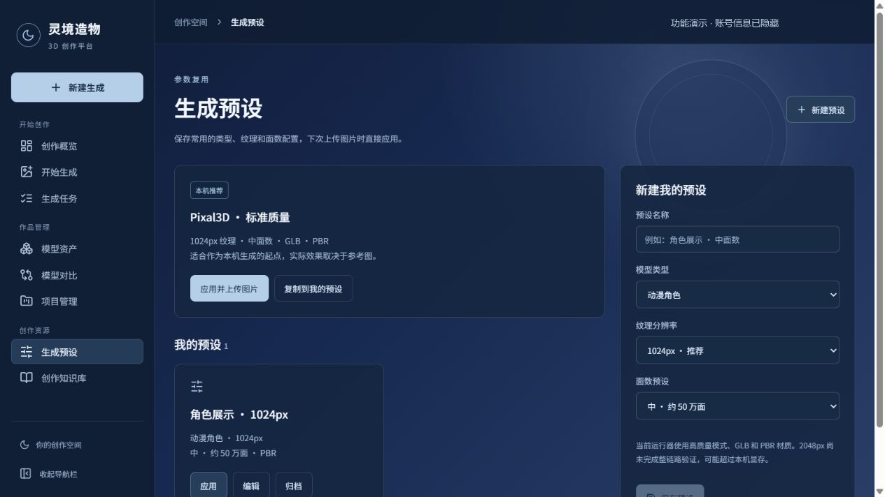

参数是否可用仍由运行能力接口决定；2048px 贴图属于实验选项，不能承诺在所有 6GB 显存设备上稳定完成。代码：[PresetsView.vue](../frontend/src/views/PresetsView.vue)、[能力接口](../services/trellis/app.py)。

## 8. 基础检查与修复

公开快照已有原模型与修复版本对照、真实 GLB 结构报告、有限基础清理、独立版本下载及人工外观复核。检查包括重复面、退化面、边界、绕序和 UV，开放衣物、栏杆等开口不能直接当作需要全部封闭的洞。

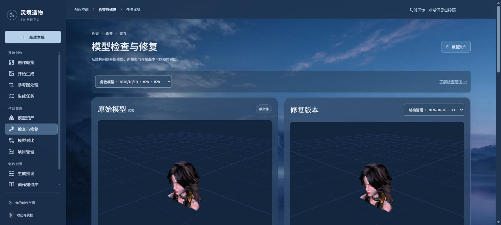

**能力边界**：带 UV 的网格跳过基础封孔。保存成功、结构计数减少和外观满意是不同结论；基础清理不能补回正确五官或缺失部件。代码：[mesh_tools.py](../backend/app/mesh_tools.py)、[creation_tools.py](../backend/app/creation_tools.py)。

## 9. 本地后续版本预览

**本节图片是本地后续功能展示，尚未同步到当前公开源码快照。** 这些图片说明产品正在向哪里推进，克隆本仓库不能据此获得下列全部能力。

### 修复助手：观察、证据与受限工具

用户描述目标，助手结合实际模型视图、网格报告和已验证规则给出方案，执行后另存结果并保留对照。截图为建筑样本的真实检查记录；视觉服务不确定时必须保留未知项，不能把建议当成修好。

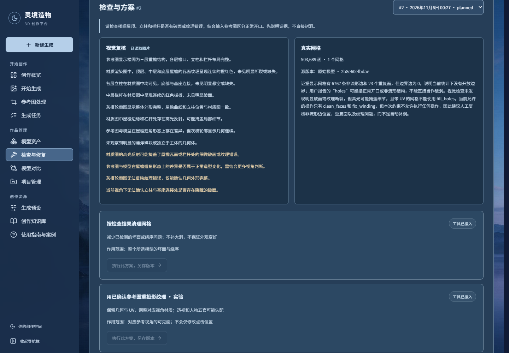

### 共用参考图：上传、候选与逐张审核

首次准备输入与修复时可以复用图集，用户上传背面、侧面或请求 AI 候选。截图中的背面与侧面属于 AI 推测，保留未审核状态；有图集不代表已经启用多视图几何融合。

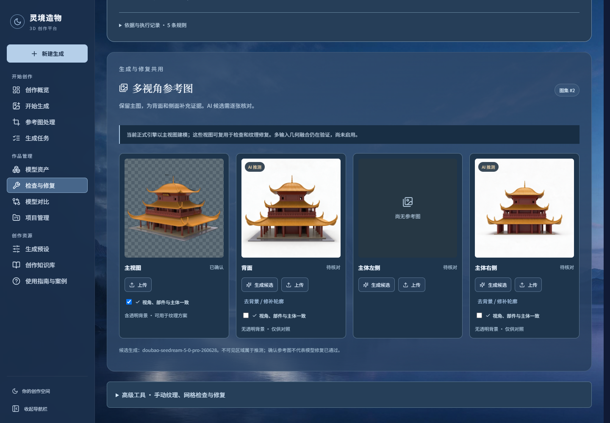

### 明确选区：把操作限定到源三角面

本地已验证面编号与源文件哈希绑定，选中区域以青色显示，局部颜色填补在副本上执行，未选面保留原材质。下图是使用实际预览组件和真实建筑 GLB 的隔离验证页，**不是公开版页面已新增入口的截图**。

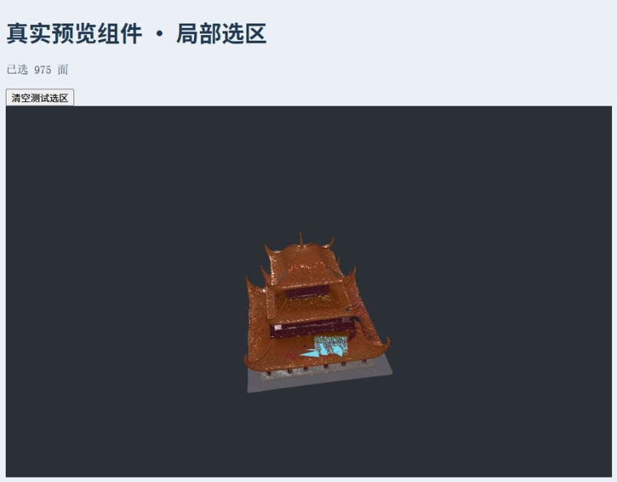

当前本地 NS / Telea 只提供颜色候选；通用大洞、缺件、人物身份恢复和稳定多视图融合仍未验收。完成文件保存并不自动改变外观验收状态。

## 10. 一次作品演示怎么串起来

1. 打开 3D 首页，进入生成流程。
2. 展示原始参考图与透明前景，说明如何人工确认实际输入。
3. 打开已有任务，解释异步执行、阶段记录与失败处理。
4. 在模型检视页旋转 GLB，展示数据、材质、下载和参数复用。
5. 转到资产库、模型对比及预设，说明结果如何归档和继续使用。
6. 展示基础修复的独立版本与边界；介绍本地后续功能时明确版本范围。

后端设计与代码验证入口见[工程案例](ENGINEERING_CASE_STUDIES.md)；完整产品流程见[技术文档](灵境造物_项目技术文档.md)。

图文整理于 2026-11-10。账号遮盖只用于保护隐私，没有改写模型、任务终态或检查结论。
