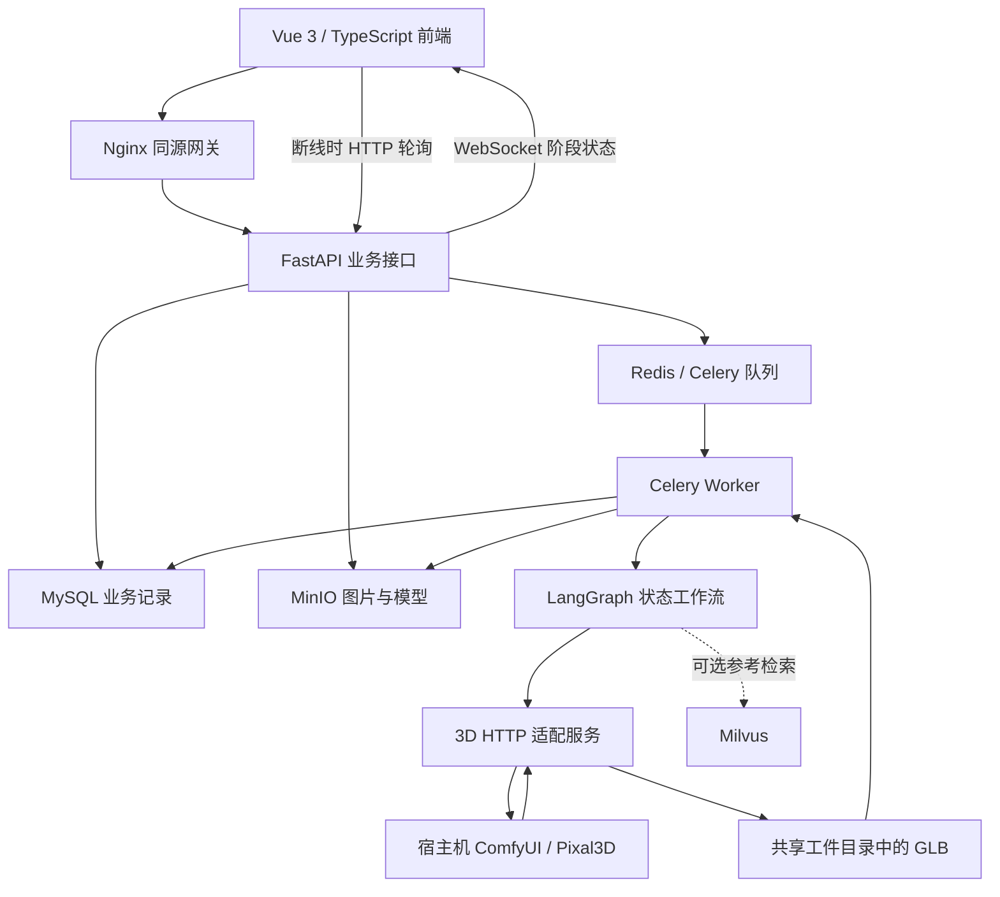
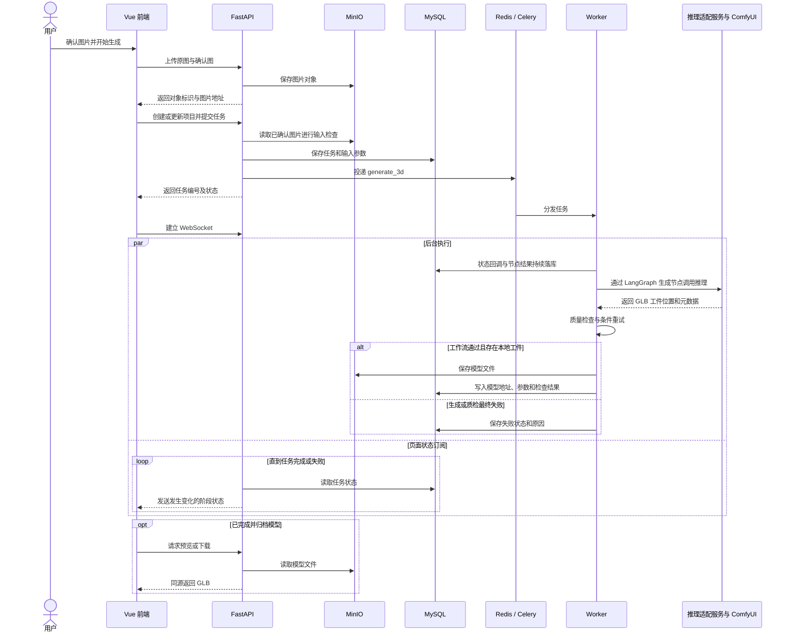
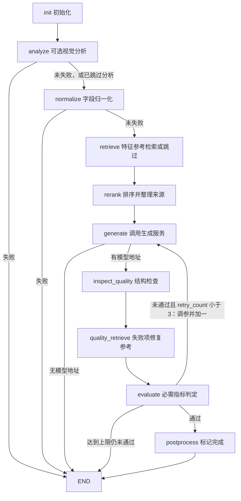
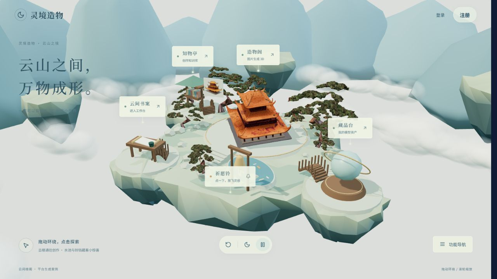

# 从图片到可交付的 3D 资产：灵境造物全栈开发实录

> 更新日期：2026-10-27。本文以工作区当前源码和已保存的开发、验收记录为依据，介绍现有设计与实现。涉及具体任务的耗时和结果，只代表相应案例；本次文档整理没有重新执行 GPU 推理或全量测试。

灵境造物是一个图片转 3D 的创作平台，面向动漫角色、建筑和物品等单图重建场景。用户可以准备参考图、提交生成任务、查看执行状态，再在线检视和下载模型。

最初的设计是“视觉模型分析图片 → 检索参考参数 → 生成模型”。实际接入本地引擎后，主流程调整为“先把输入图片准备好并由用户确认，再直接进行图生 3D”。视觉辅助、知识检索、质量检查分别承担不同职责，并不是每次生成都必须调用语言模型。

这篇文章主要记录三个问题：一张图片如何穿过前后端和生成引擎；LangGraph、异步队列与对象存储如何配合；如何区分模型成功导出、结构检查通过和外观真正可用。

## 1. 当前产品流程与功能范围

新建任务的四个步骤是：

```text
上传与配置 → 参考图预处理 → 生成与质检 → 预览与交付
```

参考图确认前，不创建本次生成任务，也不提交 GPU 队列。用户点击“确认图片并开始生成 3D”后，才上传原图与确认图、创建或更新项目并提交任务。

| 环节 | 当前实现 |
| --- | --- |
| 产品入口 | Three.js 全 3D 浮岛首页；工作台保留独立入口 |
| 账号 | 密码登录、手机验证码相关流程、注册、找回密码和个人设置；短信能力依赖实际服务配置 |
| 参考图准备 | 本地文件、拖拽、粘贴和图片 URL；格式与大小检查；裁剪、构图、抠图、原图像素修补、人工确认 |
| 本地生成 | 当前能力接口对前端开放高质量档，使用 ComfyUI / Pixal3D 工作流，输出 GLB |
| 任务追踪 | Celery 后台执行，数据库记录阶段，WebSocket 更新状态，断线回退 HTTP 轮询 |
| 模型检查 | 生成过程中的基础质检，以及交付后独立的 GLB 检查、保守修复和人工外观复核 |
| 资产管理 | 名称与标签、单个或批量移入回收站、恢复、模型下载、项目历史 |
| 结果比较 | 两个模型并排预览、参数和元数据对照、按项目筛选；两侧视角独立操作 |
| 知识与诊断 | 可选 Milvus 参数检索、质检后建议检索，以及独立的生成故障知识查询和诊断 |

代码保留了 TripoSR、其他推理提供方和历史视觉分析分支，但不能据此认为当前本地界面已经开放所有引擎与模式。页面是否可提交，以生成服务的能力接口为准。

## 2. 整体架构：接口、任务、推理分别负责什么

前端负责交互和展示；FastAPI 接收请求、读写业务数据、交付文件；Celery Worker 执行 LangGraph；模型适配服务把业务请求转换成实际推理任务。



MySQL 保存用户、项目、任务、参数和结果记录；MinIO 保存图片与模型文件。SQLAlchemy 负责查询、写入、修改和删除数据库记录，不只是“读取地址”。Redis 在这里主要承担 Celery 消息代理和结果后端，页面查询的业务任务状态以 MySQL 为依据。

### 2.1 技术选型与实际职责

| 技术 | 项目中的用途 |
| --- | --- |
| Vue 3、TypeScript、Vite | 页面组件、类型约束和构建；文件格式与大小由运行时校验逻辑检查 |
| Vue Router、Pinia、axios | 路由与登录跳转、页面状态、HTTP 请求及错误处理 |
| Element Plus | 表单、弹窗、分页等业务组件 |
| Three.js | 首页场景、GLB 预览、相机控制、浏览器内的材质与光照调整 |
| Python、FastAPI、Pydantic | 业务接口、异步 I/O、请求响应与配置校验 |
| SQLAlchemy async、MySQL | 数据建模、事务与业务记录持久化 |
| Celery、Redis | 耗时任务分发与后台执行 |
| LangGraph | 节点状态传递、条件路由和质量重试 |
| MinIO | 原图、确认图、生成模型及修复版本的对象存储 |
| ComfyUI / Pixal3D | 当前本地高质量图生 3D 推理 |
| Trimesh | 网格读取、结构检查及有限的静态网格修复，不是图生 3D 引擎 |
| DeepSeek 视觉接口 | 可选的预处理主体识别与双图复核，不负责生成模型或恢复图片像素 |
| Qwen2-VL 适配、Milvus | 保留的可选角色分析与参考检索分支 |
| Docker Compose、Nginx | 应用和数据服务编排、静态资源及 API / WebSocket 代理 |

前端当前声明 Vue 3、Three.js 0.168.0、TypeScript 5.6.2；后端依赖文件固定 FastAPI 0.115.0、SQLAlchemy 2.0.35、Celery 5.4.0 和 Trimesh 4.5.0 等版本。依赖声明不等于某个运行环境的完整版本清单，复现时应同时核对锁文件和实际安装环境。DeepAgents 虽然在依赖清单中，当前主图由 LangGraph 直接编排，不能把安装依赖当成已经使用其自主规划能力。

## 3. 先确认输入，再消耗 GPU：参考图预处理

图片并非“上传成功就适合重建”。背景可能变成模型的一部分，自动抠图也可能删掉头发、四肢、衣物或建筑底座。因此，预处理被放在任务创建之前，让用户能够检查实际输入。

### 3.1 自动抠图与可选视觉辅助

自动抠图入口将主体识别、本地分割、图片导出和双图复核组织成一个可观察的操作流程。视觉服务未配置或关闭智能辅助时，使用本地分割与人工检查路径，页面不会把人工确认显示成 AI 审核通过。

职责分工如下：

1. 可选的 DeepSeek 视觉接口给出主体类型、应保留或排除的部件、范围建议和复核结论。
2. 本机 ISNet Anime / U2Net 完成像素分割，框选范围会实际参与处理。
3. 浏览器进行裁剪、留白和构图，生成供本次任务使用的图片。
4. 用户对照原图检查，必要时精细修补并人工确认。

这一段通过普通前后端接口完成，没有放进后台的 LangGraph 角色分析节点。当前预处理视觉辅助和历史 Qwen2-VL 角色属性分析，是两个不同的入口。

### 3.2 手工修补与原图备用路径

精细修补提供恢复、擦除、圆形或方形笔刷、1-200 px 原图像素直径、缩放移动及撤销重做。恢复操作复制原图已有像素，擦除操作修改透明度，不是生成式补画，也不能补出原图里没有的背面或被遮挡部件。

预览底色只影响画面显示，不会把白底直接写进透明 PNG。修改裁剪或实际像素后，旧确认或复核结果会失效；仅切换预览底色不应触发同样的失效。

抠图效果不合适时，可以选择使用原图。复杂背景需要用户明确接受风险；确认过的输入会带上预处理元数据，引擎适配层避免再次自动裁剪，从而减少前端确认图与实际生成图不一致的问题。

### 3.3 裁剪滑块为什么要拆成预览和导出两步

早期实现每拖动一次滑块，就解码图片、扫描像素并导出 PNG，还会在导出期间禁用控件，连续拖动容易被打断。

现在按源图缓存解码结果，使用 `requestAnimationFrame` 合并输入，先绘制 384 像素的轻量预览；停止输入 250ms 后，再从原图导出 1024×1024 PNG。版本号用于丢弃过期的异步结果，防止旧裁剪覆盖新操作。原图直接生成的备用路径不因此被强制改为 1024×1024。

这次交互优化已保存构建和模拟 Canvas 回归记录；对应记录也明确说明，真实鼠标连续拖动的视觉验收尚未完整完成，不能把模拟测试写成完整浏览器验收。

## 4. 从提交请求到 GLB 交付

用户点击主提交按钮后，前端上传原图及实际确认图，创建或更新项目，再调用任务接口。后端为带 `input_preprocessed` 标记的请求读取实际图片并执行输入检查，将输入对象标识及预处理记录保存在任务参数中。



任务表保存 `celery_task_id`、`generation_params`、`analysis_result`、`retrieved_params`、模型地址、质量分、错误和重试次数。当前数据模型还包含资产标签、回收站、参数预设、检查报告与修复版本等表，不能再用早期“只有六张表”的描述概括整个系统。

### 4.1 当前本地引擎与参数映射

业务层通过 `GenerationRequest` / `GenerationResult` 与推理适配服务交互。当前本地提供方是 `local_comfyui`，使用 Pixal3D 工作流；请求中的 `trellis2` 是保留的引擎路由标识，不能仅凭这个枚举推断实际加载的模型及工作流。

能力接口报告当前可用档位、输出格式、纹理规格与默认种子，前端按该结果限制选择。当前已验证的本地入口开放高质量档和 GLB 输出，默认 1024 纹理、中密度和 PBR。2048 是显式实验选项，不代表该硬件上始终可以完成。

| 页面配置 | 适配层如何处理 | 需要区分的概念 |
| --- | --- | --- |
| 随机种子 | 写入采样节点 | 输出文件名变化不应悄悄改变采样种子 |
| 1024 / 2048 纹理 | 映射至后处理的 `texture_size` | 导出纹理尺寸不等于内部几何采样分辨率 |
| 低 / 中 / 高密度 | 目标面数约为 30万 / 50万 / 70万 | 是后处理目标，不保证实际面数恰好相等 |
| 已确认输入 | 关闭重复去背景与额外留白 | 保持用户确认的构图，不再次自动框选 |

TripoSR、命令运行器和其他提供方仍有适配代码。它们属于扩展或历史接入路径，当前能力接口不会因为这些类存在就自动向前端开放快速、平衡档。

## 5. LangGraph：业务节点、共享状态和条件路由

`MasterAgent` 创建并编译状态图，包含一个初始化节点和九个功能节点。这里多数 Agent 是职责明确的处理类：调用接口、整理数据、检索或执行规则。当前图的执行顺序由代码定义，MasterAgent 没有调用大模型自主规划节点。

| 节点 | 处理内容 |
| --- | --- |
| `init` | 准备状态、默认参数和重试次数 |
| `analyze` | 可选调用角色视觉分析服务；关闭时标记分析跳过 |
| `normalize` | 归一化字段；跳过分析时不把未知值当成真实识别结果 |
| `retrieve` | 根据特征检索参考；分析跳过时不执行该特征检索 |
| `rerank` | 按已有分数等字段排序，整理来源；不是单独调用神经重排模型 |
| `generate` | 选择适配器、构造请求、调用推理，记录实际提供方和结果 |
| `inspect_quality` | 确定性检查与基础质量记录 |
| `quality_retrieve` | 有失败项时尝试检索修复参考，没有失败项直接返回 |
| `evaluate` | 按必需指标判定通过、重试或失败 |
| `postprocess` | 标记工作流完成；不在该节点执行通用自动修复或文件归档 |



节点共享 `GenerationState`，其中包含任务输入、角色特征、检索记录、生成参数、模型地址、元数据、检查项、错误和重试次数。数据通过状态交接，具体依赖如下：

```text
图片与用户参数
  → 可选分析结果与检索参考
  → 实际生成请求和模型产物
  → 检查项与修复建议
  → 通过 / 调参重试 / 失败
```

默认前端提交 `vision_analysis=false`，因此图仍经过分析和检索相关节点，但节点内部走跳过路径。它不是“先用 Qwen2-VL 分析每一张图片”的流程，也不是从图结构中删除了这些节点。

质检重试直接回到 `generate`，不重新走图片分析和生成前检索。计数从零开始时，最多追加三次质量重试；手动重试接口也会更新任务重试次数，不能把每次手动重试都解释为重新获得三次额度。执行异常或引擎没有返回模型时，不会自动进入同一条质量重试分支。

## 6. 三类知识能力：参数参考、质量建议与故障诊断

项目中与“知识检索”有关的能力并不都属于同一条 RAG 链路。把它们分开，才能说明知识到底在哪里参与了业务。

### 6.1 生成前：可选的特征检索和参数补充

开启旧角色分析分支时，Qwen2-VL 适配服务输出角色类型、头发、服装、姿态、风格等字段。归一化后拼成查询文本，再根据集合维度请求嵌入并检索 Milvus。

| 集合 | 参考内容 | 单次最多取回 |
| --- | --- | --- |
| `character_style_collection` | 角色风格与相关配置 | 5 条 |
| `generation_params_collection` | 生成参数记录 | 3 条 |
| `material_reference_collection` | 材质参考记录 | 3 条 |

检索结果按分数等字段整理，保留集合、记录标识、标题和参考分数；记录中可用的参数用于补充配置，已有用户设置优先，最终还要经过引擎的档位与能力约束。材质参考被取回，不等于所有材质字段都会自动转成模型贴图。

例如，包含长发、裙装和动漫风格的角色特征可以构成查询，检索相应参数参考。它辅助选择配置，不会因此训练新的 3D 模型，也不能保证外观相似度提高。

目前默认入口跳过这条特征检索。配置文件中的嵌入模型名称也不代表已接通语义服务：未配置或请求失败时，代码使用 SHA-256 派生的确定性向量并标记降级。这类占位向量不具备可靠的语义相似性；当前种子导入也使用确定性向量。若要正式启用语义检索，应统一入库和查询的嵌入模型、维度与预处理，并重新建立对应索引，再验证检索质量。

### 6.2 质检后：失败项对应的修复参考

`quality_retrieve` 读取失败检查项，将“任务类型＋失败项”拼成查询，在参数集合中取回最多五条参考，将建议和来源保存在工作流与任务结果中。

例如，贴图分辨率检查失败，可以检索纹理设置相关记录。建议用于展示和后续调参参考，**当前自动重试不会自动执行这些检索建议**。自动参数调整仍是代码中的固定规则，例如面数检查失败时提高网格密度，纹理检查失败时将请求规格调整为 2048；这些设置仍受具体引擎能力和资源限制。

这一分支不决定模型是否通过。即使本地提供方的拓扑警告不阻止交付，只要有检查项失败，也可能尝试检索建议。

### 6.3 生成失败后：按错误和适用条件检索的诊断

新版失败任务页面提供“先查原因，再决定重试”。实现位于 `failure_diagnosis.py`，知识条目保存在版本化 JSON 中，采用：

```text
任务保存的错误与参数
  → 错误分类
  → 按引擎、提供方和工作流适用条件筛选知识
  → 补充当前引擎与资源状态
  → 输出证据、建议、未知项和资料来源
```

它不调用语言模型，不使用上述占位向量，也不展示虚构的语义相似度。目前更准确的称呼是“基于知识检索的故障诊断”，而不是已经完成了语言模型综合日志的完整 RAG。

诊断区分失败时保存的错误和当前检测到的状态：当前显存空闲，不能证明失败时也空闲；当前引擎在线，不能证明旧任务成功；连接中断也不能直接归因为显存不足。它只读取已配置的内部诊断接口，不读取完整宿主机日志，不自动安装补丁、执行命令或重新提交 GPU 任务。

创作知识库默认展示“生成故障”分类；其他建模知识仍通过关系库接口浏览、分页和关键词搜索。页面叫知识库，不代表每次搜索都在执行 Milvus 向量检索。

## 7. 质量检查：生成完成不等于外观合格

### 7.1 生成流水线中的基础判定

基础检查读取本地模型及引擎元数据，记录面数、退化面、纹理规格、水密性和流形相关指标。不同提供方采用不同交付条件。

当前本地 ComfyUI 提供方的必需项为面数范围、退化面和纹理规格；水密性、流形性会记录为检查结果，但不作为阻止交付的必需项。其他高质量提供方的判定还要求对应拓扑项通过。

这里有三点实现边界：

- 基础流形指标使用水密性与绕序一致性的组合，不能等同完整的拓扑证明。
- 纹理规格检查可能依据请求值或元数据，不能写成对每张实际贴图和清晰度的完整检测。
- `quality_score` 是检查项通过比例，不是角色相似度、审美分或“模型准确率”。部分警告项失败时，本地模型仍可能完成交付。

### 7.2 交付后的独立检查与保守修复

“检查与修复”工具从 MinIO 读取实际 GLB，限制文件大小和面数，检查场景网格、边界边、非流形边、退化面、重复面、UV 和绕序等。拓扑检查在诊断副本上合并同位置顶点，减少 UV 接缝被误当作几何破洞的问题。

修复只提供有限的操作：清理退化和重复面、修正绕序，以及满足条件时尝试封小孔。含 UV 的模型会跳过封孔以保护贴图；骨骼、动画、形态键模型不进入这条静态自动修复路径。

每次修复保存新的 `ModelRevision` 与报告，不覆盖原始模型；用户可以分别预览和下载。它不重新生成五官，不恢复遮挡结构，也不保证适合直接 3D 打印。

结构检查之外，页面还保存面部、背面、纹理、轮廓等人工复核项。三角面数更多、贴图画布更大，均不能替代实际外观验收。

## 8. 长任务的状态反馈与恢复边界

Worker 通过 `status_callback` 在阶段开始前提交状态，再用 `workflow.astream(..., stream_mode="values")` 接收节点状态，保存分析、检索和质量诊断数据。API 与 Worker 各自读写数据库，不通过调用 API 接口来回写状态。

WebSocket 服务约每秒读取任务记录，只在状态快照变化时发送消息；连接异常时，前端回退为约四秒一次的 HTTP 查询。

因此，页面展示的是**任务阶段进度**。接口把阶段映射为固定百分比，不是 ComfyUI 每个采样步的精确完成比例，也不是剩余耗时预测。质量重试会回到生成阶段，不能声称状态始终单调向前。

| 配置或设计 | 实际作用 | 不能由此保证的事情 |
| --- | --- | --- |
| `task_acks_late=True` | 执行后确认消息 | 不保证任务只执行一次 |
| `task_reject_on_worker_lost=True` | Worker 丢失时允许重新投递 | 不保证自动恢复到某个图节点 |
| `worker_prefetch_multiplier=1` | 减少提前占用任务 | 不等同于完整 GPU 调度 |
| 本地 Worker `--concurrency=1` | 串行消费生成任务 | 不约束绕过 Worker 直接提交的引擎任务 |
| Worker 独立异步引擎与 `NullPool` | 避免跨事件循环复用数据库连接 | 不替代数据库事务与业务幂等 |

当前图没有配置持久化 Checkpointer，数据库中的阶段记录也不是 LangGraph 执行断点。消息重新投递仍可能重新执行生成；API 与队列之间也没有事务消息或完整幂等机制，需要继续完善。

手动重试接口目前从项目记录读取参考图地址。如果项目之后更换了图片，不能未经核对就把重试认定为“使用历史任务的同一输入”；任务快照与重试输入的严格绑定仍需完善。

取消接口使用 `revoke(..., terminate=False)` 并更新业务状态，不能保证中止已经运行的 ComfyUI 任务。超时同样不代表引擎已经停止，重试前应检查队列和当前运行状态。

## 9. 模型交付、检视与资产管理

### 9.1 文件归档和同源读取

推理适配服务产生临时 GLB，Worker 在工作流通过后读取限定工件目录内的文件，检查交付边界并上传 MinIO，保存 `_artifact_object_name`，再记录对外模型地址。归档由 Worker 执行，不能把 `postprocess` 节点描述成完成了整套文件处理。

浏览器通过 Nginx 下的同源 API 读取模型，避免直接使用 Docker 内部的 `minio` 主机名。任务参数分别保存确认图与原图的对象标识，方便之后追溯；早期没有保存输入快照的任务只能按接口标记读取项目当前图片，不能把它当成原始生成输入。

### 9.2 Three.js 检视器

检视器使用 GLTFLoader、OrbitControls 与 TransformControls，支持旋转、平移、缩放、材质或线框等显示模式、灯光与粗糙度/金属度调整、截图及下载。

当前默认是不透明中性灰背景、白色光源、关闭网格，减少预览色偏和视觉干扰。改变模型摆放时可启用三轴工具。相机、材质和变换操作主要改变浏览器预览，不会自动重写下载的原始 GLB。

当前本地交付重点是 GLB。旧的 `/models/{id}/convert` 接口仅更新 `output_format` 字段，并未真正完成 GLB、OBJ、FBX、STL 之间的文件转换，因此本文不再将“多格式转换”列为已完成能力。修改扩展名或记录字段不能代替实际转换。

### 9.3 资产、对比和预设

模型资产可重命名、打标签、单个或批量移入回收站，再恢复。回收站记录只控制资产列表可见性，不删除原始模型、任务、修复版本和项目历史，也不释放对象存储空间。

对比页面已实现两个模型并排预览、参数表和项目筛选；两侧视角独立拖动，可统一切换显示模式和重置，但没有连续相机同步。不同项目之间的比较会明确标注，不能当成同一输入的严格 A/B 实验。

参数预设保存当前高质量入口支持的纹理、密度、PBR 和种子等设置，方便复用配置。它不是模型风格迁移，也不等于一次批量生成多个结果。

## 10. 让项目生成的模型回到产品里：3D 首页

首页已从指标驾驶舱改为 Three.js 云山浮岛场景，驾驶舱位于 `/workspace`。用户可以环绕场景、点击地点、先聚焦查看说明，再进入生成、资产、知识库和工作台。文字导航仍使用可读、可键盘操作的 HTML。

主楼使用已生成古建筑的网页简化副本；松树也来自本地 Pixal3D 的实际生成结果。原始模型保留，桌面与移动端分别加载独立的轻量资源，共享几何和贴图，并保留加载失败的备用素材。



树冠风摆由网页顶点动画实现，模型本身没有骨骼；云层的漂移、起伏和浓淡变化也由页面实现，没有另外调用 3D 引擎生成云。暂停后保留位置，恢复时继续；后台标签停止绘制，离开页面释放几何、纹理和材质等 WebGL 资源。

移动端降低模型复杂度、云团数量和像素比，并关闭场景阴影。支持减少动态效果偏好以及 WebGL 不可用时的功能导航。已有窄视口浏览器验收记录，但没有真实手机硬件帧率数据。

首页松树曾采用“512 几何生成后单独执行 1024 纹理”的素材制作方式；这是该展示素材的单独流程，没有据此修改平台通用的 1024 cascade 生成工作流。

## 11. 本地部署与账号边界

应用和数据服务使用 Docker Compose，ComfyUI 及其模型环境运行在宿主机。当前本地启动脚本核对并复用已登记的数据容器，同时用当前源码部署应用服务，避免切换目录后误连新的空数据库。

在 Windows 项目目录运行：

```powershell
# 安装并配置好依赖、Docker Desktop 与本机生成环境之后
py -3 scripts/start_local.py

# 源码变化后显式重建应用镜像
py -3 scripts/start_local.py --build
```

也可以使用根目录的一键启动、停止脚本。默认端口优先前端 8080、后端 8000，冲突时寻找空闲端口，不结束无关程序；以脚本输出的实际地址为准。启动依赖本机环境和权重准备，不应写成“下载源码后在任意电脑上一条命令即可生成”。

本地覆盖配置将生成 HTTP 超时设为 3600 秒、ComfyUI 等待设为 3300 秒，关闭生成服务层的自动重放；这与 LangGraph 的质量重试是不同层级。耗时任务在请求超时后可能仍在引擎中运行，关闭盲目重放可以减少重复推理，但不能代替幂等和任务关联。

账号侧已有 JWT、密码哈希、个人资料与验证码相关实现。短信未配置时返回明确不可用，不下发测试验证码冒充真实短信。前端当前保存 access token 并通过 `/auth/me` 恢复会话；虽然后端提供 refresh 接口，不能写成前端已完成自动续期。

新增 studio 资产、修复和诊断接口按登录用户检查资源归属；旧的项目、任务、文件和 WebSocket 路由仍有鉴权覆盖不足，不能笼统宣称全站已完成多用户隔离。面向公网使用前，应优先统一资源级鉴权、上传与 URL 获取的安全策略、限流及凭据管理。

## 12. 几个实际问题，比“接入了哪些框架”更值得记录

### 12.1 背景板与部件缺失

复杂背景直接输入可能被重建成模型背板，自动抠图又可能删掉人物或建筑部件。解决方向是把实际输入提前展示出来，提供主体识别、局部分割、原图像素修补和人工确认，并防止引擎再次无声改变构图。它改善了输入可控性，不代表已经解决所有分割错误。

### 12.2 NAF 编码阶段的显存峰值

一次本地任务在 NAF 编码阶段失败，排查发现已经完成特征提取的 DINO 子模型仍驻留 GPU，与后续编码器和临时张量叠加。修复调整了对象生命周期：完成必要的 NAF 初始化后，在低显存模式将 DINO 移到 CPU，再继续编码。

该记录保存了同图同参数的真实 GLB 验收，但结论只针对相应配置与案例，不能推断所有 6GB 显卡都能稳定完成全部输入。补丁修改的是本机插件环境，不会仅因重建业务容器就自动出现在其他机器上。

### 12.3 CuMesh 重建阶段的另一类显存峰值

后续任务在网格重建的哈希索引构造阶段再次失败，与前面的 NAF 编码不是同一问题。修复及时释放不再使用的临时张量，减少拼接时的额外分配，并保留小网格前后输出对照。

任务 #39 的完整回归记录确认最终导出有效 GLB；该轮引擎耗时约 40 分 24 秒。这证明对应输入可以完成，不代表性能问题已经解决，更不能用单次耗时作为平台平均性能。该任务结构检查比例仍为 0.6，记录也没有宣称人工外观验收通过。

### 12.4 面部细节试验没有通过外观验收

另一次局部纹理投影试验虽然通过了 GLB 解析、数组一致性和存储校验，用户在实际 PBR 预览中仍发现五官错位、眼镜重影和头发贴图问题。因此记录明确撤回“外观改善已验收”的结论，将其保留为失败实验，未接入默认流程。

这说明文件完整性、几何一致性与外观质量必须分别验证。扩大纹理画布或保留更多面数，不会自动恢复正确的人脸几何和身份特征。

## 13. 测试、验收与仍需完成的工作

后端已有 pytest 用例覆盖接口契约、输入准备、工作流、引擎能力、存储、账号、资产修复和故障诊断等。前端已有 Node 测试覆盖图像处理、预处理交互、相机、首页动画和资源释放；另有与正式后端隔离的浏览器验证服务。

这与早期“前端只有构建验证”的状态不同，但仍不等于有完整的自动化端到端发布门禁。模拟 Canvas 测试不能证明实际像素效果，浏览器窄视口不能替代真实手机性能，API 返回 200 不能证明模型外观合格。

| 尚需完善的方向 | 当前边界 |
| --- | --- |
| 公网访问安全 | 全量路由的用户归属、文件权限、WebSocket 鉴权尚需统一 |
| 任务可靠性 | 缺少完整幂等、事务消息、图断点恢复以及对引擎任务的可靠取消 |
| GPU 调度 | 本地 Worker 串行；缺少完整显存门控和跨入口统一排队 |
| 数据库演进 | 仍以 `create_all` 初始化，缺少版本化迁移体系 |
| 检索质量 | 需统一语义嵌入与索引，建立检索评测和参数采纳反馈闭环 |
| 外观质量 | 角色相似度、背面结构、细小配饰和人脸仍需人工验收 |
| 产品能力 | 通用格式转换、批量生成、风格迁移和连续相机同步未形成完整能力 |
| 性能与可复现性 | 需记录工作流、权重、插件补丁、输入和参数版本，扩充固定输入回归集 |

这个项目目前没有进行模型训练或微调，主要工作是模型与工具接入、状态流转、输入和结果管理，以及有限硬件上的工程排查。产品价值来自这些环节能够共同完成一次可追踪的创作任务；对尚未解决的外观和可靠性问题，保留明确的人工判断与后续优化空间。

## 14. 源码与开发记录索引

下面的相对链接以仓库中的本文位置为基准。转载到博客平台时，可将源码链接改为相应仓库地址，将本地图片上传为文章附件；Mermaid 代码可用于支持该语法的平台。

| 阅读入口 | 对应内容 |
| --- | --- |
| [前端路由](../frontend/src/router/index.ts)、[工作流页面](../frontend/src/views/WorkflowView.vue) | 当前入口与四步流程 |
| [图片准备组件](../frontend/src/components/ImagePreparation.vue)、[精细修补](../frontend/src/components/MaskRepairEditor.vue) | 输入检查、裁剪、抠图与人工确认 |
| [后端工具接口](../backend/app/creation_tools.py)、[视觉辅助](../backend/app/deepseek_vision.py) | 图片处理、检查修复及视觉服务适配 |
| [LangGraph 工作流](../backend/app/agents.py)、[生成契约](../backend/app/generation.py) | Agent 职责、状态、路由和引擎请求 |
| [任务 Worker](../backend/app/worker.py)、[任务状态前端](../frontend/src/stores/task.ts) | 阶段持久化与状态反馈 |
| [推理适配器](../services/trellis/app.py) | 本机能力查询、工作流参数映射和工件出站 |
| [资产接口](../backend/app/studio.py)、[网格工具](../backend/app/mesh_tools.py) | 资产管理、检查报告和保守修复 |
| [失败诊断](../backend/app/failure_diagnosis.py) | 错误分类、证据和知识适用条件 |
| [首页组件](../frontend/src/components/CloudWorldHome.vue)、[场景与动画](../frontend/src/utils/cloudWorld.ts) | 三维场景、素材复用及资源清理 |

相关记录：

- [预处理交互与精细画笔优化](预处理交互与精细画笔优化_20261022.md)、[裁剪交互优化](参考图裁剪交互优化_20261026.md)
- [生成失败诊断与知识库建设](生成失败诊断与知识库建设_20261023.md)
- [模型资产与检视交互](模型资产删除与检视交互优化_20261022.md)
- [NAF 编码显存修复](Pixal3D_NAF编码显存修复_20261021.md)、[CuMesh 重建显存修复](CuMesh重建显存修复_20261023.md)
- [面部辨识度失败试验记录](任务37面部辨识度排查_20261023.md)
- [3D 浮岛首页](全3D浮岛首页_20261026.md)、[生成松树与风云动画](首页生成松树与风云动画_20261027.md)
- [本地启动说明](本地一键启动说明.md)
