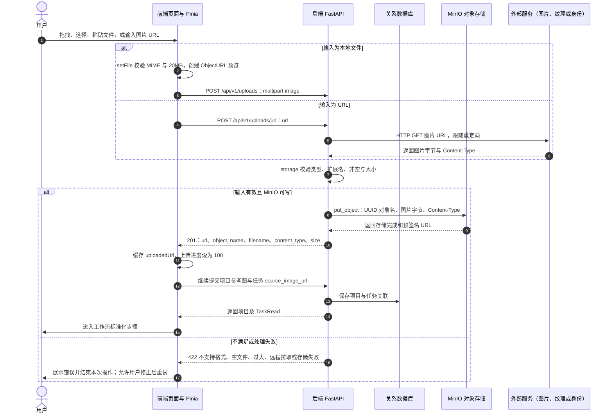

# M2-F1 多方式上传

| 项目 | 内容 |
| --- | --- |
| 所属模块 | 02 · 图片上传与预处理 |
| 清单来源 | PRD 详细功能清单 |
| 优先级 | P0 |
| 当前状态 | **已实现** |
| 分析基准 | 工作区根目录 frontend / backend / services 当前源码；2026-10-18 |

## 功能范围与实现边界

需求：支持拖拽上传、点击选择、粘贴上传、URL 拉取

当前边界：拖拽、选择、粘贴及 URL 拉取；产物供项目和任务使用。

图中无“设计”标记的是当前源码行为；标有“[设计]”及虚线/设计分支的部分是尚未落地的需求补充。

关键差异与限制：本地预览 URL 不上传服务器；URL 拉取上传分支没有字节级进度。上传接口自身不创建任务。

## 参与方、调用与数据

U=用户、F=前端页面与 Pinia、A=后端 FastAPI、D=关系数据库、S=MinIO 对象存储、X=外部服务（图片、纹理或身份）。

输入、输出与存储由下列两张图中的箭头逐步标注。`A` 表示 FastAPI；`W` 表示 Worker/Agent；两者属于不同进程。图中 `F → F`、`V → V` 表示前端内部处理，`W → W` 表示后端内部处理。

涉及的现有接口或复用边界（设计路径另见图中标记）：

- `POST /api/v1/uploads`
- `POST /api/v1/uploads/url`

## 业务流程图

节点直接标注前端、后端、服务或存储角色；箭头上的缩写表示调用方与接收方，具体请求、返回数据写在目标节点内。蓝色为前端、绿色为后端、紫色为存储；设计补充使用橙色虚线。

```mermaid
flowchart TB
    n1(["功能开始"])
    n2["前端页面与 Pinia：拖拽、选择、粘贴文件，或输入图片 URL"]
    n3{"输入为本地文件？"}
    n4["满足：输入为本地文件"]
    n5["另一分支：输入为 URL"]
    n6["前端页面与 Pinia：setFile 校验 MIME 与 20MB，创建 ObjectURL 预览"]
    n7["后端 FastAPI：POST /api/v1/uploads：multipart image"]
    n8["后端 FastAPI：POST /api/v1/uploads/url：url"]
    n9["外部服务（图片、纹理或身份）：HTTP GET 图片 URL，跟随重定向"]
    n10["后端 FastAPI：返回图片字节与 Content-Type"]
    n11["后端 FastAPI：storage 校验类型、扩展名、非空与大小"]
    n12{"输入有效且 MinIO 可写？"}
    n13["满足：输入有效且 MinIO 可写"]
    n14["另一分支：不满足或处理失败"]
    n15["MinIO 对象存储：put_object：UUID 对象名、图片字节、Content-Type"]
    n16["后端 FastAPI：返回存储完成和预签名 URL"]
    n17["前端页面与 Pinia：201：url、object_name、filename、content_type、size"]
    n18["前端页面与 Pinia：缓存 uploadedUrl，上传进度设为 100"]
    n19["后端 FastAPI：继续提交项目参考图与任务 source_image_url"]
    n20["关系数据库：保存项目与任务关联"]
    n21["前端页面与 Pinia：返回项目及 TaskRead"]
    n22["用户：进入工作流标准化步骤"]
    n23["前端页面与 Pinia：422 不支持格式、空文件、过大、远程拉取或存储失败"]
    n24["用户：展示错误并结束本次操作；允许用户修正后重试"]
    n25(["本次操作结束或等待后续任务"])
  n1 -->|"U → F"| n2
  n2 -->|"判断"| n3
  n3 -->|"是"| n4
  n3 -->|"输入为 URL"| n5
  n4 -->|"F → F"| n6
  n6 -->|"F → A"| n7
  n5 -->|"F → A"| n8
  n8 -->|"A → X"| n9
  n9 -->|"X → A"| n10
  n7 -->|"A → A"| n11
  n10 -->|"A → A"| n11
  n11 -->|"判断"| n12
  n12 -->|"是"| n13
  n12 -->|"不满足或处理失败"| n14
  n13 -->|"A → S"| n15
  n15 -->|"S → A"| n16
  n16 -->|"A → F"| n17
  n17 -->|"F → F"| n18
  n18 -->|"F → A"| n19
  n19 -->|"A → D"| n20
  n20 -->|"A → F"| n21
  n21 -->|"F → U"| n22
  n14 -->|"A → F"| n23
  n23 -->|"F → U"| n24
  n22 -->|"结果 / 状态"| n25
  n24 -->|"结果 / 状态"| n25
  classDef user fill:#f8fafc,stroke:#64748b
  class n1,n22,n24,n25 user
  classDef frontend fill:#eff6ff,stroke:#2563eb
  class n2,n3,n4,n5,n6,n13,n14,n17,n18,n21,n23 frontend
  classDef backend fill:#ecfdf5,stroke:#059669
  class n7,n8,n10,n11,n12,n16,n19 backend
  classDef external fill:#f0fdfa,stroke:#0f766e
  class n9 external
  classDef storage fill:#f5f3ff,stroke:#7c3aed
  class n15,n20 storage
```

## 时序图

## 异常与结束条件

图内列出了该功能的关键校验、失败或降级路径。实际经过 FastAPI 的请求还可能返回 422 参数错误、409 数据冲突、503 数据库暂不可用或 500 未预期错误；前端经 Axios 的请求会显示统一错误，401 会清理登录状态。浏览器直连文件、WebSocket 和纯本地操作不经过同一个 Axios 错误拦截器。

需求验收目标（来自 PRD，不代表本次已验证达标）：四种方式均可用，成功率 >= 99%

## 源码依据

- [frontend/src/views/GenerateView.vue](D:/灵境造物/frontend/src/views/GenerateView.vue:1)
- [backend/app/storage.py](D:/灵境造物/backend/app/storage.py:1)
- [backend/app/routers.py · upload_image](D:/灵境造物/backend/app/routers.py:201)

需求来源：[docs/AI_3D数字人开发工具链_PRD文档.md](D:/灵境造物/docs/AI_3D数字人开发工具链_PRD文档.md:1)。业务请求的通用边界参考 [frontend/src/services/api.ts](D:/灵境造物/frontend/src/services/api.ts:1) 与 [backend/app/exceptions.py](D:/灵境造物/backend/app/exceptions.py:1)。

[返回总目录](../README.md) · [返回本模块](README.md)
