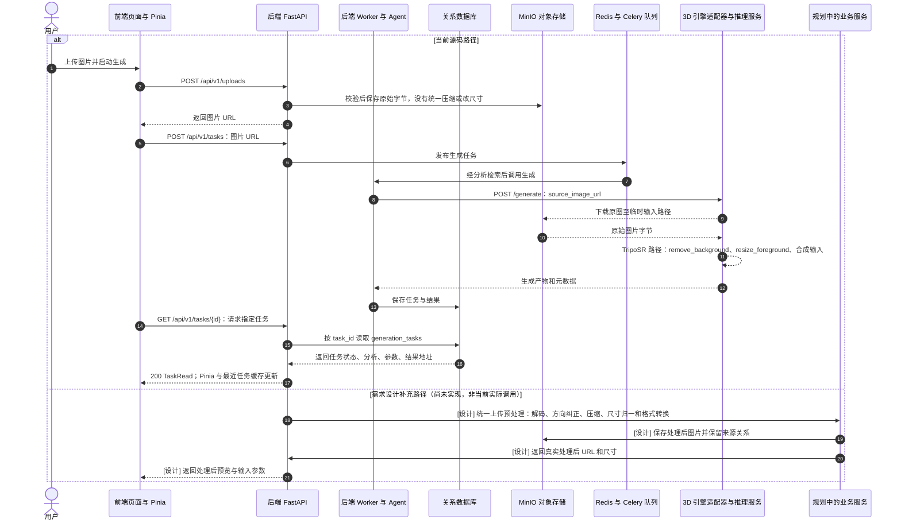

# M2-F4 自动预处理

| 项目 | 内容 |
| --- | --- |
| 所属模块 | 02 · 图片上传与预处理 |
| 清单来源 | PRD 详细功能清单 |
| 优先级 | P0 |
| 当前状态 | **部分实现** |
| 分析基准 | 工作区根目录 frontend / backend / services 当前源码；2026-10-18 |

## 功能范围与实现边界

需求：图片压缩、尺寸归一化、格式统一转换

当前边界：上传保留原字节；生成 provider 内部存在输入处理，不构成统一上传预处理。

图中无“设计”标记的是当前源码行为；标有“[设计]”及虚线/设计分支的部分是尚未落地的需求补充。

关键差异与限制：把文件下载到 source-image.png 路径不等于编码转换；推理内处理受 provider 和权重配置影响。

## 参与方、调用与数据

U=用户、F=前端页面与 Pinia、A=后端 FastAPI、W=后端 Worker 与 Agent、D=关系数据库、S=MinIO 对象存储、Q=Redis 与 Celery 队列、T=3D 引擎适配器与推理服务、P=规划中的业务服务。

输入、输出与存储由下列两张图中的箭头逐步标注。`A` 表示 FastAPI；`W` 表示 Worker/Agent；两者属于不同进程。图中 `F → F`、`V → V` 表示前端内部处理，`W → W` 表示后端内部处理。

涉及的现有接口或复用边界（设计路径另见图中标记）：

- `POST /api/v1/uploads`
- `POST /api/v1/tasks`
- `POST /generate`
- `GET /api/v1/tasks/{id}`

## 业务流程图

节点直接标注前端、后端、服务或存储角色；箭头上的缩写表示调用方与接收方，具体请求、返回数据写在目标节点内。蓝色为前端、绿色为后端、紫色为存储；设计补充使用橙色虚线。

```mermaid
flowchart TB
    n1(["功能开始"])
    n2["前端页面与 Pinia：上传图片并启动生成"]
    n3["后端 FastAPI：POST /api/v1/uploads"]
    n4["MinIO 对象存储：校验后保存原始字节，没有统一压缩或改尺寸"]
    n5["前端页面与 Pinia：返回图片 URL"]
    n6["后端 FastAPI：POST /api/v1/tasks：图片 URL"]
    n7["Redis 与 Celery 队列：发布生成任务"]
    n8["后端 Worker 与 Agent：经分析检索后调用生成"]
    n9["3D 引擎适配器与推理服务：POST /generate：source_image_url"]
    n10["MinIO 对象存储：下载原图至临时输入路径"]
    n11["3D 引擎适配器与推理服务：原始图片字节"]
    n12["3D 引擎适配器与推理服务：TripoSR 路径：remove_background、resize_foreground、合成输入"]
    n13["后端 Worker 与 Agent：生成产物和元数据"]
    n14["关系数据库：保存任务与结果"]
    n15["后端 FastAPI：GET /api/v1/tasks/{id}：请求指定任务"]
    n16["关系数据库：按 task_id 读取 generation_tasks"]
    n17["后端 FastAPI：返回任务状态、分析、参数、结果地址"]
    n18["前端页面与 Pinia：200 TaskRead；Pinia 与最近任务缓存更新"]
    n19["[设计] 需求设计补充：独立替代路径，尚未实现"]
    n20["[设计] 规划中的业务服务：统一上传预处理：解码、方向纠正、压缩、尺寸归一和格式转换"]
    n21["[设计] MinIO 对象存储：保存处理后图片并保留来源关系"]
    n22["[设计] 后端 FastAPI：返回真实处理后 URL 和尺寸"]
    n23["[设计] 前端页面与 Pinia：返回处理后预览与输入参数"]
    n24(["本次操作结束或等待后续任务"])
  n1 -->|"U → F"| n2
  n2 -->|"F → A"| n3
  n3 -->|"A → S"| n4
  n4 -->|"A → F"| n5
  n5 -->|"F → A"| n6
  n6 -->|"A → Q"| n7
  n7 -->|"Q → W"| n8
  n8 -->|"W → T"| n9
  n9 -->|"T → S"| n10
  n10 -->|"S → T"| n11
  n11 -->|"T → T"| n12
  n12 -->|"T → W"| n13
  n13 -->|"W → D"| n14
  n14 -->|"F → A"| n15
  n15 -->|"A → D"| n16
  n16 -->|"D → A"| n17
  n17 -->|"A → F"| n18
  n1 -.->|"设计路径，非当前执行"| n19
  n19 -.->|"A → P"| n20
  n20 -.->|"P → S"| n21
  n21 -.->|"P → A"| n22
  n22 -.->|"A → F"| n23
  n18 -->|"结果 / 状态"| n24
  n23 -->|"结果 / 状态"| n24
  classDef user fill:#f8fafc,stroke:#64748b
  class n1,n24 user
  classDef frontend fill:#eff6ff,stroke:#2563eb
  class n2,n5,n18,n23 frontend
  classDef backend fill:#ecfdf5,stroke:#059669
  class n3,n6,n8,n13,n15,n17,n22 backend
  classDef storage fill:#f5f3ff,stroke:#7c3aed
  class n4,n10,n14,n16,n21 storage
  classDef queue fill:#fffbeb,stroke:#d97706
  class n7 queue
  classDef model fill:#fdf2f8,stroke:#db2777
  class n9,n11,n12 model
  classDef planned fill:#fff7ed,stroke:#c2410c
  class n19,n20 planned
  classDef design fill:#fff7ed,stroke:#c2410c,stroke-dasharray:5 5
  class n19,n20,n21,n22,n23 design
```

## 时序图

## 异常与结束条件

图内列出了该功能的关键校验、失败或降级路径。实际经过 FastAPI 的请求还可能返回 422 参数错误、409 数据冲突、503 数据库暂不可用或 500 未预期错误；前端经 Axios 的请求会显示统一错误，401 会清理登录状态。浏览器直连文件、WebSocket 和纯本地操作不经过同一个 Axios 错误拦截器。

需求验收目标（来自 PRD，不代表本次已验证达标）：处理时间 < 2 秒

## 源码依据

- [backend/app/storage.py](D:/灵境造物/backend/app/storage.py:1)
- [services/trellis/app.py · run_inference](D:/灵境造物/services/trellis/app.py:93)
- [services/trellis/run_triposr.py](D:/灵境造物/services/trellis/run_triposr.py:1)
- [models/triposr/run.py](D:/灵境造物/models/triposr/run.py:1)

需求来源：[docs/AI_3D数字人开发工具链_PRD文档.md](D:/灵境造物/docs/AI_3D数字人开发工具链_PRD文档.md:1)。业务请求的通用边界参考 [frontend/src/services/api.ts](D:/灵境造物/frontend/src/services/api.ts:1) 与 [backend/app/exceptions.py](D:/灵境造物/backend/app/exceptions.py:1)。

[返回总目录](../README.md) · [返回本模块](README.md)
