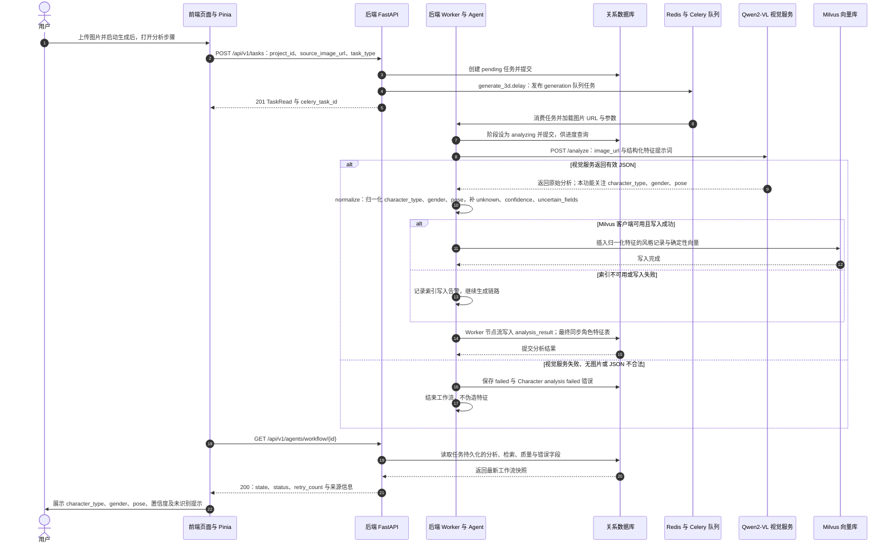

# M3-F1 角色特征识别

| 项目 | 内容 |
| --- | --- |
| 所属模块 | 03 · AI 角色分析 |
| 清单来源 | PRD 详细功能清单 |
| 优先级 | P0 |
| 当前状态 | **部分实现** |
| 分析基准 | 工作区根目录 frontend / backend / services 当前源码；2026-10-18 |

## 功能范围与实现边界

需求：识别角色类型、性别、年龄、姿态

当前边界：角色类别、性别与姿态提取和展示可用；年龄未纳入规范化字段。

图中无“设计”标记的是当前源码行为；标有“[设计]”及虚线/设计分支的部分是尚未落地的需求补充。

关键差异与限制：年龄仅可能出现在 raw_analysis，不能保证结构化提取。 confidence 低于 0.6 或缺失字段会标为 uncertain_fields；生产视觉服务失败则任务失败。

## 参与方、调用与数据

U=用户、F=前端页面与 Pinia、A=后端 FastAPI、W=后端 Worker 与 Agent、D=关系数据库、Q=Redis 与 Celery 队列、H=Qwen2-VL 视觉服务、R=Milvus 向量库。

输入、输出与存储由下列两张图中的箭头逐步标注。`A` 表示 FastAPI；`W` 表示 Worker/Agent；两者属于不同进程。图中 `F → F`、`V → V` 表示前端内部处理，`W → W` 表示后端内部处理。

涉及的现有接口或复用边界（设计路径另见图中标记）：

- `POST /api/v1/tasks`
- `POST /analyze`
- `GET /api/v1/agents/workflow/{id}`

## 业务流程图

节点直接标注前端、后端、服务或存储角色；箭头上的缩写表示调用方与接收方，具体请求、返回数据写在目标节点内。蓝色为前端、绿色为后端、紫色为存储；设计补充使用橙色虚线。

```mermaid
flowchart TB
    n1(["功能开始"])
    n2["前端页面与 Pinia：上传图片并启动生成后，打开分析步骤"]
    n3["后端 FastAPI：POST /api/v1/tasks：project_id、source_image_url、task_type"]
    n4["关系数据库：创建 pending 任务并提交"]
    n5["Redis 与 Celery 队列：generate_3d.delay：发布 generation 队列任务"]
    n6["前端页面与 Pinia：201 TaskRead 与 celery_task_id"]
    n7["后端 Worker 与 Agent：消费任务并加载图片 URL 与参数"]
    n8["关系数据库：阶段设为 analyzing 并提交，供进度查询"]
    n9["Qwen2-VL 视觉服务：POST /analyze：image_url 与结构化特征提示词"]
    n10{"视觉服务返回有效 JSON？"}
    n11["满足：视觉服务返回有效 JSON"]
    n12["另一分支：视觉服务失败、无图片或 JSON 不合法"]
    n13["后端 Worker 与 Agent：返回原始分析；本功能关注 character_type、gender、pose"]
    n14["后端 Worker 与 Agent：normalize：归一化 character_type、gender、pose，补 unknown、confidence、uncertain_fields"]
    n15{"Milvus 客户端可用且写入成功？"}
    n16["满足：Milvus 客户端可用且写入成功"]
    n17["另一分支：索引不可用或写入失败"]
    n18["Milvus 向量库：插入归一化特征的风格记录与确定性向量"]
    n19["后端 Worker 与 Agent：写入完成"]
    n20["后端 Worker 与 Agent：记录索引写入告警，继续生成链路"]
    n21["关系数据库：Worker 节点流写入 analysis_result；最终同步角色特征表"]
    n22["后端 Worker 与 Agent：提交分析结果"]
    n23["关系数据库：保存 failed 与 Character analysis failed 错误"]
    n24["后端 Worker 与 Agent：结束工作流，不伪造特征"]
    n25["后端 FastAPI：GET /api/v1/agents/workflow/{id}"]
    n26["关系数据库：读取任务持久化的分析、检索、质量与错误字段"]
    n27["后端 FastAPI：返回最新工作流快照"]
    n28["前端页面与 Pinia：200：state、status、retry_count 与来源信息"]
    n29["用户：展示 character_type、gender、pose、置信度及未识别提示"]
    n30(["本次操作结束或等待后续任务"])
  n1 -->|"U → F"| n2
  n2 -->|"F → A"| n3
  n3 -->|"A → D"| n4
  n4 -->|"A → Q"| n5
  n5 -->|"A → F"| n6
  n6 -->|"Q → W"| n7
  n7 -->|"W → D"| n8
  n8 -->|"W → H"| n9
  n9 -->|"判断"| n10
  n10 -->|"是"| n11
  n10 -->|"视觉服务失败、无图片或 JSON 不合法"| n12
  n11 -->|"H → W"| n13
  n13 -->|"W → W"| n14
  n14 -->|"判断"| n15
  n15 -->|"是"| n16
  n15 -->|"索引不可用或写入失败"| n17
  n16 -->|"W → R"| n18
  n18 -->|"R → W"| n19
  n17 -->|"W → W"| n20
  n19 -->|"W → D"| n21
  n20 -->|"W → D"| n21
  n21 -->|"D → W"| n22
  n12 -->|"W → D"| n23
  n23 -->|"W → W"| n24
  n22 -->|"F → A"| n25
  n24 -->|"F → A"| n25
  n25 -->|"A → D"| n26
  n26 -->|"D → A"| n27
  n27 -->|"A → F"| n28
  n28 -->|"F → U"| n29
  n29 -->|"结果 / 状态"| n30
  classDef user fill:#f8fafc,stroke:#64748b
  class n1,n29,n30 user
  classDef frontend fill:#eff6ff,stroke:#2563eb
  class n2,n6,n11,n12,n16,n17,n28 frontend
  classDef backend fill:#ecfdf5,stroke:#059669
  class n3,n7,n10,n13,n14,n15,n19,n20,n22,n24,n25,n27 backend
  classDef storage fill:#f5f3ff,stroke:#7c3aed
  class n4,n8,n18,n21,n23,n26 storage
  classDef queue fill:#fffbeb,stroke:#d97706
  class n5 queue
  classDef model fill:#fdf2f8,stroke:#db2777
  class n9 model
```

## 时序图

## 异常与结束条件

图内列出了该功能的关键校验、失败或降级路径。实际经过 FastAPI 的请求还可能返回 422 参数错误、409 数据冲突、503 数据库暂不可用或 500 未预期错误；前端经 Axios 的请求会显示统一错误，401 会清理登录状态。浏览器直连文件、WebSocket 和纯本地操作不经过同一个 Axios 错误拦截器。

需求验收目标（来自 PRD，不代表本次已验证达标）：识别准确率 >= 90%

## 源码依据

- [frontend/src/views/StandardizeView.vue](D:/灵境造物/frontend/src/views/StandardizeView.vue:1)
- [frontend/src/views/TasksView.vue](D:/灵境造物/frontend/src/views/TasksView.vue:1)
- [backend/app/agents.py · class CharacterNormalizationAgent](D:/灵境造物/backend/app/agents.py:143)
- [backend/app/worker.py](D:/灵境造物/backend/app/worker.py:1)
- [backend/app/schemas.py · class CharacterFeatureExtraction](D:/灵境造物/backend/app/schemas.py:43)

需求来源：[docs/AI_3D数字人开发工具链_PRD文档.md](D:/灵境造物/docs/AI_3D数字人开发工具链_PRD文档.md:1)。业务请求的通用边界参考 [frontend/src/services/api.ts](D:/灵境造物/frontend/src/services/api.ts:1) 与 [backend/app/exceptions.py](D:/灵境造物/backend/app/exceptions.py:1)。

[返回总目录](../README.md) · [返回本模块](README.md)
