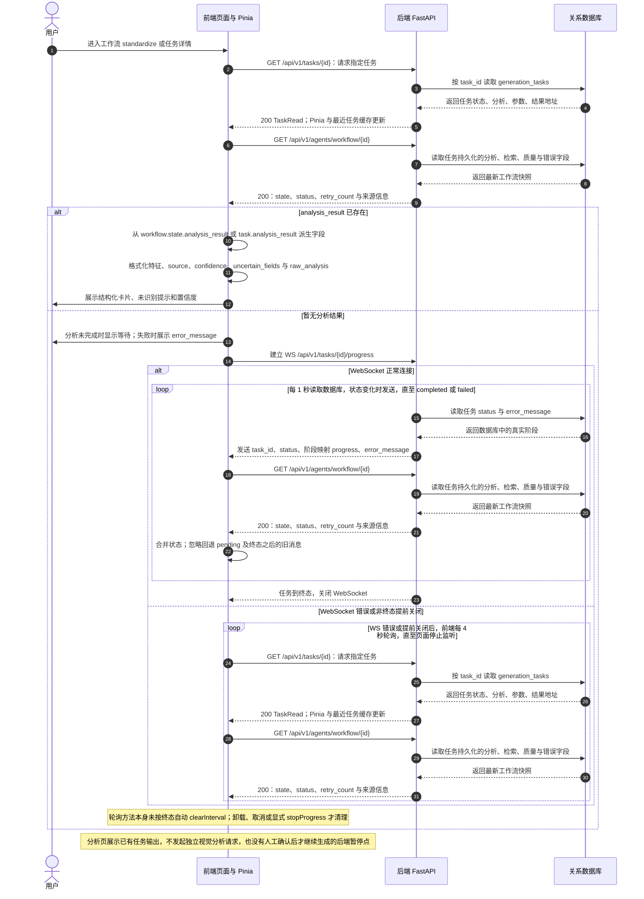

# M3-F6 分析结果展示

| 项目 | 内容 |
| --- | --- |
| 所属模块 | 03 · AI 角色分析 |
| 清单来源 | PRD 详细功能清单 |
| 优先级 | P0 |
| 当前状态 | **已实现** |
| 分析基准 | 工作区根目录 frontend / backend / services 当前源码；2026-10-18 |

## 功能范围与实现边界

需求：以结构化卡片展示分析结果

当前边界：以标准化页和任务详情卡片展示持久化分析结果及来源。

图中无“设计”标记的是当前源码行为；标有“[设计]”及虚线/设计分支的部分是尚未落地的需求补充。

关键差异与限制：工作流导航步骤属于前端展示；Worker 已按图自动推进，不等待用户逐页确认。

## 参与方、调用与数据

U=用户、F=前端页面与 Pinia、A=后端 FastAPI、D=关系数据库。

输入、输出与存储由下列两张图中的箭头逐步标注。`A` 表示 FastAPI；`W` 表示 Worker/Agent；两者属于不同进程。图中 `F → F`、`V → V` 表示前端内部处理，`W → W` 表示后端内部处理。

涉及的现有接口或复用边界（设计路径另见图中标记）：

- `GET /api/v1/tasks/{id}`
- `GET /api/v1/agents/workflow/{id}`
- `WS /api/v1/tasks/{id}/progress`

## 业务流程图

节点直接标注前端、后端、服务或存储角色；箭头上的缩写表示调用方与接收方，具体请求、返回数据写在目标节点内。蓝色为前端、绿色为后端、紫色为存储；设计补充使用橙色虚线。

```mermaid
flowchart TB
    n1(["功能开始"])
    n2["前端页面与 Pinia：进入工作流 standardize 或任务详情"]
    n3["后端 FastAPI：GET /api/v1/tasks/{id}：请求指定任务"]
    n4["关系数据库：按 task_id 读取 generation_tasks"]
    n5["后端 FastAPI：返回任务状态、分析、参数、结果地址"]
    n6["前端页面与 Pinia：200 TaskRead；Pinia 与最近任务缓存更新"]
    n7["后端 FastAPI：GET /api/v1/agents/workflow/{id}"]
    n8["关系数据库：读取任务持久化的分析、检索、质量与错误字段"]
    n9["后端 FastAPI：返回最新工作流快照"]
    n10["前端页面与 Pinia：200：state、status、retry_count 与来源信息"]
    n11{"analysis_result 已存在？"}
    n12["满足：analysis_result 已存在"]
    n13["另一分支：暂无分析结果"]
    n14["前端页面与 Pinia：从 workflow.state.analysis_result 或 task.analysis_result 派生字段"]
    n15["前端页面与 Pinia：格式化特征、source、confidence、uncertain_fields 与 raw_analysis"]
    n16["用户：展示结构化卡片、未识别提示和置信度"]
    n17["用户：分析未完成时显示等待；失败时展示 error_message"]
    n18["后端 FastAPI：建立 WS /api/v1/tasks/{id}/progress"]
    n19{"WebSocket 正常连接？"}
    n20["满足：WebSocket 正常连接"]
    n21["另一分支：WebSocket 错误或非终态提前关闭"]
    n22{"每 1 秒读取数据库，状态变化时发送，直至 completed 或 failed"}
    n23["执行本轮"]
    n24["关系数据库：读取任务 status 与 error_message"]
    n25["后端 FastAPI：返回数据库中的真实阶段"]
    n26["前端页面与 Pinia：发送 task_id、status、阶段映射 progress、error_message"]
    n27["后端 FastAPI：GET /api/v1/agents/workflow/{id}"]
    n28["关系数据库：读取任务持久化的分析、检索、质量与错误字段"]
    n29["后端 FastAPI：返回最新工作流快照"]
    n30["前端页面与 Pinia：200：state、status、retry_count 与来源信息"]
    n31["前端页面与 Pinia：合并状态；忽略回退 pending 及终态之后的旧消息"]
    n32["循环结束或停止监听"]
    n33["前端页面与 Pinia：任务到终态，关闭 WebSocket"]
    n34{"WS 错误或提前关闭后，前端每 4 秒轮询，直至页面停止监听"}
    n35["执行本轮"]
    n36["后端 FastAPI：GET /api/v1/tasks/{id}：请求指定任务"]
    n37["关系数据库：按 task_id 读取 generation_tasks"]
    n38["后端 FastAPI：返回任务状态、分析、参数、结果地址"]
    n39["前端页面与 Pinia：200 TaskRead；Pinia 与最近任务缓存更新"]
    n40["后端 FastAPI：GET /api/v1/agents/workflow/{id}"]
    n41["关系数据库：读取任务持久化的分析、检索、质量与错误字段"]
    n42["后端 FastAPI：返回最新工作流快照"]
    n43["前端页面与 Pinia：200：state、status、retry_count 与来源信息"]
    n44["循环结束或停止监听"]
    n45["说明：轮询方法本身未按终态自动 clearInterval；卸载、取消或显式 stopProgress 才清理"]
    n46["说明：分析页展示已有任务输出，不发起独立视觉分析请求，也没有人工确认后才继续生成的后端暂停点"]
    n47(["本次操作结束或等待后续任务"])
  n1 -->|"U → F"| n2
  n2 -->|"F → A"| n3
  n3 -->|"A → D"| n4
  n4 -->|"D → A"| n5
  n5 -->|"A → F"| n6
  n6 -->|"F → A"| n7
  n7 -->|"A → D"| n8
  n8 -->|"D → A"| n9
  n9 -->|"A → F"| n10
  n10 -->|"判断"| n11
  n11 -->|"是"| n12
  n11 -->|"暂无分析结果"| n13
  n12 -->|"F → F"| n14
  n14 -->|"F → F"| n15
  n15 -->|"F → U"| n16
  n13 -->|"F → U"| n17
  n17 -->|"F → A"| n18
  n18 -->|"判断"| n19
  n19 -->|"是"| n20
  n19 -->|"WebSocket 错误或非终态提前关闭"| n21
  n20 -->|"进入循环"| n22
  n22 -->|"继续"| n23
  n23 -->|"A → D"| n24
  n24 -->|"D → A"| n25
  n25 -->|"A → F"| n26
  n26 -->|"F → A"| n27
  n27 -->|"A → D"| n28
  n28 -->|"D → A"| n29
  n29 -->|"A → F"| n30
  n30 -->|"F → F"| n31
  n31 -->|"下一轮或检查结束条件"| n22
  n22 -->|"完成 / 停止"| n32
  n32 -->|"A → F"| n33
  n21 -->|"进入循环"| n34
  n34 -->|"继续"| n35
  n35 -->|"F → A"| n36
  n36 -->|"A → D"| n37
  n37 -->|"D → A"| n38
  n38 -->|"A → F"| n39
  n39 -->|"F → A"| n40
  n40 -->|"A → D"| n41
  n41 -->|"D → A"| n42
  n42 -->|"A → F"| n43
  n43 -->|"下一轮或检查结束条件"| n34
  n34 -->|"完成 / 停止"| n44
  n33 -->|"边界说明"| n45
  n44 -->|"边界说明"| n45
  n16 -->|"边界说明"| n46
  n45 -->|"边界说明"| n46
  n46 -->|"结果 / 状态"| n47
  classDef user fill:#f8fafc,stroke:#64748b
  class n1,n16,n17,n47 user
  classDef frontend fill:#eff6ff,stroke:#2563eb
  class n2,n6,n10,n11,n12,n13,n14,n15,n20,n21,n22,n23,n26,n30,n31,n32,n33,n34,n35,n39,n43,n44,n45,n46 frontend
  classDef backend fill:#ecfdf5,stroke:#059669
  class n3,n5,n7,n9,n18,n19,n25,n27,n29,n36,n38,n40,n42 backend
  classDef storage fill:#f5f3ff,stroke:#7c3aed
  class n4,n8,n24,n28,n37,n41 storage
```

## 时序图

## 异常与结束条件

图内列出了该功能的关键校验、失败或降级路径。实际经过 FastAPI 的请求还可能返回 422 参数错误、409 数据冲突、503 数据库暂不可用或 500 未预期错误；前端经 Axios 的请求会显示统一错误，401 会清理登录状态。浏览器直连文件、WebSocket 和纯本地操作不经过同一个 Axios 错误拦截器。

需求验收目标（来自 PRD，不代表本次已验证达标）：展示完整度 100%

## 源码依据

- [frontend/src/views/StandardizeView.vue](D:/灵境造物/frontend/src/views/StandardizeView.vue:1)
- [frontend/src/views/TasksView.vue](D:/灵境造物/frontend/src/views/TasksView.vue:1)
- [frontend/src/stores/task.ts](D:/灵境造物/frontend/src/stores/task.ts:1)
- [backend/app/routers.py · agent_workflow](D:/灵境造物/backend/app/routers.py:625)

需求来源：[docs/AI_3D数字人开发工具链_PRD文档.md](D:/灵境造物/docs/AI_3D数字人开发工具链_PRD文档.md:1)。业务请求的通用边界参考 [frontend/src/services/api.ts](D:/灵境造物/frontend/src/services/api.ts:1) 与 [backend/app/exceptions.py](D:/灵境造物/backend/app/exceptions.py:1)。

[返回总目录](../README.md) · [返回本模块](README.md)
