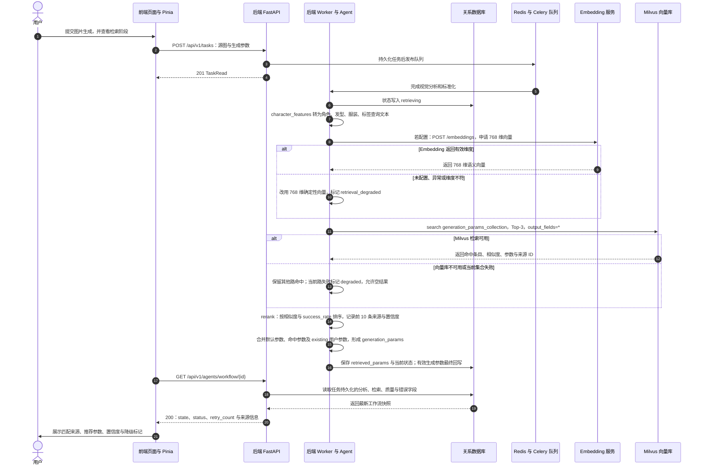

# M4-F2 参数向量检索

| 项目 | 内容 |
| --- | --- |
| 所属模块 | 04 · RAG 知识检索 |
| 清单来源 | PRD 详细功能清单 |
| 优先级 | P0 |
| 当前状态 | **已实现（有降级路径）** |
| 分析基准 | 工作区根目录 frontend / backend / services 当前源码；2026-10-18 |

## 功能范围与实现边界

需求：基于角色特征检索最优生成参数

当前边界：工作流按结构化特征检索生成参数，结果保留集合、ID 与分数。

图中无“设计”标记的是当前源码行为；标有“[设计]”及虚线/设计分支的部分是尚未落地的需求补充。

关键差异与限制：三路由同一 RAGRetrievalAgent 依次调用；本图突出当前一路。未配置语义 Embedding 时用确定性向量并标记降级，不能据此宣称语义质量达标。材质参考命中也不等于已替换模型材质。

## 参与方、调用与数据

U=用户、F=前端页面与 Pinia、A=后端 FastAPI、W=后端 Worker 与 Agent、D=关系数据库、Q=Redis 与 Celery 队列、E=Embedding 服务、R=Milvus 向量库。

输入、输出与存储由下列两张图中的箭头逐步标注。`A` 表示 FastAPI；`W` 表示 Worker/Agent；两者属于不同进程。图中 `F → F`、`V → V` 表示前端内部处理，`W → W` 表示后端内部处理。

涉及的现有接口或复用边界（设计路径另见图中标记）：

- `POST /api/v1/tasks`
- `POST /embeddings`
- `GET /api/v1/agents/workflow/{id}`

## 业务流程图

节点直接标注前端、后端、服务或存储角色；箭头上的缩写表示调用方与接收方，具体请求、返回数据写在目标节点内。蓝色为前端、绿色为后端、紫色为存储；设计补充使用橙色虚线。

```mermaid
flowchart TB
    n1(["功能开始"])
    n2["前端页面与 Pinia：提交图片生成，并查看检索阶段"]
    n3["后端 FastAPI：POST /api/v1/tasks：源图与生成参数"]
    n4["Redis 与 Celery 队列：持久化任务后发布队列"]
    n5["前端页面与 Pinia：201 TaskRead"]
    n6["后端 Worker 与 Agent：完成视觉分析和标准化"]
    n7["关系数据库：状态写入 retrieving"]
    n8["后端 Worker 与 Agent：character_features 转为角色、发型、服装、标签查询文本"]
    n9["Embedding 服务：若配置：POST /embeddings，申请 768 维向量"]
    n10{"Embedding 返回有效维度？"}
    n11["满足：Embedding 返回有效维度"]
    n12["另一分支：未配置、异常或维度不符"]
    n13["后端 Worker 与 Agent：返回 768 维语义向量"]
    n14["后端 Worker 与 Agent：改用 768 维确定性向量，标记 retrieval_degraded"]
    n15["Milvus 向量库：search generation_params_collection，Top-3，output_fields=*"]
    n16{"Milvus 检索可用？"}
    n17["满足：Milvus 检索可用"]
    n18["另一分支：向量库不可用或当前集合失败"]
    n19["后端 Worker 与 Agent：返回命中条目、相似度、参数与来源 ID"]
    n20["后端 Worker 与 Agent：保留其他路命中；当前路失败标记 degraded，允许空结果"]
    n21["后端 Worker 与 Agent：rerank：按相似度与 success_rate 排序，记录前 10 条来源与置信度"]
    n22["后端 Worker 与 Agent：合并默认参数、命中参数及 existing 用户参数，形成 generation_params"]
    n23["关系数据库：保存 retrieved_params 与当前状态；有效生成参数最终回写"]
    n24["后端 FastAPI：GET /api/v1/agents/workflow/{id}"]
    n25["关系数据库：读取任务持久化的分析、检索、质量与错误字段"]
    n26["后端 FastAPI：返回最新工作流快照"]
    n27["前端页面与 Pinia：200：state、status、retry_count 与来源信息"]
    n28["用户：展示匹配来源、推荐参数、置信度与降级标记"]
    n29(["本次操作结束或等待后续任务"])
  n1 -->|"U → F"| n2
  n2 -->|"F → A"| n3
  n3 -->|"A → Q"| n4
  n4 -->|"A → F"| n5
  n5 -->|"Q → W"| n6
  n6 -->|"W → D"| n7
  n7 -->|"W → W"| n8
  n8 -->|"W → E"| n9
  n9 -->|"判断"| n10
  n10 -->|"是"| n11
  n10 -->|"未配置、异常或维度不符"| n12
  n11 -->|"E → W"| n13
  n12 -->|"W → W"| n14
  n13 -->|"W → R"| n15
  n14 -->|"W → R"| n15
  n15 -->|"判断"| n16
  n16 -->|"是"| n17
  n16 -->|"向量库不可用或当前集合失败"| n18
  n17 -->|"R → W"| n19
  n18 -->|"W → W"| n20
  n19 -->|"W → W"| n21
  n20 -->|"W → W"| n21
  n21 -->|"W → W"| n22
  n22 -->|"W → D"| n23
  n23 -->|"F → A"| n24
  n24 -->|"A → D"| n25
  n25 -->|"D → A"| n26
  n26 -->|"A → F"| n27
  n27 -->|"F → U"| n28
  n28 -->|"结果 / 状态"| n29
  classDef user fill:#f8fafc,stroke:#64748b
  class n1,n28,n29 user
  classDef frontend fill:#eff6ff,stroke:#2563eb
  class n2,n5,n10,n11,n12,n16,n17,n18,n27 frontend
  classDef backend fill:#ecfdf5,stroke:#059669
  class n3,n6,n8,n13,n14,n19,n20,n21,n22,n24,n26 backend
  classDef queue fill:#fffbeb,stroke:#d97706
  class n4 queue
  classDef storage fill:#f5f3ff,stroke:#7c3aed
  class n7,n15,n23,n25 storage
  classDef model fill:#fdf2f8,stroke:#db2777
  class n9 model
```

## 时序图

## 异常与结束条件

图内列出了该功能的关键校验、失败或降级路径。实际经过 FastAPI 的请求还可能返回 422 参数错误、409 数据冲突、503 数据库暂不可用或 500 未预期错误；前端经 Axios 的请求会显示统一错误，401 会清理登录状态。浏览器直连文件、WebSocket 和纯本地操作不经过同一个 Axios 错误拦截器。

需求验收目标（来自 PRD，不代表本次已验证达标）：参数推荐采纳率 >= 70%

## 源码依据

- [backend/app/agents.py · class RAGRetrievalAgent](D:/灵境造物/backend/app/agents.py:246)
- [backend/app/agents.py · class RetrievalRerankAgent](D:/灵境造物/backend/app/agents.py:341)
- [backend/app/worker.py](D:/灵境造物/backend/app/worker.py:1)
- [frontend/src/views/TasksView.vue](D:/灵境造物/frontend/src/views/TasksView.vue:1)

需求来源：[docs/AI_3D数字人开发工具链_PRD文档.md](D:/灵境造物/docs/AI_3D数字人开发工具链_PRD文档.md:1)。业务请求的通用边界参考 [frontend/src/services/api.ts](D:/灵境造物/frontend/src/services/api.ts:1) 与 [backend/app/exceptions.py](D:/灵境造物/backend/app/exceptions.py:1)。

[返回总目录](../README.md) · [返回本模块](README.md)
