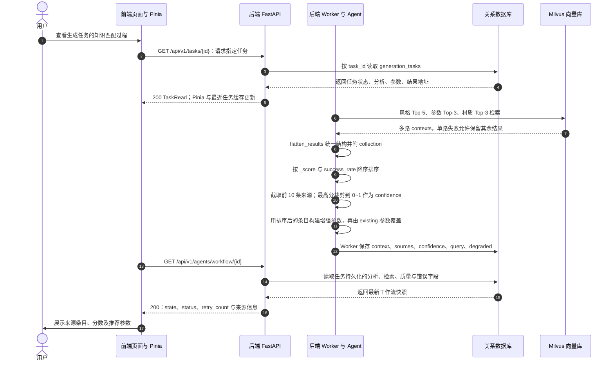

# M4-F4 检索结果融合

| 项目 | 内容 |
| --- | --- |
| 所属模块 | 04 · RAG 知识检索 |
| 清单来源 | PRD 详细功能清单 |
| 优先级 | P0 |
| 当前状态 | **已实现** |
| 分析基准 | 工作区根目录 frontend / backend / services 当前源码；2026-10-18 |

## 功能范围与实现边界

需求：多路检索结果融合与重排序

当前边界：对三集合命中排序并输出来源、置信度和参数。

图中无“设计”标记的是当前源码行为；标有“[设计]”及虚线/设计分支的部分是尚未落地的需求补充。

关键差异与限制：当前是规则排序，并非调用独立神经重排序模型；参数合并为字典顺序覆盖，不等于对每个参数挑选最高分条目。

## 参与方、调用与数据

U=用户、F=前端页面与 Pinia、A=后端 FastAPI、W=后端 Worker 与 Agent、D=关系数据库、R=Milvus 向量库。

输入、输出与存储由下列两张图中的箭头逐步标注。`A` 表示 FastAPI；`W` 表示 Worker/Agent；两者属于不同进程。图中 `F → F`、`V → V` 表示前端内部处理，`W → W` 表示后端内部处理。

涉及的现有接口或复用边界（设计路径另见图中标记）：

- `GET /api/v1/tasks/{id}`
- `GET /api/v1/agents/workflow/{id}`

## 业务流程图

节点直接标注前端、后端、服务或存储角色；箭头上的缩写表示调用方与接收方，具体请求、返回数据写在目标节点内。蓝色为前端、绿色为后端、紫色为存储；设计补充使用橙色虚线。

```mermaid
flowchart TB
    n1(["功能开始"])
    n2["前端页面与 Pinia：查看生成任务的知识匹配过程"]
    n3["后端 FastAPI：GET /api/v1/tasks/{id}：请求指定任务"]
    n4["关系数据库：按 task_id 读取 generation_tasks"]
    n5["后端 FastAPI：返回任务状态、分析、参数、结果地址"]
    n6["前端页面与 Pinia：200 TaskRead；Pinia 与最近任务缓存更新"]
    n7["Milvus 向量库：风格 Top-5、参数 Top-3、材质 Top-3 检索"]
    n8["后端 Worker 与 Agent：多路 contexts，单路失败允许保留其余结果"]
    n9["后端 Worker 与 Agent：flatten_results 统一结构并附 collection"]
    n10["后端 Worker 与 Agent：按 _score 与 success_rate 降序排序"]
    n11["后端 Worker 与 Agent：截取前 10 条来源；最高分裁剪到 0~1 作为 confidence"]
    n12["后端 Worker 与 Agent：用排序后的条目构建增强参数，再由 existing 参数覆盖"]
    n13["关系数据库：Worker 保存 context、sources、confidence、query、degraded"]
    n14["后端 FastAPI：GET /api/v1/agents/workflow/{id}"]
    n15["关系数据库：读取任务持久化的分析、检索、质量与错误字段"]
    n16["后端 FastAPI：返回最新工作流快照"]
    n17["前端页面与 Pinia：200：state、status、retry_count 与来源信息"]
    n18["用户：展示来源条目、分数及推荐参数"]
    n19(["本次操作结束或等待后续任务"])
  n1 -->|"U → F"| n2
  n2 -->|"F → A"| n3
  n3 -->|"A → D"| n4
  n4 -->|"D → A"| n5
  n5 -->|"A → F"| n6
  n6 -->|"W → R"| n7
  n7 -->|"R → W"| n8
  n8 -->|"W → W"| n9
  n9 -->|"W → W"| n10
  n10 -->|"W → W"| n11
  n11 -->|"W → W"| n12
  n12 -->|"W → D"| n13
  n13 -->|"F → A"| n14
  n14 -->|"A → D"| n15
  n15 -->|"D → A"| n16
  n16 -->|"A → F"| n17
  n17 -->|"F → U"| n18
  n18 -->|"结果 / 状态"| n19
  classDef user fill:#f8fafc,stroke:#64748b
  class n1,n18,n19 user
  classDef frontend fill:#eff6ff,stroke:#2563eb
  class n2,n6,n17 frontend
  classDef backend fill:#ecfdf5,stroke:#059669
  class n3,n5,n8,n9,n10,n11,n12,n14,n16 backend
  classDef storage fill:#f5f3ff,stroke:#7c3aed
  class n4,n7,n13,n15 storage
```

## 时序图

## 异常与结束条件

图内列出了该功能的关键校验、失败或降级路径。实际经过 FastAPI 的请求还可能返回 422 参数错误、409 数据冲突、503 数据库暂不可用或 500 未预期错误；前端经 Axios 的请求会显示统一错误，401 会清理登录状态。浏览器直连文件、WebSocket 和纯本地操作不经过同一个 Axios 错误拦截器。

需求验收目标（来自 PRD，不代表本次已验证达标）：融合结果相关性 >= 85%

## 源码依据

- [backend/app/agents.py · class RetrievalRerankAgent](D:/灵境造物/backend/app/agents.py:341)
- [backend/app/agents.py · _build_enhanced_params](D:/灵境造物/backend/app/agents.py:325)
- [backend/app/worker.py](D:/灵境造物/backend/app/worker.py:1)
- [frontend/src/stores/task.ts](D:/灵境造物/frontend/src/stores/task.ts:1)

需求来源：[docs/AI_3D数字人开发工具链_PRD文档.md](D:/灵境造物/docs/AI_3D数字人开发工具链_PRD文档.md:1)。业务请求的通用边界参考 [frontend/src/services/api.ts](D:/灵境造物/frontend/src/services/api.ts:1) 与 [backend/app/exceptions.py](D:/灵境造物/backend/app/exceptions.py:1)。

[返回总目录](../README.md) · [返回本模块](README.md)
