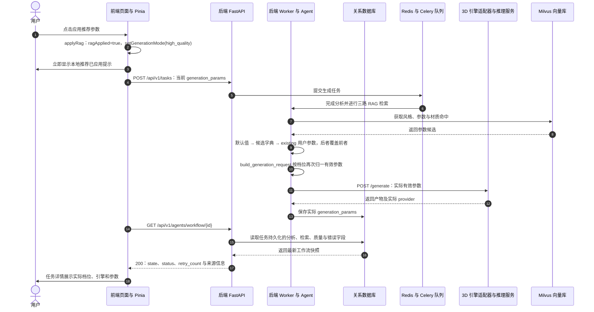

# M4-F5 参数自动推荐

| 项目 | 内容 |
| --- | --- |
| 所属模块 | 04 · RAG 知识检索 |
| 清单来源 | PRD 详细功能清单 |
| 优先级 | P0 |
| 当前状态 | **部分实现** |
| 分析基准 | 工作区根目录 frontend / backend / services 当前源码；2026-10-18 |

## 功能范围与实现边界

需求：基于检索结果自动填充生成参数

当前边界：后端按 RAG 增强生成参数；上传页“应用推荐”仅切换本地质量档。

图中无“设计”标记的是当前源码行为；标有“[设计]”及虚线/设计分支的部分是尚未落地的需求补充。

关键差异与限制：上传页按钮没有调用推荐接口；也没有异步获取 RAG 结果后再回填表单。先填入的用户默认值也会被视作 existing，覆盖同名检索值。

## 参与方、调用与数据

U=用户、F=前端页面与 Pinia、A=后端 FastAPI、W=后端 Worker 与 Agent、D=关系数据库、Q=Redis 与 Celery 队列、T=3D 引擎适配器与推理服务、R=Milvus 向量库。

输入、输出与存储由下列两张图中的箭头逐步标注。`A` 表示 FastAPI；`W` 表示 Worker/Agent；两者属于不同进程。图中 `F → F`、`V → V` 表示前端内部处理，`W → W` 表示后端内部处理。

涉及的现有接口或复用边界（设计路径另见图中标记）：

- `POST /api/v1/tasks`
- `POST /generate`
- `GET /api/v1/agents/workflow/{id}`

## 业务流程图

节点直接标注前端、后端、服务或存储角色；箭头上的缩写表示调用方与接收方，具体请求、返回数据写在目标节点内。蓝色为前端、绿色为后端、紫色为存储；设计补充使用橙色虚线。

```mermaid
flowchart TB
    n1(["功能开始"])
    n2["前端页面与 Pinia：点击应用推荐参数"]
    n3["前端页面与 Pinia：applyRag：ragApplied=true，setGenerationMode(high_quality)"]
    n4["用户：立即显示本地推荐已应用提示"]
    n5["后端 FastAPI：POST /api/v1/tasks：当前 generation_params"]
    n6["Redis 与 Celery 队列：提交生成任务"]
    n7["后端 Worker 与 Agent：完成分析并进行三路 RAG 检索"]
    n8["Milvus 向量库：获取风格、参数与材质命中"]
    n9["后端 Worker 与 Agent：返回参数候选"]
    n10["后端 Worker 与 Agent：默认值 → 候选字典 → existing 用户参数，后者覆盖前者"]
    n11["后端 Worker 与 Agent：build_generation_request 按档位再次归一有效参数"]
    n12["3D 引擎适配器与推理服务：POST /generate：实际有效参数"]
    n13["后端 Worker 与 Agent：返回产物及实际 provider"]
    n14["关系数据库：保存实际 generation_params"]
    n15["后端 FastAPI：GET /api/v1/agents/workflow/{id}"]
    n16["关系数据库：读取任务持久化的分析、检索、质量与错误字段"]
    n17["后端 FastAPI：返回最新工作流快照"]
    n18["前端页面与 Pinia：200：state、status、retry_count 与来源信息"]
    n19["用户：任务详情展示实际档位、引擎和参数"]
    n20(["本次操作结束或等待后续任务"])
  n1 -->|"U → F"| n2
  n2 -->|"F → F"| n3
  n3 -->|"F → U"| n4
  n4 -->|"F → A"| n5
  n5 -->|"A → Q"| n6
  n6 -->|"Q → W"| n7
  n7 -->|"W → R"| n8
  n8 -->|"R → W"| n9
  n9 -->|"W → W"| n10
  n10 -->|"W → W"| n11
  n11 -->|"W → T"| n12
  n12 -->|"T → W"| n13
  n13 -->|"W → D"| n14
  n14 -->|"F → A"| n15
  n15 -->|"A → D"| n16
  n16 -->|"D → A"| n17
  n17 -->|"A → F"| n18
  n18 -->|"F → U"| n19
  n19 -->|"结果 / 状态"| n20
  classDef user fill:#f8fafc,stroke:#64748b
  class n1,n4,n19,n20 user
  classDef frontend fill:#eff6ff,stroke:#2563eb
  class n2,n3,n18 frontend
  classDef backend fill:#ecfdf5,stroke:#059669
  class n5,n7,n9,n10,n11,n13,n15,n17 backend
  classDef queue fill:#fffbeb,stroke:#d97706
  class n6 queue
  classDef storage fill:#f5f3ff,stroke:#7c3aed
  class n8,n14,n16 storage
  classDef model fill:#fdf2f8,stroke:#db2777
  class n12 model
```

## 时序图

## 异常与结束条件

图内列出了该功能的关键校验、失败或降级路径。实际经过 FastAPI 的请求还可能返回 422 参数错误、409 数据冲突、503 数据库暂不可用或 500 未预期错误；前端经 Axios 的请求会显示统一错误，401 会清理登录状态。浏览器直连文件、WebSocket 和纯本地操作不经过同一个 Axios 错误拦截器。

需求验收目标（来自 PRD，不代表本次已验证达标）：推荐参数可用率 >= 90%

## 源码依据

- [frontend/src/views/GenerateView.vue · applyRag](D:/灵境造物/frontend/src/views/GenerateView.vue:22)
- [backend/app/agents.py · _build_enhanced_params](D:/灵境造物/backend/app/agents.py:325)
- [backend/app/generation.py · build_generation_request](D:/灵境造物/backend/app/generation.py:298)

需求来源：[docs/AI_3D数字人开发工具链_PRD文档.md](D:/灵境造物/docs/AI_3D数字人开发工具链_PRD文档.md:1)。业务请求的通用边界参考 [frontend/src/services/api.ts](D:/灵境造物/frontend/src/services/api.ts:1) 与 [backend/app/exceptions.py](D:/灵境造物/backend/app/exceptions.py:1)。

[返回总目录](../README.md) · [返回本模块](README.md)
