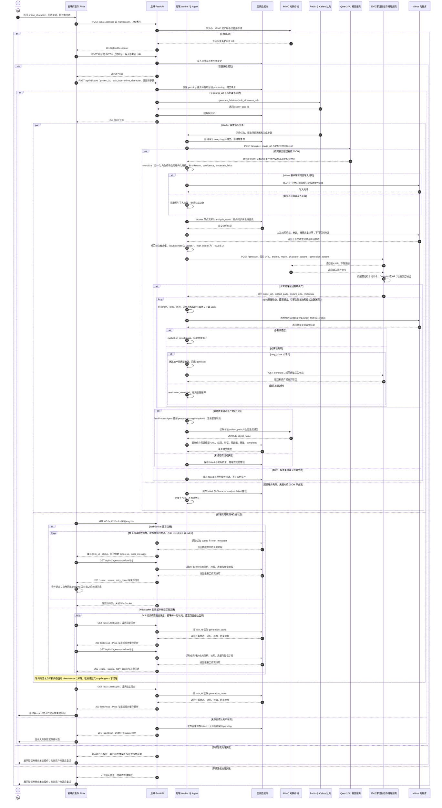

# M5-F1 动漫角色 3D 化

| 项目 | 内容 |
| --- | --- |
| 所属模块 | 05 · 3D 模型生成 |
| 清单来源 | PRD 详细功能清单 |
| 优先级 | P0 |
| 当前状态 | **已实现（依赖真实服务配置）** |
| 分析基准 | 工作区根目录 frontend / backend / services 当前源码；2026-10-18 |

## 功能范围与实现边界

需求：将动漫角色图片生成 3D 人形模型

当前边界：动漫角色源图到异步生成、质检、归档与前端终态交付。

图中无“设计”标记的是当前源码行为；标有“[设计]”及虚线/设计分支的部分是尚未落地的需求补充。

关键差异与限制：运行需要真实视觉/推理 provider、权重及存储。队列入队失败可能以 201 返回 failed 任务，前端不能仅按 HTTP 成功判断生成成功。高质量非 local_comfyui 路径要求水密和流形，其他模式可带拓扑警告交付。

## 参与方、调用与数据

U=用户、F=前端页面与 Pinia、A=后端 FastAPI、W=后端 Worker 与 Agent、D=关系数据库、S=MinIO 对象存储、Q=Redis 与 Celery 队列、H=Qwen2-VL 视觉服务、T=3D 引擎适配器与推理服务、R=Milvus 向量库。

输入、输出与存储由下列两张图中的箭头逐步标注。`A` 表示 FastAPI；`W` 表示 Worker/Agent；两者属于不同进程。图中 `F → F`、`V → V` 表示前端内部处理，`W → W` 表示后端内部处理。

涉及的现有接口或复用边界（设计路径另见图中标记）：

- `POST /api/v1/uploads`
- `POST /api/v1/tasks`
- `POST /analyze`
- `POST /generate`
- `WS /api/v1/tasks/{id}/progress`
- `GET /api/v1/agents/workflow/{id}`
- `GET /api/v1/tasks/{id}`

## 业务流程图

节点直接标注前端、后端、服务或存储角色；箭头上的缩写表示调用方与接收方，具体请求、返回数据写在目标节点内。蓝色为前端、绿色为后端、紫色为存储；设计补充使用橙色虚线。

```mermaid
flowchart TB
    n1(["功能开始"])
    n2["前端页面与 Pinia：选择 anime_character、图片来源、档位和参数"]
    n3["后端 FastAPI：POST /api/v1/uploads 或 /uploads/url：上传图片"]
    n4["MinIO 对象存储：按大小、MIME 或扩展名校验并存储"]
    n5{"上传成功？"}
    n6["满足：上传成功"]
    n7["另一分支：不满足或处理失败"]
    n8["后端 FastAPI：返回对象名和图片 URL"]
    n9["前端页面与 Pinia：201 UploadResponse"]
    n10["后端 FastAPI：POST 项目或 PATCH 已选项目，写入参考图 URL"]
    n11["关系数据库：写入项目与参考图并提交"]
    n12{"项目保存成功？"}
    n13["满足：项目保存成功"]
    n14["另一分支：不满足或处理失败"]
    n15["前端页面与 Pinia：返回项目 ID"]
    n16["后端 FastAPI：POST /api/v1/tasks：project_id、task_type=anime_character、源图和参数"]
    n17["关系数据库：创建 pending 任务并将项目设 processing，提交事务"]
    n18{"有 source_url 且队列发布成功？"}
    n19["满足：有 source_url 且队列发布成功"]
    n20["另一分支：无源图或队列不可用"]
    n21["Redis 与 Celery 队列：generate_3d.delay(task_id, source_url)"]
    n22["后端 FastAPI：返回 celery_task_id"]
    n23["关系数据库：回写队列 ID"]
    n24["前端页面与 Pinia：201 TaskRead"]
    n25["并行：Worker 异步执行业务；前端实时观测持久化状态"]
    n26["Worker 异步执行业务"]
    n27["前端实时观测持久化状态"]
    n28["后端 Worker 与 Agent：消费任务，读取项目源图和生成参数"]
    n29["关系数据库：阶段设为 analyzing 并提交，供进度查询"]
    n30["Qwen2-VL 视觉服务：POST /analyze：image_url 与结构化特征提示词"]
    n31{"视觉服务返回有效 JSON？"}
    n32["满足：视觉服务返回有效 JSON"]
    n33["另一分支：视觉服务失败、无图片或 JSON 不合法"]
    n34["后端 Worker 与 Agent：返回原始分析；本功能关注 角色或物品的结构化特征"]
    n35["后端 Worker 与 Agent：normalize：归一化 角色或物品的结构化特征，补 unknown、confidence、uncertain_fields"]
    n36{"Milvus 客户端可用且写入成功？"}
    n37["满足：Milvus 客户端可用且写入成功"]
    n38["另一分支：索引不可用或写入失败"]
    n39["Milvus 向量库：插入归一化特征的风格记录与确定性向量"]
    n40["后端 Worker 与 Agent：写入完成"]
    n41["后端 Worker 与 Agent：记录索引写入告警，继续生成链路"]
    n42["关系数据库：Worker 节点流写入 analysis_result；最终同步角色特征表"]
    n43["后端 Worker 与 Agent：提交分析结果"]
    n44["Milvus 向量库：三路检索风格、参数、材质并重排序；不可用则降级"]
    n45["后端 Worker 与 Agent：返回上下文或空结果与降级状态"]
    n46["后端 Worker 与 Agent：规范档位有效值：fast/balanced 为 TripoSR，high_quality 为 TRELLIS-2"]
    n47["3D 引擎适配器与推理服务：POST /generate：图片 URL、engine、mode、character_params、generation_params"]
    n48["MinIO 对象存储：通过图片 URL 下载源图"]
    n49["3D 引擎适配器与推理服务：返回输入图片字节"]
    n50["3D 引擎适配器与推理服务：依配置运行本地命令、ComfyUI 或 HF；检查非空输出"]
    n51{"真实推理返回有效资产？"}
    n52["满足：真实推理返回有效资产"]
    n53["另一分支：超时、服务失败或无有效文件"]
    n54["后端 Worker 与 Agent：返回 model_url、artifact_path、texture_urls、metadata"]
    n55{"每轮质量检查，直至通过、引擎失败或自动重试次数达到 3"}
    n56["执行本轮"]
    n57["后端 Worker 与 Agent：检测水密、流形、面数、退化面和纹理元数据；计算 score"]
    n58["Milvus 向量库：存在失败项时检索修复案例；失败则标记降级"]
    n59["后端 Worker 与 Agent：返回修复来源或空结果"]
    n60{"必需项通过？"}
    n61["满足：必需项通过"]
    n62["另一分支：必需项失败"]
    n63["后端 Worker 与 Agent：evaluation_result=pass，结束质量循环"]
    n64{"retry_count 小于 3？"}
    n65["满足：retry_count 小于 3"]
    n66["另一分支：重试上限达到"]
    n67["后端 Worker 与 Agent：计数加一并调整参数，回到 generate"]
    n68["3D 引擎适配器与推理服务：POST /generate：规范调整后的参数"]
    n69["后端 Worker 与 Agent：返回新资产或真实错误"]
    n70["后端 Worker 与 Agent：evaluation_result=fail，结束质量循环"]
    n71["循环结束或停止监听"]
    n72{"最终质量通过且产物可归档？"}
    n73["满足：最终质量通过且产物可归档"]
    n74["另一分支：未通过或归档失败"]
    n75["后端 Worker 与 Agent：PostProcessAgent 更新 postprocessing/completed；没有额外转换"]
    n76["MinIO 对象存储：读取本地 artifact_path 并上传生成模型"]
    n77["后端 Worker 与 Agent：返回私有 object_name"]
    n78["关系数据库：最终保存同源模型 URL、纹理、特征、元数据、质量、completed"]
    n79["后端 Worker 与 Agent：事务提交完成"]
    n80["关系数据库：保存 failed 与实际质量、推理或归档错误"]
    n81["关系数据库：保存 failed 与模型服务错误，不生成伪资产"]
    n82["关系数据库：保存 failed 与 Character analysis failed 错误"]
    n83["后端 Worker 与 Agent：结束工作流，不伪造特征"]
    n84["后端 FastAPI：建立 WS /api/v1/tasks/{id}/progress"]
    n85{"WebSocket 正常连接？"}
    n86["满足：WebSocket 正常连接"]
    n87["另一分支：WebSocket 错误或非终态提前关闭"]
    n88{"每 1 秒读取数据库，状态变化时发送，直至 completed 或 failed"}
    n89["执行本轮"]
    n90["关系数据库：读取任务 status 与 error_message"]
    n91["后端 FastAPI：返回数据库中的真实阶段"]
    n92["前端页面与 Pinia：发送 task_id、status、阶段映射 progress、error_message"]
    n93["后端 FastAPI：GET /api/v1/agents/workflow/{id}"]
    n94["关系数据库：读取任务持久化的分析、检索、质量与错误字段"]
    n95["后端 FastAPI：返回最新工作流快照"]
    n96["前端页面与 Pinia：200：state、status、retry_count 与来源信息"]
    n97["前端页面与 Pinia：合并状态；忽略回退 pending 及终态之后的旧消息"]
    n98["循环结束或停止监听"]
    n99["前端页面与 Pinia：任务到终态，关闭 WebSocket"]
    n100{"WS 错误或提前关闭后，前端每 4 秒轮询，直至页面停止监听"}
    n101["执行本轮"]
    n102["后端 FastAPI：GET /api/v1/tasks/{id}：请求指定任务"]
    n103["关系数据库：按 task_id 读取 generation_tasks"]
    n104["后端 FastAPI：返回任务状态、分析、参数、结果地址"]
    n105["前端页面与 Pinia：200 TaskRead；Pinia 与最近任务缓存更新"]
    n106["后端 FastAPI：GET /api/v1/agents/workflow/{id}"]
    n107["关系数据库：读取任务持久化的分析、检索、质量与错误字段"]
    n108["后端 FastAPI：返回最新工作流快照"]
    n109["前端页面与 Pinia：200：state、status、retry_count 与来源信息"]
    n110["循环结束或停止监听"]
    n111["说明：轮询方法本身未按终态自动 clearInterval；卸载、取消或显式 stopProgress 才清理"]
    n112["后端 FastAPI：GET /api/v1/tasks/{id}：请求指定任务"]
    n113["关系数据库：按 task_id 读取 generation_tasks"]
    n114["后端 FastAPI：返回任务状态、分析、参数、结果地址"]
    n115["前端页面与 Pinia：200 TaskRead；Pinia 与最近任务缓存更新"]
    n116["用户：最终展示可预览入口或真实失败原因"]
    n117["关系数据库：发布异常保存 failed；无源图则保持 pending"]
    n118["前端页面与 Pinia：201 TaskRead，必须结合 status 判定"]
    n119["用户：显示入队失败或等待状态"]
    n120["前端页面与 Pinia：404 项目不存在、422 参数错误或 503 数据库异常"]
    n121["用户：展示错误并结束本次操作；允许用户修正后重试"]
    n122["前端页面与 Pinia：422 图片非法、拉取或存储失败"]
    n123["用户：展示错误并结束本次操作；允许用户修正后重试"]
    n124(["本次操作结束或等待后续任务"])
  n1 -->|"U → F"| n2
  n2 -->|"F → A"| n3
  n3 -->|"A → S"| n4
  n4 -->|"判断"| n5
  n5 -->|"是"| n6
  n5 -->|"不满足或处理失败"| n7
  n6 -->|"S → A"| n8
  n8 -->|"A → F"| n9
  n9 -->|"F → A"| n10
  n10 -->|"A → D"| n11
  n11 -->|"判断"| n12
  n12 -->|"是"| n13
  n12 -->|"不满足或处理失败"| n14
  n13 -->|"A → F"| n15
  n15 -->|"F → A"| n16
  n16 -->|"A → D"| n17
  n17 -->|"判断"| n18
  n18 -->|"是"| n19
  n18 -->|"无源图或队列不可用"| n20
  n19 -->|"A → Q"| n21
  n21 -->|"Q → A"| n22
  n22 -->|"A → D"| n23
  n23 -->|"A → F"| n24
  n24 -->|"异步并行"| n25
  n25 -->|"Worker"| n26
  n25 -->|"前端监控"| n27
  n26 -->|"Q → W"| n28
  n28 -->|"W → D"| n29
  n29 -->|"W → H"| n30
  n30 -->|"判断"| n31
  n31 -->|"是"| n32
  n31 -->|"视觉服务失败、无图片或 JSON 不合法"| n33
  n32 -->|"H → W"| n34
  n34 -->|"W → W"| n35
  n35 -->|"判断"| n36
  n36 -->|"是"| n37
  n36 -->|"索引不可用或写入失败"| n38
  n37 -->|"W → R"| n39
  n39 -->|"R → W"| n40
  n38 -->|"W → W"| n41
  n40 -->|"W → D"| n42
  n41 -->|"W → D"| n42
  n42 -->|"D → W"| n43
  n43 -->|"W → R"| n44
  n44 -->|"R → W"| n45
  n45 -->|"W → W"| n46
  n46 -->|"W → T"| n47
  n47 -->|"T → S"| n48
  n48 -->|"S → T"| n49
  n49 -->|"T → T"| n50
  n50 -->|"判断"| n51
  n51 -->|"是"| n52
  n51 -->|"超时、服务失败或无有效文件"| n53
  n52 -->|"T → W"| n54
  n54 -->|"进入循环"| n55
  n55 -->|"继续"| n56
  n56 -->|"W → W"| n57
  n57 -->|"W → R"| n58
  n58 -->|"R → W"| n59
  n59 -->|"判断"| n60
  n60 -->|"是"| n61
  n60 -->|"必需项失败"| n62
  n61 -->|"W → W"| n63
  n62 -->|"判断"| n64
  n64 -->|"是"| n65
  n64 -->|"重试上限达到"| n66
  n65 -->|"W → W"| n67
  n67 -->|"W → T"| n68
  n68 -->|"T → W"| n69
  n66 -->|"W → W"| n70
  n63 -->|"下一轮或检查结束条件"| n55
  n69 -->|"下一轮或检查结束条件"| n55
  n70 -->|"下一轮或检查结束条件"| n55
  n55 -->|"完成 / 停止"| n71
  n71 -->|"判断"| n72
  n72 -->|"是"| n73
  n72 -->|"未通过或归档失败"| n74
  n73 -->|"W → W"| n75
  n75 -->|"W → S"| n76
  n76 -->|"S → W"| n77
  n77 -->|"W → D"| n78
  n78 -->|"D → W"| n79
  n74 -->|"W → D"| n80
  n53 -->|"W → D"| n81
  n33 -->|"W → D"| n82
  n82 -->|"W → W"| n83
  n27 -->|"F → A"| n84
  n84 -->|"判断"| n85
  n85 -->|"是"| n86
  n85 -->|"WebSocket 错误或非终态提前关闭"| n87
  n86 -->|"进入循环"| n88
  n88 -->|"继续"| n89
  n89 -->|"A → D"| n90
  n90 -->|"D → A"| n91
  n91 -->|"A → F"| n92
  n92 -->|"F → A"| n93
  n93 -->|"A → D"| n94
  n94 -->|"D → A"| n95
  n95 -->|"A → F"| n96
  n96 -->|"F → F"| n97
  n97 -->|"下一轮或检查结束条件"| n88
  n88 -->|"完成 / 停止"| n98
  n98 -->|"A → F"| n99
  n87 -->|"进入循环"| n100
  n100 -->|"继续"| n101
  n101 -->|"F → A"| n102
  n102 -->|"A → D"| n103
  n103 -->|"D → A"| n104
  n104 -->|"A → F"| n105
  n105 -->|"F → A"| n106
  n106 -->|"A → D"| n107
  n107 -->|"D → A"| n108
  n108 -->|"A → F"| n109
  n109 -->|"下一轮或检查结束条件"| n100
  n100 -->|"完成 / 停止"| n110
  n99 -->|"边界说明"| n111
  n110 -->|"边界说明"| n111
  n79 -->|"F → A"| n112
  n80 -->|"F → A"| n112
  n81 -->|"F → A"| n112
  n83 -->|"F → A"| n112
  n111 -->|"F → A"| n112
  n112 -->|"A → D"| n113
  n113 -->|"D → A"| n114
  n114 -->|"A → F"| n115
  n115 -->|"F → U"| n116
  n20 -->|"A → D"| n117
  n117 -->|"A → F"| n118
  n118 -->|"F → U"| n119
  n14 -->|"A → F"| n120
  n120 -->|"F → U"| n121
  n7 -->|"A → F"| n122
  n122 -->|"F → U"| n123
  n116 -->|"结果 / 状态"| n124
  n119 -->|"结果 / 状态"| n124
  n121 -->|"结果 / 状态"| n124
  n123 -->|"结果 / 状态"| n124
  classDef user fill:#f8fafc,stroke:#64748b
  class n1,n116,n119,n121,n123,n124 user
  classDef frontend fill:#eff6ff,stroke:#2563eb
  class n2,n6,n7,n9,n13,n14,n15,n19,n20,n24,n25,n27,n32,n33,n37,n38,n52,n53,n56,n61,n62,n65,n66,n71,n73,n74,n86,n87,n88,n89,n92,n96,n97,n98,n99,n100,n101,n105,n109,n110,n111,n115,n118,n120,n122 frontend
  classDef backend fill:#ecfdf5,stroke:#059669
  class n3,n5,n8,n10,n12,n16,n18,n22,n26,n28,n31,n34,n35,n36,n40,n41,n43,n45,n46,n51,n54,n55,n57,n59,n60,n63,n64,n67,n69,n70,n72,n75,n77,n79,n83,n84,n85,n91,n93,n95,n102,n104,n106,n108,n112,n114 backend
  classDef storage fill:#f5f3ff,stroke:#7c3aed
  class n4,n11,n17,n23,n29,n39,n42,n44,n48,n58,n76,n78,n80,n81,n82,n90,n94,n103,n107,n113,n117 storage
  classDef queue fill:#fffbeb,stroke:#d97706
  class n21 queue
  classDef model fill:#fdf2f8,stroke:#db2777
  class n30,n47,n49,n50,n68 model
```

## 时序图

## 异常与结束条件

图内列出了该功能的关键校验、失败或降级路径。实际经过 FastAPI 的请求还可能返回 422 参数错误、409 数据冲突、503 数据库暂不可用或 500 未预期错误；前端经 Axios 的请求会显示统一错误，401 会清理登录状态。浏览器直连文件、WebSocket 和纯本地操作不经过同一个 Axios 错误拦截器。

需求验收目标（来自 PRD，不代表本次已验证达标）：生成成功率 >= 90%，耗时 < 180s

## 源码依据

- [frontend/src/views/GenerateView.vue](D:/灵境造物/frontend/src/views/GenerateView.vue:1)
- [backend/app/routers.py · create_task](D:/灵境造物/backend/app/routers.py:222)
- [backend/app/worker.py · run_generation_task](D:/灵境造物/backend/app/worker.py:63)
- [backend/app/agents.py · class MasterAgent](D:/灵境造物/backend/app/agents.py:638)
- [backend/app/generation.py](D:/灵境造物/backend/app/generation.py:1)
- [services/trellis/app.py](D:/灵境造物/services/trellis/app.py:1)

需求来源：[docs/AI_3D数字人开发工具链_PRD文档.md](D:/灵境造物/docs/AI_3D数字人开发工具链_PRD文档.md:1)。业务请求的通用边界参考 [frontend/src/services/api.ts](D:/灵境造物/frontend/src/services/api.ts:1) 与 [backend/app/exceptions.py](D:/灵境造物/backend/app/exceptions.py:1)。

[返回总目录](../README.md) · [返回本模块](README.md)
