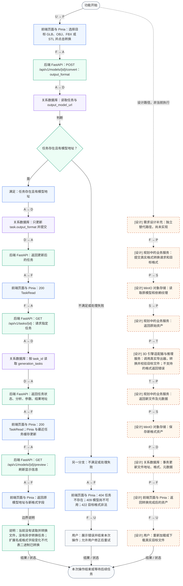
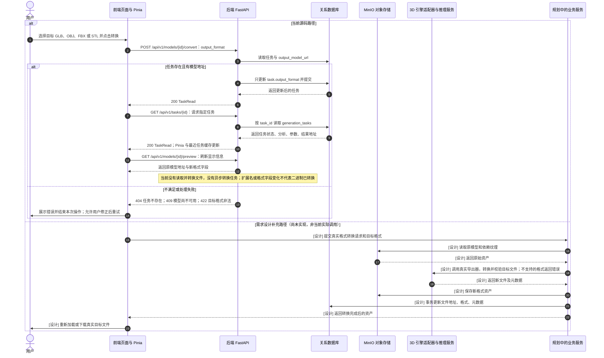

# M5-F4 多格式输出

| 项目 | 内容 |
| --- | --- |
| 所属模块 | 05 · 3D 模型生成 |
| 清单来源 | PRD 详细功能清单 |
| 优先级 | P0 |
| 当前状态 | **部分实现** |
| 分析基准 | 工作区根目录 frontend / backend / services 当前源码；2026-10-18 |

## 功能范围与实现边界

需求：支持 GLB/OBJ/FBX/STL 格式导出

当前边界：UI 和契约有多格式选项；当前三档实际生成请求固定 GLB，转换接口尚未转换字节。

图中无“设计”标记的是当前源码行为；标有“[设计]”及虚线/设计分支的部分是尚未落地的需求补充。

关键差异与限制：GenerationRequest 接受多种格式不代表当前 provider 都能生成；TIER_PRESETS 与 build_generation_request 固定 GLB，不能把枚举支持等同于 GLB/OBJ/FBX/STL 全链路导出。

## 参与方、调用与数据

U=用户、F=前端页面与 Pinia、A=后端 FastAPI、D=关系数据库、S=MinIO 对象存储、T=3D 引擎适配器与推理服务、P=规划中的业务服务。

输入、输出与存储由下列两张图中的箭头逐步标注。`A` 表示 FastAPI；`W` 表示 Worker/Agent；两者属于不同进程。图中 `F → F`、`V → V` 表示前端内部处理，`W → W` 表示后端内部处理。

涉及的现有接口或复用边界（设计路径另见图中标记）：

- `POST /api/v1/models/{id}/convert`
- `GET /api/v1/tasks/{id}`
- `GET /api/v1/models/{id}/preview`

## 业务流程图

节点直接标注前端、后端、服务或存储角色；箭头上的缩写表示调用方与接收方，具体请求、返回数据写在目标节点内。蓝色为前端、绿色为后端、紫色为存储；设计补充使用橙色虚线。

## 时序图

## 异常与结束条件

图内列出了该功能的关键校验、失败或降级路径。实际经过 FastAPI 的请求还可能返回 422 参数错误、409 数据冲突、503 数据库暂不可用或 500 未预期错误；前端经 Axios 的请求会显示统一错误，401 会清理登录状态。浏览器直连文件、WebSocket 和纯本地操作不经过同一个 Axios 错误拦截器。

需求验收目标（来自 PRD，不代表本次已验证达标）：格式转换成功率 >= 99%

## 源码依据

- [frontend/src/views/ModelView.vue · convertModel](D:/灵境造物/frontend/src/views/ModelView.vue:53)
- [backend/app/routers.py · convert_model](D:/灵境造物/backend/app/routers.py:553)
- [backend/app/generation.py · build_generation_request](D:/灵境造物/backend/app/generation.py:298)

需求来源：[docs/AI_3D数字人开发工具链_PRD文档.md](D:/灵境造物/docs/AI_3D数字人开发工具链_PRD文档.md:1)。业务请求的通用边界参考 [frontend/src/services/api.ts](D:/灵境造物/frontend/src/services/api.ts:1) 与 [backend/app/exceptions.py](D:/灵境造物/backend/app/exceptions.py:1)。

[返回总目录](../README.md) · [返回本模块](README.md)
