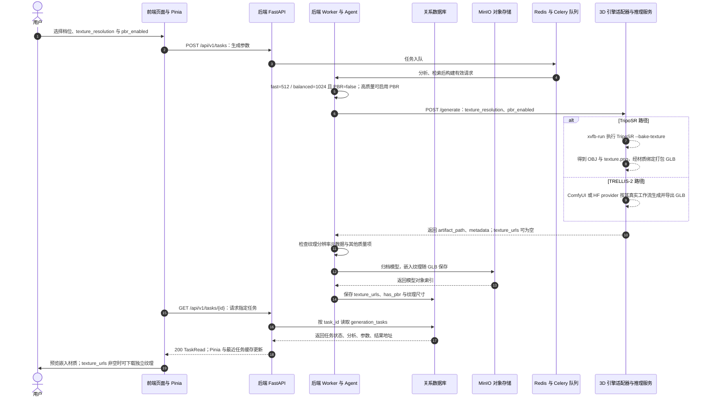

# M5-F5 纹理生成

| 项目 | 内容 |
| --- | --- |
| 所属模块 | 05 · 3D 模型生成 |
| 清单来源 | PRD 详细功能清单 |
| 优先级 | P0 |
| 当前状态 | **部分实现** |
| 分析基准 | 工作区根目录 frontend / backend / services 当前源码；2026-10-18 |

## 功能范围与实现边界

需求：自动生成 PBR 纹理贴图（漫反射/法线/粗糙度/金属度）

当前边界：TripoSR 纹理烘焙及 TRELLIS provider 材质生成可用；不保证独立完整 PBR 四图输出。

图中无“设计”标记的是当前源码行为；标有“[设计]”及虚线/设计分支的部分是尚未落地的需求补充。

关键差异与限制：metadata.has_pbr 主要记录请求意图，不足以证明漫反射、法线、粗糙度和金属度四种独立贴图都存在。

## 参与方、调用与数据

U=用户、F=前端页面与 Pinia、A=后端 FastAPI、W=后端 Worker 与 Agent、D=关系数据库、S=MinIO 对象存储、Q=Redis 与 Celery 队列、T=3D 引擎适配器与推理服务。

输入、输出与存储由下列两张图中的箭头逐步标注。`A` 表示 FastAPI；`W` 表示 Worker/Agent；两者属于不同进程。图中 `F → F`、`V → V` 表示前端内部处理，`W → W` 表示后端内部处理。

涉及的现有接口或复用边界（设计路径另见图中标记）：

- `POST /api/v1/tasks`
- `POST /generate`
- `GET /api/v1/tasks/{id}`

## 业务流程图

节点直接标注前端、后端、服务或存储角色；箭头上的缩写表示调用方与接收方，具体请求、返回数据写在目标节点内。蓝色为前端、绿色为后端、紫色为存储；设计补充使用橙色虚线。

```mermaid
flowchart TB
    n1(["功能开始"])
    n2["前端页面与 Pinia：选择档位、texture_resolution 与 pbr_enabled"]
    n3["后端 FastAPI：POST /api/v1/tasks：生成参数"]
    n4["Redis 与 Celery 队列：任务入队"]
    n5["后端 Worker 与 Agent：分析、检索后构建有效请求"]
    n6["后端 Worker 与 Agent：fast=512 / balanced=1024 且 PBR=false；高质量可启用 PBR"]
    n7["3D 引擎适配器与推理服务：POST /generate：texture_resolution、pbr_enabled"]
    n8{"TripoSR 路径？"}
    n9["满足：TripoSR 路径"]
    n10["另一分支：TRELLIS-2 路径"]
    n11["3D 引擎适配器与推理服务：xvfb-run 执行 TripoSR --bake-texture"]
    n12["3D 引擎适配器与推理服务：得到 OBJ 与 texture.png，经材质绑定打包 GLB"]
    n13["3D 引擎适配器与推理服务：ComfyUI 或 HF provider 按其真实工作流生成并导出 GLB"]
    n14["后端 Worker 与 Agent：返回 artifact_path、metadata；texture_urls 可为空"]
    n15["后端 Worker 与 Agent：检查纹理分辨率元数据与其他质量项"]
    n16["MinIO 对象存储：归档模型，嵌入纹理随 GLB 保存"]
    n17["后端 Worker 与 Agent：返回模型对象索引"]
    n18["关系数据库：保存 texture_urls、has_pbr 与纹理尺寸"]
    n19["后端 FastAPI：GET /api/v1/tasks/{id}：请求指定任务"]
    n20["关系数据库：按 task_id 读取 generation_tasks"]
    n21["后端 FastAPI：返回任务状态、分析、参数、结果地址"]
    n22["前端页面与 Pinia：200 TaskRead；Pinia 与最近任务缓存更新"]
    n23["用户：预览嵌入材质；texture_urls 非空时可下载独立纹理"]
    n24(["本次操作结束或等待后续任务"])
  n1 -->|"U → F"| n2
  n2 -->|"F → A"| n3
  n3 -->|"A → Q"| n4
  n4 -->|"Q → W"| n5
  n5 -->|"W → W"| n6
  n6 -->|"W → T"| n7
  n7 -->|"判断"| n8
  n8 -->|"是"| n9
  n8 -->|"TRELLIS-2 路径"| n10
  n9 -->|"T → T"| n11
  n11 -->|"T → T"| n12
  n10 -->|"T → T"| n13
  n12 -->|"T → W"| n14
  n13 -->|"T → W"| n14
  n14 -->|"W → W"| n15
  n15 -->|"W → S"| n16
  n16 -->|"S → W"| n17
  n17 -->|"W → D"| n18
  n18 -->|"F → A"| n19
  n19 -->|"A → D"| n20
  n20 -->|"D → A"| n21
  n21 -->|"A → F"| n22
  n22 -->|"F → U"| n23
  n23 -->|"结果 / 状态"| n24
  classDef user fill:#f8fafc,stroke:#64748b
  class n1,n23,n24 user
  classDef frontend fill:#eff6ff,stroke:#2563eb
  class n2,n8,n9,n10,n22 frontend
  classDef backend fill:#ecfdf5,stroke:#059669
  class n3,n5,n6,n14,n15,n17,n19,n21 backend
  classDef queue fill:#fffbeb,stroke:#d97706
  class n4 queue
  classDef model fill:#fdf2f8,stroke:#db2777
  class n7,n11,n12,n13 model
  classDef storage fill:#f5f3ff,stroke:#7c3aed
  class n16,n18,n20 storage
```

## 时序图

## 异常与结束条件

图内列出了该功能的关键校验、失败或降级路径。实际经过 FastAPI 的请求还可能返回 422 参数错误、409 数据冲突、503 数据库暂不可用或 500 未预期错误；前端经 Axios 的请求会显示统一错误，401 会清理登录状态。浏览器直连文件、WebSocket 和纯本地操作不经过同一个 Axios 错误拦截器。

需求验收目标（来自 PRD，不代表本次已验证达标）：纹理质量 >= 1024x1024

## 源码依据

- [frontend/src/views/GenerateView.vue](D:/灵境造物/frontend/src/views/GenerateView.vue:1)
- [backend/app/generation.py](D:/灵境造物/backend/app/generation.py:1)
- [services/trellis/run_triposr.py · convert_baked_obj_to_glb](D:/灵境造物/services/trellis/run_triposr.py:14)
- [services/trellis/app.py](D:/灵境造物/services/trellis/app.py:1)
- [backend/app/worker.py](D:/灵境造物/backend/app/worker.py:1)

需求来源：[docs/AI_3D数字人开发工具链_PRD文档.md](D:/灵境造物/docs/AI_3D数字人开发工具链_PRD文档.md:1)。业务请求的通用边界参考 [frontend/src/services/api.ts](D:/灵境造物/frontend/src/services/api.ts:1) 与 [backend/app/exceptions.py](D:/灵境造物/backend/app/exceptions.py:1)。

[返回总目录](../README.md) · [返回本模块](README.md)
