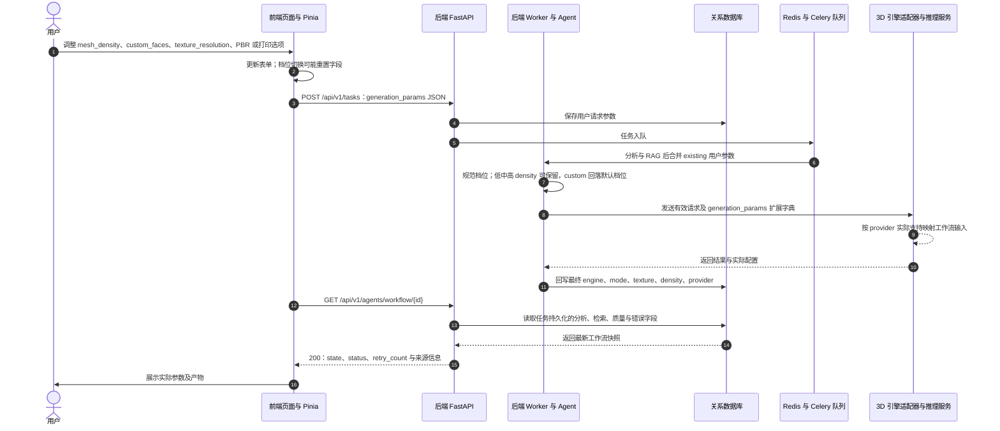

# M5-F7 生成参数自定义

| 项目 | 内容 |
| --- | --- |
| 所属模块 | 05 · 3D 模型生成 |
| 清单来源 | PRD 详细功能清单 |
| 优先级 | P1 |
| 当前状态 | **部分实现** |
| 分析基准 | 工作区根目录 frontend / backend / services 当前源码；2026-10-18 |

## 功能范围与实现边界

需求：允许用户手动调整生成参数

当前边界：网格、纹理和 PBR 参数可配置，实际支持范围受档位与 provider 约束。

图中无“设计”标记的是当前源码行为；标有“[设计]”及虚线/设计分支的部分是尚未落地的需求补充。

关键差异与限制：custom_faces、print_optimization 出现在请求不等于有执行逻辑。fast/balanced 强制纹理预设和 PBR=false；不会实时修改运行中的任务或现有模型。

## 参与方、调用与数据

U=用户、F=前端页面与 Pinia、A=后端 FastAPI、W=后端 Worker 与 Agent、D=关系数据库、Q=Redis 与 Celery 队列、T=3D 引擎适配器与推理服务。

输入、输出与存储由下列两张图中的箭头逐步标注。`A` 表示 FastAPI；`W` 表示 Worker/Agent；两者属于不同进程。图中 `F → F`、`V → V` 表示前端内部处理，`W → W` 表示后端内部处理。

涉及的现有接口或复用边界（设计路径另见图中标记）：

- `POST /api/v1/tasks`
- `GET /api/v1/agents/workflow/{id}`

## 业务流程图

节点直接标注前端、后端、服务或存储角色；箭头上的缩写表示调用方与接收方，具体请求、返回数据写在目标节点内。蓝色为前端、绿色为后端、紫色为存储；设计补充使用橙色虚线。

```mermaid
flowchart TB
    n1(["功能开始"])
    n2["前端页面与 Pinia：调整 mesh_density、custom_faces、texture_resolution、PBR 或打印选项"]
    n3["前端页面与 Pinia：更新表单；档位切换可能重置字段"]
    n4["后端 FastAPI：POST /api/v1/tasks：generation_params JSON"]
    n5["关系数据库：保存用户请求参数"]
    n6["Redis 与 Celery 队列：任务入队"]
    n7["后端 Worker 与 Agent：分析与 RAG 后合并 existing 用户参数"]
    n8["后端 Worker 与 Agent：规范档位；低中高 density 可保留，custom 回落默认档位"]
    n9["3D 引擎适配器与推理服务：发送有效请求及 generation_params 扩展字典"]
    n10["3D 引擎适配器与推理服务：按 provider 实际支持映射工作流输入"]
    n11["后端 Worker 与 Agent：返回结果与实际配置"]
    n12["关系数据库：回写最终 engine、mode、texture、density、provider"]
    n13["后端 FastAPI：GET /api/v1/agents/workflow/{id}"]
    n14["关系数据库：读取任务持久化的分析、检索、质量与错误字段"]
    n15["后端 FastAPI：返回最新工作流快照"]
    n16["前端页面与 Pinia：200：state、status、retry_count 与来源信息"]
    n17["用户：展示实际参数及产物"]
    n18(["本次操作结束或等待后续任务"])
  n1 -->|"U → F"| n2
  n2 -->|"F → F"| n3
  n3 -->|"F → A"| n4
  n4 -->|"A → D"| n5
  n5 -->|"A → Q"| n6
  n6 -->|"Q → W"| n7
  n7 -->|"W → W"| n8
  n8 -->|"W → T"| n9
  n9 -->|"T → T"| n10
  n10 -->|"T → W"| n11
  n11 -->|"W → D"| n12
  n12 -->|"F → A"| n13
  n13 -->|"A → D"| n14
  n14 -->|"D → A"| n15
  n15 -->|"A → F"| n16
  n16 -->|"F → U"| n17
  n17 -->|"结果 / 状态"| n18
  classDef user fill:#f8fafc,stroke:#64748b
  class n1,n17,n18 user
  classDef frontend fill:#eff6ff,stroke:#2563eb
  class n2,n3,n16 frontend
  classDef backend fill:#ecfdf5,stroke:#059669
  class n4,n7,n8,n11,n13,n15 backend
  classDef storage fill:#f5f3ff,stroke:#7c3aed
  class n5,n12,n14 storage
  classDef queue fill:#fffbeb,stroke:#d97706
  class n6 queue
  classDef model fill:#fdf2f8,stroke:#db2777
  class n9,n10 model
```

## 时序图

## 异常与结束条件

图内列出了该功能的关键校验、失败或降级路径。实际经过 FastAPI 的请求还可能返回 422 参数错误、409 数据冲突、503 数据库暂不可用或 500 未预期错误；前端经 Axios 的请求会显示统一错误，401 会清理登录状态。浏览器直连文件、WebSocket 和纯本地操作不经过同一个 Axios 错误拦截器。

需求验收目标（来自 PRD，不代表本次已验证达标）：参数调整实时生效

## 源码依据

- [frontend/src/views/GenerateView.vue · submit](D:/灵境造物/frontend/src/views/GenerateView.vue:24)
- [backend/app/generation.py · build_generation_request](D:/灵境造物/backend/app/generation.py:298)
- [services/trellis/app.py · _build_comfy_prompt](D:/灵境造物/services/trellis/app.py:220)

需求来源：[docs/AI_3D数字人开发工具链_PRD文档.md](D:/灵境造物/docs/AI_3D数字人开发工具链_PRD文档.md:1)。业务请求的通用边界参考 [frontend/src/services/api.ts](D:/灵境造物/frontend/src/services/api.ts:1) 与 [backend/app/exceptions.py](D:/灵境造物/backend/app/exceptions.py:1)。

[返回总目录](../README.md) · [返回本模块](README.md)
