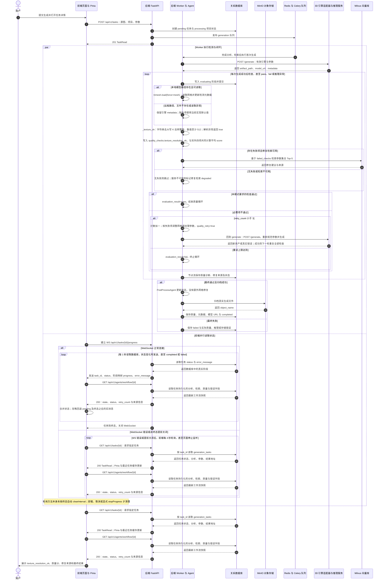

# M6-F5 纹理质量检查

| 项目 | 内容 |
| --- | --- |
| 所属模块 | 06 · 质量评估与后处理 |
| 清单来源 | PRD 详细功能清单 |
| 优先级 | P0 |
| 当前状态 | **部分实现** |
| 分析基准 | 工作区根目录 frontend / backend / services 当前源码；2026-10-18 |

## 功能范围与实现边界

需求：检测纹理分辨率、完整性

当前边界：基于纹理分辨率元数据的弱校验。

图中无“设计”标记的是当前源码行为；标有“[设计]”及虚线/设计分支的部分是尚未落地的需求补充。

关键差异与限制：未逐张解码检查贴图完整性；1K/2K 字符串被当 1/2，非法字符串反而返回 true，需据实理解边界。 quality_score 为五项布尔平均值；通过门槛按模式规定的必需项判断，不是简单以 0.8 分判断。

## 参与方、调用与数据

U=用户、F=前端页面与 Pinia、A=后端 FastAPI、W=后端 Worker 与 Agent、D=关系数据库、S=MinIO 对象存储、Q=Redis 与 Celery 队列、T=3D 引擎适配器与推理服务、R=Milvus 向量库。

输入、输出与存储由下列两张图中的箭头逐步标注。`A` 表示 FastAPI；`W` 表示 Worker/Agent；两者属于不同进程。图中 `F → F`、`V → V` 表示前端内部处理，`W → W` 表示后端内部处理。

涉及的现有接口或复用边界（设计路径另见图中标记）：

- `POST /api/v1/tasks`
- `POST /generate`
- `WS /api/v1/tasks/{id}/progress`
- `GET /api/v1/agents/workflow/{id}`
- `GET /api/v1/tasks/{id}`

## 业务流程图

节点直接标注前端、后端、服务或存储角色；箭头上的缩写表示调用方与接收方，具体请求、返回数据写在目标节点内。蓝色为前端、绿色为后端、紫色为存储；设计补充使用橙色虚线。

```mermaid
flowchart TB
    n1(["功能开始"])
    n2["前端页面与 Pinia：提交生成并打开任务详情"]
    n3["后端 FastAPI：POST /api/v1/tasks：源图、项目、参数"]
    n4["关系数据库：创建 pending 任务与 processing 项目状态"]
    n5["Redis 与 Celery 队列：发布 generation 队列"]
    n6["前端页面与 Pinia：201 TaskRead"]
    n7["并行：Worker 执行检测与闭环；前端并行读取状态"]
    n8["Worker 执行检测与闭环"]
    n9["前端并行读取状态"]
    n10["后端 Worker 与 Agent：完成分析、检索后执行首次生成"]
    n11["3D 引擎适配器与推理服务：POST /generate：有效引擎与参数"]
    n12["后端 Worker 与 Agent：返回 artifact_path、model_url、metadata"]
    n13{"每次生成成功后检查，直至 pass、fail 或推理异常"}
    n14["执行本轮"]
    n15["关系数据库：写入 evaluating 阶段并提交"]
    n16{"本地模型路径存在且可读取？"}
    n17["满足：本地模型路径存在且可读取"]
    n18["另一分支：远程路径、文件不存在或读取异常"]
    n19["后端 Worker 与 Agent：trimesh.load(force=mesh)：读取网格并更新检测元数据"]
    n20["后端 Worker 与 Agent：保留引擎 metadata；缺失项使用当前实现默认值"]
    n21["后端 Worker 与 Agent：_texture_ok：字符串去大写 K 后转整数，数值至少 512；解析异常返回 true"]
    n22["后端 Worker 与 Agent：写入 quality_checks.texture_resolution_ok，与另外四项共同计算平均 score"]
    n23{"存在失败项且修复检索可用？"}
    n24["满足：存在失败项且修复检索可用"]
    n25["另一分支：无失败或检索不可用"]
    n26["Milvus 向量库：基于 failed_checks 检索参数集合 Top-5"]
    n27["后端 Worker 与 Agent：返回修复建议与来源"]
    n28["后端 Worker 与 Agent：无失败则跳过；服务不可用则标记修复检索 degraded"]
    n29{"本模式要求的检查通过？"}
    n30["满足：本模式要求的检查通过"]
    n31["另一分支：必需项不通过"]
    n32["后端 Worker 与 Agent：evaluation_result=pass，结束质量循环"]
    n33{"retry_count 小于 3？"}
    n34["满足：retry_count 小于 3"]
    n35["另一分支：重试上限达到"]
    n36["后端 Worker 与 Agent：计数加一；按失败项调整网格或纹理参数，quality_retry=true"]
    n37["3D 引擎适配器与推理服务：回到 generate：POST /generate，重新规范参数并生成"]
    n38["后端 Worker 与 Agent：返回新资产或真实错误；成功则下一轮重复全部检查"]
    n39["后端 Worker 与 Agent：evaluation_result=fail，终止循环"]
    n40["关系数据库：节点流保存质量诊断、修复来源及状态"]
    n41["循环结束或停止监听"]
    n42{"最终通过且归档成功？"}
    n43["满足：最终通过且归档成功"]
    n44["另一分支：最终失败"]
    n45["后端 Worker 与 Agent：PostProcessAgent 更新状态，没有额外网格修复"]
    n46["MinIO 对象存储：归档真实生成文件"]
    n47["后端 Worker 与 Agent：返回 object_name"]
    n48["关系数据库：保存质量、元数据、模型 URL 与 completed"]
    n49["关系数据库：保存 failed 与实际质量、推理或存储错误"]
    n50["后端 FastAPI：建立 WS /api/v1/tasks/{id}/progress"]
    n51{"WebSocket 正常连接？"}
    n52["满足：WebSocket 正常连接"]
    n53["另一分支：WebSocket 错误或非终态提前关闭"]
    n54{"每 1 秒读取数据库，状态变化时发送，直至 completed 或 failed"}
    n55["执行本轮"]
    n56["关系数据库：读取任务 status 与 error_message"]
    n57["后端 FastAPI：返回数据库中的真实阶段"]
    n58["前端页面与 Pinia：发送 task_id、status、阶段映射 progress、error_message"]
    n59["后端 FastAPI：GET /api/v1/agents/workflow/{id}"]
    n60["关系数据库：读取任务持久化的分析、检索、质量与错误字段"]
    n61["后端 FastAPI：返回最新工作流快照"]
    n62["前端页面与 Pinia：200：state、status、retry_count 与来源信息"]
    n63["前端页面与 Pinia：合并状态；忽略回退 pending 及终态之后的旧消息"]
    n64["循环结束或停止监听"]
    n65["前端页面与 Pinia：任务到终态，关闭 WebSocket"]
    n66{"WS 错误或提前关闭后，前端每 4 秒轮询，直至页面停止监听"}
    n67["执行本轮"]
    n68["后端 FastAPI：GET /api/v1/tasks/{id}：请求指定任务"]
    n69["关系数据库：按 task_id 读取 generation_tasks"]
    n70["后端 FastAPI：返回任务状态、分析、参数、结果地址"]
    n71["前端页面与 Pinia：200 TaskRead；Pinia 与最近任务缓存更新"]
    n72["后端 FastAPI：GET /api/v1/agents/workflow/{id}"]
    n73["关系数据库：读取任务持久化的分析、检索、质量与错误字段"]
    n74["后端 FastAPI：返回最新工作流快照"]
    n75["前端页面与 Pinia：200：state、status、retry_count 与来源信息"]
    n76["循环结束或停止监听"]
    n77["说明：轮询方法本身未按终态自动 clearInterval；卸载、取消或显式 stopProgress 才清理"]
    n78["后端 FastAPI：GET /api/v1/tasks/{id}：请求指定任务"]
    n79["关系数据库：按 task_id 读取 generation_tasks"]
    n80["后端 FastAPI：返回任务状态、分析、参数、结果地址"]
    n81["前端页面与 Pinia：200 TaskRead；Pinia 与最近任务缓存更新"]
    n82["后端 FastAPI：GET /api/v1/agents/workflow/{id}"]
    n83["关系数据库：读取任务持久化的分析、检索、质量与错误字段"]
    n84["后端 FastAPI：返回最新工作流快照"]
    n85["前端页面与 Pinia：200：state、status、retry_count 与来源信息"]
    n86["用户：展示 texture_resolution_ok、质量分、修复来源和最终结果"]
    n87(["本次操作结束或等待后续任务"])
  n1 -->|"U → F"| n2
  n2 -->|"F → A"| n3
  n3 -->|"A → D"| n4
  n4 -->|"A → Q"| n5
  n5 -->|"A → F"| n6
  n6 -->|"异步并行"| n7
  n7 -->|"Worker"| n8
  n7 -->|"前端监控"| n9
  n8 -->|"Q → W"| n10
  n10 -->|"W → T"| n11
  n11 -->|"T → W"| n12
  n12 -->|"进入循环"| n13
  n13 -->|"继续"| n14
  n14 -->|"W → D"| n15
  n15 -->|"判断"| n16
  n16 -->|"是"| n17
  n16 -->|"远程路径、文件不存在或读取异常"| n18
  n17 -->|"W → W"| n19
  n18 -->|"W → W"| n20
  n19 -->|"W → W"| n21
  n20 -->|"W → W"| n21
  n21 -->|"W → W"| n22
  n22 -->|"判断"| n23
  n23 -->|"是"| n24
  n23 -->|"无失败或检索不可用"| n25
  n24 -->|"W → R"| n26
  n26 -->|"R → W"| n27
  n25 -->|"W → W"| n28
  n27 -->|"判断"| n29
  n28 -->|"判断"| n29
  n29 -->|"是"| n30
  n29 -->|"必需项不通过"| n31
  n30 -->|"W → W"| n32
  n31 -->|"判断"| n33
  n33 -->|"是"| n34
  n33 -->|"重试上限达到"| n35
  n34 -->|"W → W"| n36
  n36 -->|"W → T"| n37
  n37 -->|"T → W"| n38
  n35 -->|"W → W"| n39
  n32 -->|"W → D"| n40
  n38 -->|"W → D"| n40
  n39 -->|"W → D"| n40
  n40 -->|"下一轮或检查结束条件"| n13
  n13 -->|"完成 / 停止"| n41
  n41 -->|"判断"| n42
  n42 -->|"是"| n43
  n42 -->|"最终失败"| n44
  n43 -->|"W → W"| n45
  n45 -->|"W → S"| n46
  n46 -->|"S → W"| n47
  n47 -->|"W → D"| n48
  n44 -->|"W → D"| n49
  n9 -->|"F → A"| n50
  n50 -->|"判断"| n51
  n51 -->|"是"| n52
  n51 -->|"WebSocket 错误或非终态提前关闭"| n53
  n52 -->|"进入循环"| n54
  n54 -->|"继续"| n55
  n55 -->|"A → D"| n56
  n56 -->|"D → A"| n57
  n57 -->|"A → F"| n58
  n58 -->|"F → A"| n59
  n59 -->|"A → D"| n60
  n60 -->|"D → A"| n61
  n61 -->|"A → F"| n62
  n62 -->|"F → F"| n63
  n63 -->|"下一轮或检查结束条件"| n54
  n54 -->|"完成 / 停止"| n64
  n64 -->|"A → F"| n65
  n53 -->|"进入循环"| n66
  n66 -->|"继续"| n67
  n67 -->|"F → A"| n68
  n68 -->|"A → D"| n69
  n69 -->|"D → A"| n70
  n70 -->|"A → F"| n71
  n71 -->|"F → A"| n72
  n72 -->|"A → D"| n73
  n73 -->|"D → A"| n74
  n74 -->|"A → F"| n75
  n75 -->|"下一轮或检查结束条件"| n66
  n66 -->|"完成 / 停止"| n76
  n65 -->|"边界说明"| n77
  n76 -->|"边界说明"| n77
  n48 -->|"F → A"| n78
  n49 -->|"F → A"| n78
  n77 -->|"F → A"| n78
  n78 -->|"A → D"| n79
  n79 -->|"D → A"| n80
  n80 -->|"A → F"| n81
  n81 -->|"F → A"| n82
  n82 -->|"A → D"| n83
  n83 -->|"D → A"| n84
  n84 -->|"A → F"| n85
  n85 -->|"F → U"| n86
  n86 -->|"结果 / 状态"| n87
  classDef user fill:#f8fafc,stroke:#64748b
  class n1,n86,n87 user
  classDef frontend fill:#eff6ff,stroke:#2563eb
  class n2,n6,n7,n9,n14,n17,n18,n24,n25,n30,n31,n34,n35,n41,n43,n44,n52,n53,n54,n55,n58,n62,n63,n64,n65,n66,n67,n71,n75,n76,n77,n81,n85 frontend
  classDef backend fill:#ecfdf5,stroke:#059669
  class n3,n8,n10,n12,n13,n16,n19,n20,n21,n22,n23,n27,n28,n29,n32,n33,n36,n38,n39,n42,n45,n47,n50,n51,n57,n59,n61,n68,n70,n72,n74,n78,n80,n82,n84 backend
  classDef storage fill:#f5f3ff,stroke:#7c3aed
  class n4,n15,n26,n40,n46,n48,n49,n56,n60,n69,n73,n79,n83 storage
  classDef queue fill:#fffbeb,stroke:#d97706
  class n5 queue
  classDef model fill:#fdf2f8,stroke:#db2777
  class n11,n37 model
```

## 时序图

## 异常与结束条件

图内列出了该功能的关键校验、失败或降级路径。实际经过 FastAPI 的请求还可能返回 422 参数错误、409 数据冲突、503 数据库暂不可用或 500 未预期错误；前端经 Axios 的请求会显示统一错误，401 会清理登录状态。浏览器直连文件、WebSocket 和纯本地操作不经过同一个 Axios 错误拦截器。

需求验收目标（来自 PRD，不代表本次已验证达标）：检测准确率 >= 95%

## 源码依据

- [backend/app/agents.py · class DeterministicQualityCheckAgent](D:/灵境造物/backend/app/agents.py:491)
- [backend/app/agents.py · class QualityCheckAgent](D:/灵境造物/backend/app/agents.py:437)
- [backend/app/worker.py](D:/灵境造物/backend/app/worker.py:1)
- [frontend/src/views/TasksView.vue](D:/灵境造物/frontend/src/views/TasksView.vue:1)

需求来源：[docs/AI_3D数字人开发工具链_PRD文档.md](D:/灵境造物/docs/AI_3D数字人开发工具链_PRD文档.md:1)。业务请求的通用边界参考 [frontend/src/services/api.ts](D:/灵境造物/frontend/src/services/api.ts:1) 与 [backend/app/exceptions.py](D:/灵境造物/backend/app/exceptions.py:1)。

[返回总目录](../README.md) · [返回本模块](README.md)
