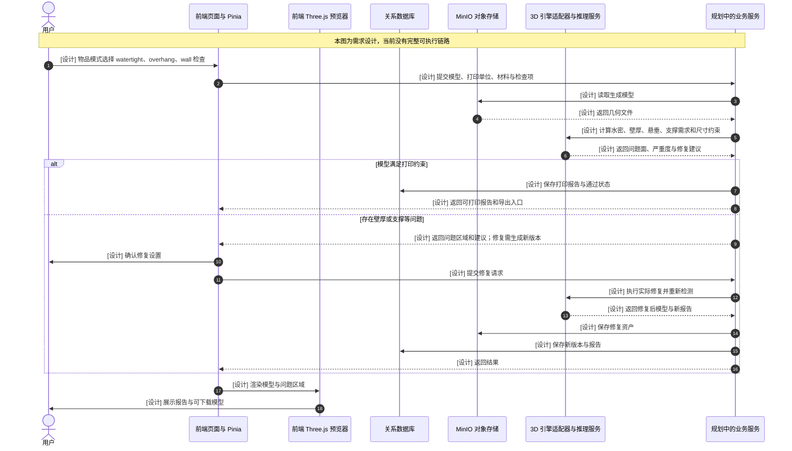

# M6-F9 3D 打印优化

| 项目 | 内容 |
| --- | --- |
| 所属模块 | 06 · 质量评估与后处理 |
| 清单来源 | PRD 详细功能清单 |
| 优先级 | P1 |
| 当前状态 | **未实现（需求设计）** |
| 分析基准 | 工作区根目录 frontend / backend / services 当前源码；2026-10-18 |

## 功能范围与实现边界

需求：添加支撑结构检测、壁厚检查

当前边界：前端有打印检查选项传参；壁厚、支撑与悬垂分析和优化尚未实现。

图中全部业务步骤均为需求设计；沿用的现有读取/上传接口只说明可复用边界，不表示整个功能已实现。

关键差异与限制：现有 watertight 质量项覆盖闭合性的一部分；不能替代整套打印可行性验证。当前 print_optimization 只随 JSON 传递。

## 参与方、调用与数据

U=用户、F=前端页面与 Pinia、V=前端 Three.js 预览器、D=关系数据库、S=MinIO 对象存储、T=3D 引擎适配器与推理服务、P=规划中的业务服务。

输入、输出与存储由下列两张图中的箭头逐步标注。`A` 表示 FastAPI；`W` 表示 Worker/Agent；两者属于不同进程。图中 `F → F`、`V → V` 表示前端内部处理，`W → W` 表示后端内部处理。

该功能没有独立 HTTP 接口；所需前置资产获取或规划中的服务调用已在图中完整标出。

## 业务流程图

节点直接标注前端、后端、服务或存储角色；箭头上的缩写表示调用方与接收方，具体请求、返回数据写在目标节点内。蓝色为前端、绿色为后端、紫色为存储；设计补充使用橙色虚线。

```mermaid
flowchart TB
    n1(["[设计] 功能开始"])
    n2["[设计] 前端页面与 Pinia：物品模式选择 watertight、overhang、wall 检查"]
    n3["[设计] 规划中的业务服务：提交模型、打印单位、材料与检查项"]
    n4["[设计] MinIO 对象存储：读取生成模型"]
    n5["[设计] 规划中的业务服务：返回几何文件"]
    n6["[设计] 3D 引擎适配器与推理服务：计算水密、壁厚、悬垂、支撑需求和尺寸约束"]
    n7["[设计] 规划中的业务服务：返回问题面、严重度与修复建议"]
    n8{"[设计] 模型满足打印约束？"}
    n9["[设计] 满足：模型满足打印约束"]
    n10["[设计] 另一分支：存在壁厚或支撑等问题"]
    n11["[设计] 关系数据库：保存打印报告与通过状态"]
    n12["[设计] 前端页面与 Pinia：返回可打印报告和导出入口"]
    n13["[设计] 前端页面与 Pinia：返回问题区域和建议；修复需生成新版本"]
    n14["[设计] 用户：确认修复设置"]
    n15["[设计] 规划中的业务服务：提交修复请求"]
    n16["[设计] 3D 引擎适配器与推理服务：执行实际修复并重新检测"]
    n17["[设计] 规划中的业务服务：返回修复后模型与新报告"]
    n18["[设计] MinIO 对象存储：保存修复资产"]
    n19["[设计] 关系数据库：保存新版本与报告"]
    n20["[设计] 前端页面与 Pinia：返回结果"]
    n21["[设计] 前端 Three.js 预览器：渲染模型与问题区域"]
    n22["[设计] 用户：展示报告与可下载模型"]
    n23(["[设计] 本次操作结束或等待后续任务"])
  n1 -.->|"U → F"| n2
  n2 -.->|"F → P"| n3
  n3 -.->|"P → S"| n4
  n4 -.->|"S → P"| n5
  n5 -.->|"P → T"| n6
  n6 -.->|"T → P"| n7
  n7 -.->|"判断"| n8
  n8 -.->|"是"| n9
  n8 -.->|"存在壁厚或支撑等问题"| n10
  n9 -.->|"P → D"| n11
  n11 -.->|"P → F"| n12
  n10 -.->|"P → F"| n13
  n13 -.->|"F → U"| n14
  n14 -.->|"F → P"| n15
  n15 -.->|"P → T"| n16
  n16 -.->|"T → P"| n17
  n17 -.->|"P → S"| n18
  n18 -.->|"P → D"| n19
  n19 -.->|"P → F"| n20
  n12 -.->|"F → V"| n21
  n20 -.->|"F → V"| n21
  n21 -.->|"V → U"| n22
  n22 -.->|"结果 / 状态"| n23
  classDef user fill:#f8fafc,stroke:#64748b
  class n1,n14,n22,n23 user
  classDef frontend fill:#eff6ff,stroke:#2563eb
  class n2,n8,n9,n10,n12,n13,n20,n21 frontend
  classDef planned fill:#fff7ed,stroke:#c2410c
  class n3,n5,n7,n15,n17 planned
  classDef storage fill:#f5f3ff,stroke:#7c3aed
  class n4,n11,n18,n19 storage
  classDef model fill:#fdf2f8,stroke:#db2777
  class n6,n16 model
  classDef design fill:#fff7ed,stroke:#c2410c,stroke-dasharray:5 5
  class n1,n2,n3,n4,n5,n6,n7,n8,n9,n10,n11,n12,n13,n14,n15,n16,n17,n18,n19,n20,n21,n22,n23 design
```

## 时序图

## 异常与结束条件

这是待实现设计：需覆盖图中权限、参数、资源缺失和下游失败分支；成功返回应与实际落库及资产可读性一致。图中接口复用不表示新增业务已完成。

需求验收目标（来自 PRD，不代表本次已验证达标）：打印成功率 >= 90%

## 源码依据

- [frontend/src/views/GenerateView.vue](D:/灵境造物/frontend/src/views/GenerateView.vue:1)
- [backend/app/agents.py · class DeterministicQualityCheckAgent](D:/灵境造物/backend/app/agents.py:491)
- [backend/app/generation.py](D:/灵境造物/backend/app/generation.py:1)

需求来源：[docs/AI_3D数字人开发工具链_PRD文档.md](D:/灵境造物/docs/AI_3D数字人开发工具链_PRD文档.md:1)。业务请求的通用边界参考 [frontend/src/services/api.ts](D:/灵境造物/frontend/src/services/api.ts:1) 与 [backend/app/exceptions.py](D:/灵境造物/backend/app/exceptions.py:1)。

[返回总目录](../README.md) · [返回本模块](README.md)
