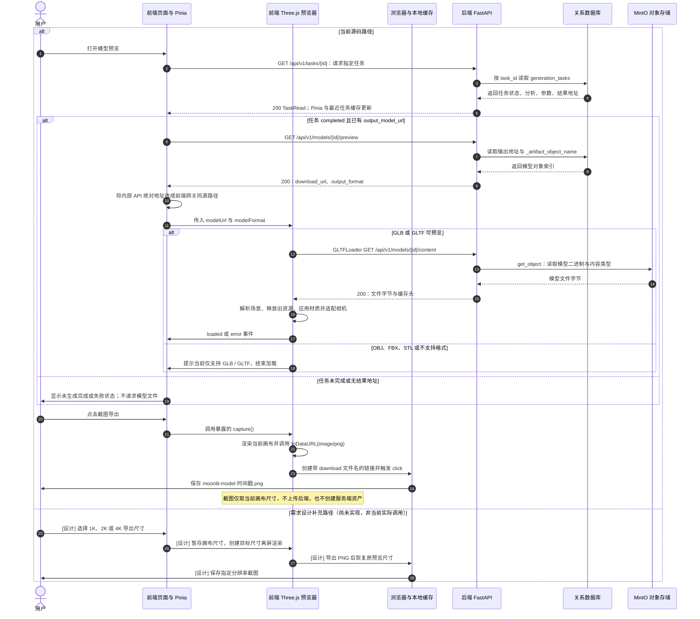

# M7-F9 截图导出

| 项目 | 内容 |
| --- | --- |
| 所属模块 | 07 · 3D 预览与交互 |
| 清单来源 | PRD 详细功能清单 |
| 优先级 | P1 |
| 当前状态 | **部分实现** |
| 分析基准 | 工作区根目录 frontend / backend / services 当前源码；2026-10-18 |

## 功能范围与实现边界

需求：导出当前视角的 2D 截图

当前边界：当前画布导出 PNG 可用；1K / 2K / 4K 尺寸选择未实现。

图中无“设计”标记的是当前源码行为；标有“[设计]”及虚线/设计分支的部分是尚未落地的需求补充。

关键差异与限制：跨域外部资源可能影响画布导出；当前 capture 未显式捕获 toDataURL 异常。

## 参与方、调用与数据

U=用户、F=前端页面与 Pinia、V=前端 Three.js 预览器、B=浏览器与本地缓存、A=后端 FastAPI、D=关系数据库、S=MinIO 对象存储。

输入、输出与存储由下列两张图中的箭头逐步标注。`A` 表示 FastAPI；`W` 表示 Worker/Agent；两者属于不同进程。图中 `F → F`、`V → V` 表示前端内部处理，`W → W` 表示后端内部处理。

涉及的现有接口或复用边界（设计路径另见图中标记）：

- `GET /api/v1/tasks/{id}`
- `GET /api/v1/models/{id}/preview`
- `GET /api/v1/models/{id}/content`

## 业务流程图

节点直接标注前端、后端、服务或存储角色；箭头上的缩写表示调用方与接收方，具体请求、返回数据写在目标节点内。蓝色为前端、绿色为后端、紫色为存储；设计补充使用橙色虚线。

```mermaid
flowchart TB
    n1(["功能开始"])
    n2["前端页面与 Pinia：打开模型预览"]
    n3["后端 FastAPI：GET /api/v1/tasks/{id}：请求指定任务"]
    n4["关系数据库：按 task_id 读取 generation_tasks"]
    n5["后端 FastAPI：返回任务状态、分析、参数、结果地址"]
    n6["前端页面与 Pinia：200 TaskRead；Pinia 与最近任务缓存更新"]
    n7{"任务 completed 且已有 output_model_url？"}
    n8["满足：任务 completed 且已有 output_model_url"]
    n9["另一分支：任务未完成或无结果地址"]
    n10["后端 FastAPI：GET /api/v1/models/{id}/preview"]
    n11["关系数据库：读取输出地址与 _artifact_object_name"]
    n12["后端 FastAPI：返回模型对象索引"]
    n13["前端页面与 Pinia：200：download_url、output_format"]
    n14["前端页面与 Pinia：将内部 API 绝对地址改成前端网关同源路径"]
    n15["前端 Three.js 预览器：传入 modelUrl 与 modelFormat"]
    n16{"GLB 或 GLTF 可预览？"}
    n17["满足：GLB 或 GLTF 可预览"]
    n18["另一分支：OBJ、FBX、STL 或不支持格式"]
    n19["后端 FastAPI：GLTFLoader GET /api/v1/models/{id}/content"]
    n20["MinIO 对象存储：get_object：读取模型二进制与内容类型"]
    n21["后端 FastAPI：模型文件字节"]
    n22["前端 Three.js 预览器：200：文件字节与缓存头"]
    n23["前端 Three.js 预览器：解析场景、释放旧资源、应用材质并适配相机"]
    n24["前端页面与 Pinia：loaded 或 error 事件"]
    n25["前端页面与 Pinia：提示当前仅支持 GLB / GLTF，结束加载"]
    n26["用户：显示未生成完成或失败状态；不请求模型文件"]
    n27["前端页面与 Pinia：点击截图导出"]
    n28["前端 Three.js 预览器：调用暴露的 capture()"]
    n29["前端 Three.js 预览器：渲染当前画布并调用 toDataURL(image/png)"]
    n30["浏览器与本地缓存：创建带 download 文件名的链接并触发 click"]
    n31["用户：保存 moonlit-model-时间戳.png"]
    n32["说明：截图仅取当前画布尺寸，不上传后端，也不创建服务端资产"]
    n33["[设计] 需求设计补充：独立替代路径，尚未实现"]
    n34["[设计] 前端页面与 Pinia：选择 1K、2K 或 4K 导出尺寸"]
    n35["[设计] 前端 Three.js 预览器：暂存画布尺寸，创建目标尺寸离屏渲染"]
    n36["[设计] 浏览器与本地缓存：导出 PNG 后恢复原预览尺寸"]
    n37["[设计] 用户：保存指定分辨率截图"]
    n38(["本次操作结束或等待后续任务"])
  n1 -->|"U → F"| n2
  n2 -->|"F → A"| n3
  n3 -->|"A → D"| n4
  n4 -->|"D → A"| n5
  n5 -->|"A → F"| n6
  n6 -->|"判断"| n7
  n7 -->|"是"| n8
  n7 -->|"任务未完成或无结果地址"| n9
  n8 -->|"F → A"| n10
  n10 -->|"A → D"| n11
  n11 -->|"D → A"| n12
  n12 -->|"A → F"| n13
  n13 -->|"F → F"| n14
  n14 -->|"F → V"| n15
  n15 -->|"判断"| n16
  n16 -->|"是"| n17
  n16 -->|"OBJ、FBX、STL 或不支持格式"| n18
  n17 -->|"V → A"| n19
  n19 -->|"A → S"| n20
  n20 -->|"S → A"| n21
  n21 -->|"A → V"| n22
  n22 -->|"V → V"| n23
  n23 -->|"V → F"| n24
  n18 -->|"V → F"| n25
  n9 -->|"F → U"| n26
  n24 -->|"U → F"| n27
  n25 -->|"U → F"| n27
  n26 -->|"U → F"| n27
  n27 -->|"F → V"| n28
  n28 -->|"V → V"| n29
  n29 -->|"V → B"| n30
  n30 -->|"B → U"| n31
  n31 -->|"边界说明"| n32
  n1 -.->|"设计路径，非当前执行"| n33
  n33 -.->|"U → F"| n34
  n34 -.->|"F → V"| n35
  n35 -.->|"V → B"| n36
  n36 -.->|"B → U"| n37
  n32 -->|"结果 / 状态"| n38
  n37 -->|"结果 / 状态"| n38
  classDef user fill:#f8fafc,stroke:#64748b
  class n1,n26,n31,n37,n38 user
  classDef frontend fill:#eff6ff,stroke:#2563eb
  class n2,n6,n8,n9,n13,n14,n15,n17,n18,n22,n23,n24,n25,n27,n28,n29,n30,n32,n34,n35,n36 frontend
  classDef backend fill:#ecfdf5,stroke:#059669
  class n3,n5,n7,n10,n12,n16,n19,n21 backend
  classDef storage fill:#f5f3ff,stroke:#7c3aed
  class n4,n11,n20 storage
  classDef planned fill:#fff7ed,stroke:#c2410c
  class n33 planned
  classDef design fill:#fff7ed,stroke:#c2410c,stroke-dasharray:5 5
  class n33,n34,n35,n36,n37 design
```

## 时序图

## 异常与结束条件

图内列出了该功能的关键校验、失败或降级路径。实际经过 FastAPI 的请求还可能返回 422 参数错误、409 数据冲突、503 数据库暂不可用或 500 未预期错误；前端经 Axios 的请求会显示统一错误，401 会清理登录状态。浏览器直连文件、WebSocket 和纯本地操作不经过同一个 Axios 错误拦截器。

需求验收目标（来自 PRD，不代表本次已验证达标）：截图分辨率支持 1K/2K/4K

## 源码依据

- [frontend/src/components/ThreePreview.vue · capture](D:/灵境造物/frontend/src/components/ThreePreview.vue:202)
- [frontend/src/views/ModelView.vue](D:/灵境造物/frontend/src/views/ModelView.vue:1)

需求来源：[docs/AI_3D数字人开发工具链_PRD文档.md](D:/灵境造物/docs/AI_3D数字人开发工具链_PRD文档.md:1)。业务请求的通用边界参考 [frontend/src/services/api.ts](D:/灵境造物/frontend/src/services/api.ts:1) 与 [backend/app/exceptions.py](D:/灵境造物/backend/app/exceptions.py:1)。

[返回总目录](../README.md) · [返回本模块](README.md)
