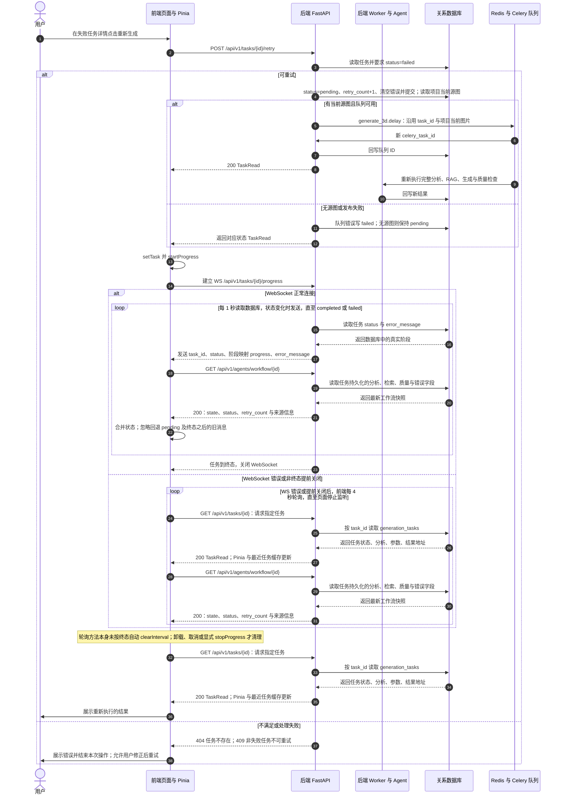

# M8-F11 任务手动重试

| 项目 | 内容 |
| --- | --- |
| 所属模块 | 08 · 项目管理 |
| 清单来源 | 当前源码补充 |
| 优先级 | 源码补充 |
| 当前状态 | **已实现** |
| 分析基准 | 工作区根目录 frontend / backend / services 当前源码；2026-10-18 |

## 功能范围与实现边界

需求：失败任务原 ID 重新入队，并增加 retry_count。

当前边界：失败任务原 ID 重新入队，并增加 retry_count。

图中无“设计”标记的是当前源码行为；标有“[设计]”及虚线/设计分支的部分是尚未落地的需求补充。

关键差异与限制：此操作不是创建新版本任务；旧分析、产物等字段未在 API 入口全部清空。图片取项目当前参考图；手动重试和自动质量重试共用 retry_count。

## 参与方、调用与数据

U=用户、F=前端页面与 Pinia、A=后端 FastAPI、W=后端 Worker 与 Agent、D=关系数据库、Q=Redis 与 Celery 队列。

输入、输出与存储由下列两张图中的箭头逐步标注。`A` 表示 FastAPI；`W` 表示 Worker/Agent；两者属于不同进程。图中 `F → F`、`V → V` 表示前端内部处理，`W → W` 表示后端内部处理。

涉及的现有接口或复用边界（设计路径另见图中标记）：

- `POST /api/v1/tasks/{id}/retry`
- `WS /api/v1/tasks/{id}/progress`
- `GET /api/v1/agents/workflow/{id}`
- `GET /api/v1/tasks/{id}`

## 业务流程图

节点直接标注前端、后端、服务或存储角色；箭头上的缩写表示调用方与接收方，具体请求、返回数据写在目标节点内。蓝色为前端、绿色为后端、紫色为存储；设计补充使用橙色虚线。

```mermaid
flowchart TB
    n1(["功能开始"])
    n2["前端页面与 Pinia：在失败任务详情点击重新生成"]
    n3["后端 FastAPI：POST /api/v1/tasks/{id}/retry"]
    n4["关系数据库：读取任务并要求 status=failed"]
    n5{"可重试？"}
    n6["满足：可重试"]
    n7["另一分支：不满足或处理失败"]
    n8["关系数据库：status=pending、retry_count+1、清空错误并提交；读取项目当前源图"]
    n9{"有当前源图且队列可用？"}
    n10["满足：有当前源图且队列可用"]
    n11["另一分支：无源图或发布失败"]
    n12["Redis 与 Celery 队列：generate_3d.delay：沿用 task_id 与项目当前图片"]
    n13["后端 FastAPI：新 celery_task_id"]
    n14["关系数据库：回写队列 ID"]
    n15["前端页面与 Pinia：200 TaskRead"]
    n16["后端 Worker 与 Agent：重新执行完整分析、RAG、生成与质量检查"]
    n17["关系数据库：回写新结果"]
    n18["关系数据库：队列错误写 failed；无源图则保持 pending"]
    n19["前端页面与 Pinia：返回对应状态 TaskRead"]
    n20["前端页面与 Pinia：setTask 并 startProgress"]
    n21["后端 FastAPI：建立 WS /api/v1/tasks/{id}/progress"]
    n22{"WebSocket 正常连接？"}
    n23["满足：WebSocket 正常连接"]
    n24["另一分支：WebSocket 错误或非终态提前关闭"]
    n25{"每 1 秒读取数据库，状态变化时发送，直至 completed 或 failed"}
    n26["执行本轮"]
    n27["关系数据库：读取任务 status 与 error_message"]
    n28["后端 FastAPI：返回数据库中的真实阶段"]
    n29["前端页面与 Pinia：发送 task_id、status、阶段映射 progress、error_message"]
    n30["后端 FastAPI：GET /api/v1/agents/workflow/{id}"]
    n31["关系数据库：读取任务持久化的分析、检索、质量与错误字段"]
    n32["后端 FastAPI：返回最新工作流快照"]
    n33["前端页面与 Pinia：200：state、status、retry_count 与来源信息"]
    n34["前端页面与 Pinia：合并状态；忽略回退 pending 及终态之后的旧消息"]
    n35["循环结束或停止监听"]
    n36["前端页面与 Pinia：任务到终态，关闭 WebSocket"]
    n37{"WS 错误或提前关闭后，前端每 4 秒轮询，直至页面停止监听"}
    n38["执行本轮"]
    n39["后端 FastAPI：GET /api/v1/tasks/{id}：请求指定任务"]
    n40["关系数据库：按 task_id 读取 generation_tasks"]
    n41["后端 FastAPI：返回任务状态、分析、参数、结果地址"]
    n42["前端页面与 Pinia：200 TaskRead；Pinia 与最近任务缓存更新"]
    n43["后端 FastAPI：GET /api/v1/agents/workflow/{id}"]
    n44["关系数据库：读取任务持久化的分析、检索、质量与错误字段"]
    n45["后端 FastAPI：返回最新工作流快照"]
    n46["前端页面与 Pinia：200：state、status、retry_count 与来源信息"]
    n47["循环结束或停止监听"]
    n48["说明：轮询方法本身未按终态自动 clearInterval；卸载、取消或显式 stopProgress 才清理"]
    n49["后端 FastAPI：GET /api/v1/tasks/{id}：请求指定任务"]
    n50["关系数据库：按 task_id 读取 generation_tasks"]
    n51["后端 FastAPI：返回任务状态、分析、参数、结果地址"]
    n52["前端页面与 Pinia：200 TaskRead；Pinia 与最近任务缓存更新"]
    n53["用户：展示重新执行的结果"]
    n54["前端页面与 Pinia：404 任务不存在；409 非失败任务不可重试"]
    n55["用户：展示错误并结束本次操作；允许用户修正后重试"]
    n56(["本次操作结束或等待后续任务"])
  n1 -->|"U → F"| n2
  n2 -->|"F → A"| n3
  n3 -->|"A → D"| n4
  n4 -->|"判断"| n5
  n5 -->|"是"| n6
  n5 -->|"不满足或处理失败"| n7
  n6 -->|"A → D"| n8
  n8 -->|"判断"| n9
  n9 -->|"是"| n10
  n9 -->|"无源图或发布失败"| n11
  n10 -->|"A → Q"| n12
  n12 -->|"Q → A"| n13
  n13 -->|"A → D"| n14
  n14 -->|"A → F"| n15
  n15 -->|"Q → W"| n16
  n16 -->|"W → D"| n17
  n11 -->|"A → D"| n18
  n18 -->|"A → F"| n19
  n17 -->|"F → F"| n20
  n19 -->|"F → F"| n20
  n20 -->|"F → A"| n21
  n21 -->|"判断"| n22
  n22 -->|"是"| n23
  n22 -->|"WebSocket 错误或非终态提前关闭"| n24
  n23 -->|"进入循环"| n25
  n25 -->|"继续"| n26
  n26 -->|"A → D"| n27
  n27 -->|"D → A"| n28
  n28 -->|"A → F"| n29
  n29 -->|"F → A"| n30
  n30 -->|"A → D"| n31
  n31 -->|"D → A"| n32
  n32 -->|"A → F"| n33
  n33 -->|"F → F"| n34
  n34 -->|"下一轮或检查结束条件"| n25
  n25 -->|"完成 / 停止"| n35
  n35 -->|"A → F"| n36
  n24 -->|"进入循环"| n37
  n37 -->|"继续"| n38
  n38 -->|"F → A"| n39
  n39 -->|"A → D"| n40
  n40 -->|"D → A"| n41
  n41 -->|"A → F"| n42
  n42 -->|"F → A"| n43
  n43 -->|"A → D"| n44
  n44 -->|"D → A"| n45
  n45 -->|"A → F"| n46
  n46 -->|"下一轮或检查结束条件"| n37
  n37 -->|"完成 / 停止"| n47
  n36 -->|"边界说明"| n48
  n47 -->|"边界说明"| n48
  n48 -->|"F → A"| n49
  n49 -->|"A → D"| n50
  n50 -->|"D → A"| n51
  n51 -->|"A → F"| n52
  n52 -->|"F → U"| n53
  n7 -->|"A → F"| n54
  n54 -->|"F → U"| n55
  n53 -->|"结果 / 状态"| n56
  n55 -->|"结果 / 状态"| n56
  classDef user fill:#f8fafc,stroke:#64748b
  class n1,n53,n55,n56 user
  classDef frontend fill:#eff6ff,stroke:#2563eb
  class n2,n6,n7,n10,n11,n15,n19,n20,n23,n24,n25,n26,n29,n33,n34,n35,n36,n37,n38,n42,n46,n47,n48,n52,n54 frontend
  classDef backend fill:#ecfdf5,stroke:#059669
  class n3,n5,n9,n13,n16,n21,n22,n28,n30,n32,n39,n41,n43,n45,n49,n51 backend
  classDef storage fill:#f5f3ff,stroke:#7c3aed
  class n4,n8,n14,n17,n18,n27,n31,n40,n44,n50 storage
  classDef queue fill:#fffbeb,stroke:#d97706
  class n12 queue
```

## 时序图

## 异常与结束条件

图内列出了该功能的关键校验、失败或降级路径。实际经过 FastAPI 的请求还可能返回 422 参数错误、409 数据冲突、503 数据库暂不可用或 500 未预期错误；前端经 Axios 的请求会显示统一错误，401 会清理登录状态。浏览器直连文件、WebSocket 和纯本地操作不经过同一个 Axios 错误拦截器。

需求验收目标（来自 PRD，不代表本次已验证达标）：按本文所列实际行为核对；本次未运行业务性能验收。

## 源码依据

- [frontend/src/views/TasksView.vue · retry](D:/灵境造物/frontend/src/views/TasksView.vue:100)
- [frontend/src/stores/task.ts · retry](D:/灵境造物/frontend/src/stores/task.ts:110)
- [backend/app/routers.py · retry_task](D:/灵境造物/backend/app/routers.py:361)
- [backend/app/worker.py](D:/灵境造物/backend/app/worker.py:1)

需求来源：[docs/AI_3D数字人开发工具链_PRD文档.md](D:/灵境造物/docs/AI_3D数字人开发工具链_PRD文档.md:1)。业务请求的通用边界参考 [frontend/src/services/api.ts](D:/灵境造物/frontend/src/services/api.ts:1) 与 [backend/app/exceptions.py](D:/灵境造物/backend/app/exceptions.py:1)。

[返回总目录](../README.md) · [返回本模块](README.md)
