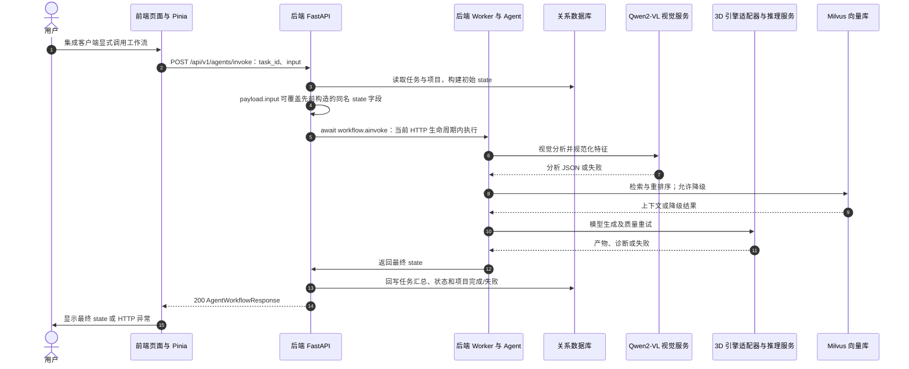

# M10-F5 直接调用 Agent 工作流

| 项目 | 内容 |
| --- | --- |
| 所属模块 | 10 · 智能体工作流可视化 |
| 清单来源 | 当前源码补充 |
| 优先级 | 源码补充 |
| 当前状态 | **仅后端 API** |
| 分析基准 | 工作区根目录 frontend / backend / services 当前源码；2026-10-18 |

## 功能范围与实现边界

需求：绕过 Celery，HTTP 请求内直接执行 LangGraph 并保存最终汇总。

当前边界：绕过 Celery，HTTP 请求内直接执行 LangGraph 并保存最终汇总。

图中无“设计”标记的是当前源码行为；标有“[设计]”及虚线/设计分支的部分是尚未落地的需求补充。

关键差异与限制：该入口无前端页面调用，不使用 Celery，也不走 Worker 的逐节点持久化和本地文件 MinIO 归档步骤；长耗时可能超过普通前端 15 秒请求超时，不能等同于正常异步任务入口。

## 参与方、调用与数据

U=用户、F=前端页面与 Pinia、A=后端 FastAPI、W=后端 Worker 与 Agent、D=关系数据库、H=Qwen2-VL 视觉服务、T=3D 引擎适配器与推理服务、R=Milvus 向量库。

输入、输出与存储由下列两张图中的箭头逐步标注。`A` 表示 FastAPI；`W` 表示 Worker/Agent；两者属于不同进程。图中 `F → F`、`V → V` 表示前端内部处理，`W → W` 表示后端内部处理。

涉及的现有接口或复用边界（设计路径另见图中标记）：

- `POST /api/v1/agents/invoke`

## 业务流程图

节点直接标注前端、后端、服务或存储角色；箭头上的缩写表示调用方与接收方，具体请求、返回数据写在目标节点内。蓝色为前端、绿色为后端、紫色为存储；设计补充使用橙色虚线。

```mermaid
flowchart TB
    n1(["功能开始"])
    n2["前端页面与 Pinia：集成客户端显式调用工作流"]
    n3["后端 FastAPI：POST /api/v1/agents/invoke：task_id、input"]
    n4["关系数据库：读取任务与项目，构建初始 state"]
    n5["后端 FastAPI：payload.input 可覆盖先前构造的同名 state 字段"]
    n6["后端 Worker 与 Agent：await workflow.ainvoke：当前 HTTP 生命周期内执行"]
    n7["Qwen2-VL 视觉服务：视觉分析并规范化特征"]
    n8["后端 Worker 与 Agent：分析 JSON 或失败"]
    n9["Milvus 向量库：检索与重排序；允许降级"]
    n10["后端 Worker 与 Agent：上下文或降级结果"]
    n11["3D 引擎适配器与推理服务：模型生成及质量重试"]
    n12["后端 Worker 与 Agent：产物、诊断或失败"]
    n13["后端 FastAPI：返回最终 state"]
    n14["关系数据库：回写任务汇总、状态和项目完成/失败"]
    n15["前端页面与 Pinia：200 AgentWorkflowResponse"]
    n16["用户：显示最终 state 或 HTTP 异常"]
    n17(["本次操作结束或等待后续任务"])
  n1 -->|"U → F"| n2
  n2 -->|"F → A"| n3
  n3 -->|"A → D"| n4
  n4 -->|"A → A"| n5
  n5 -->|"A → W"| n6
  n6 -->|"W → H"| n7
  n7 -->|"H → W"| n8
  n8 -->|"W → R"| n9
  n9 -->|"R → W"| n10
  n10 -->|"W → T"| n11
  n11 -->|"T → W"| n12
  n12 -->|"W → A"| n13
  n13 -->|"A → D"| n14
  n14 -->|"A → F"| n15
  n15 -->|"F → U"| n16
  n16 -->|"结果 / 状态"| n17
  classDef user fill:#f8fafc,stroke:#64748b
  class n1,n16,n17 user
  classDef frontend fill:#eff6ff,stroke:#2563eb
  class n2,n15 frontend
  classDef backend fill:#ecfdf5,stroke:#059669
  class n3,n5,n6,n8,n10,n12,n13 backend
  classDef storage fill:#f5f3ff,stroke:#7c3aed
  class n4,n9,n14 storage
  classDef model fill:#fdf2f8,stroke:#db2777
  class n7,n11 model
```

## 时序图

## 异常与结束条件

图内列出了该功能的关键校验、失败或降级路径。实际经过 FastAPI 的请求还可能返回 422 参数错误、409 数据冲突、503 数据库暂不可用或 500 未预期错误；前端经 Axios 的请求会显示统一错误，401 会清理登录状态。浏览器直连文件、WebSocket 和纯本地操作不经过同一个 Axios 错误拦截器。

需求验收目标（来自 PRD，不代表本次已验证达标）：按本文所列实际行为核对；本次未运行业务性能验收。

## 源码依据

- [backend/app/routers.py · invoke_agent](D:/灵境造物/backend/app/routers.py:646)
- [backend/app/agents.py · class MasterAgent](D:/灵境造物/backend/app/agents.py:638)
- [backend/app/worker.py](D:/灵境造物/backend/app/worker.py:1)

需求来源：[docs/AI_3D数字人开发工具链_PRD文档.md](D:/灵境造物/docs/AI_3D数字人开发工具链_PRD文档.md:1)。业务请求的通用边界参考 [frontend/src/services/api.ts](D:/灵境造物/frontend/src/services/api.ts:1) 与 [backend/app/exceptions.py](D:/灵境造物/backend/app/exceptions.py:1)。

[返回总目录](../README.md) · [返回本模块](README.md)
