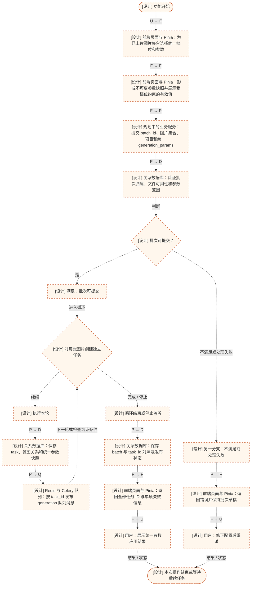
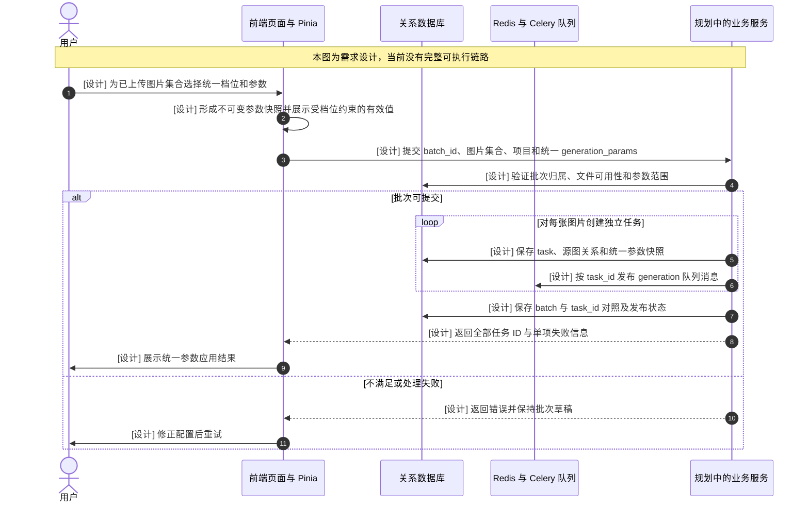

# M11-F2 统一参数配置

| 项目 | 内容 |
| --- | --- |
| 所属模块 | 11 · 批量生成 |
| 清单来源 | PRD 详细功能清单 |
| 优先级 | P1 |
| 当前状态 | **未实现（需求设计）** |
| 分析基准 | 工作区根目录 frontend / backend / services 当前源码；2026-10-18 |

## 功能范围与实现边界

需求：为所有任务设置统一的生成参数

当前边界：统一参数分发到多个任务、批次参数快照未实现。

图中全部业务步骤均为需求设计；沿用的现有读取/上传接口只说明可复用边界，不表示整个功能已实现。

关键差异与限制：当前生成页单次只取一个文件；只有单任务 POST /tasks，没有 batch_id、批量事务、聚合状态和批量 API。Celery worker 并发配置也不等于已实现“最多 4 个”批量产品能力。 每个任务需独立源图关联，避免多个任务依赖同一项目可变的 source_image_url。

## 参与方、调用与数据

U=用户、F=前端页面与 Pinia、D=关系数据库、Q=Redis 与 Celery 队列、P=规划中的业务服务。

输入、输出与存储由下列两张图中的箭头逐步标注。`A` 表示 FastAPI；`W` 表示 Worker/Agent；两者属于不同进程。图中 `F → F`、`V → V` 表示前端内部处理，`W → W` 表示后端内部处理。

该功能没有独立 HTTP 接口；所需前置资产获取或规划中的服务调用已在图中完整标出。

## 业务流程图

节点直接标注前端、后端、服务或存储角色；箭头上的缩写表示调用方与接收方，具体请求、返回数据写在目标节点内。蓝色为前端、绿色为后端、紫色为存储；设计补充使用橙色虚线。

## 时序图

## 异常与结束条件

这是待实现设计：需覆盖图中权限、参数、资源缺失和下游失败分支；成功返回应与实际落库及资产可读性一致。图中接口复用不表示新增业务已完成。

需求验收目标（来自 PRD，不代表本次已验证达标）：参数应用准确率 100%

## 源码依据

- [frontend/src/views/GenerateView.vue · submit](D:/灵境造物/frontend/src/views/GenerateView.vue:24)
- [backend/app/routers.py · create_task](D:/灵境造物/backend/app/routers.py:222)
- [backend/app/worker.py](D:/灵境造物/backend/app/worker.py:1)

需求来源：[docs/AI_3D数字人开发工具链_PRD文档.md](D:/灵境造物/docs/AI_3D数字人开发工具链_PRD文档.md:1)。业务请求的通用边界参考 [frontend/src/services/api.ts](D:/灵境造物/frontend/src/services/api.ts:1) 与 [backend/app/exceptions.py](D:/灵境造物/backend/app/exceptions.py:1)。

[返回总目录](../README.md) · [返回本模块](README.md)
