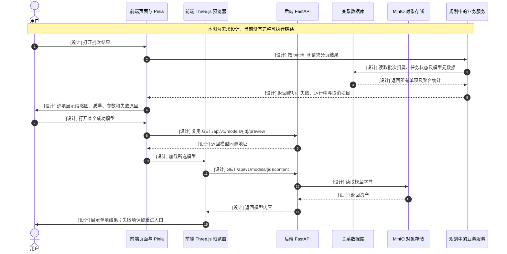

# M11-F4 批量结果查看

| 项目 | 内容 |
| --- | --- |
| 所属模块 | 11 · 批量生成 |
| 清单来源 | PRD 详细功能清单 |
| 优先级 | P1 |
| 当前状态 | **未实现（需求设计）** |
| 分析基准 | 工作区根目录 frontend / backend / services 当前源码；2026-10-18 |

## 功能范围与实现边界

需求：统一查看所有任务的生成结果

当前边界：统一批次结果列表、逐项查看和批量导出未实现。

图中全部业务步骤均为需求设计；沿用的现有读取/上传接口只说明可复用边界，不表示整个功能已实现。

关键差异与限制：当前生成页单次只取一个文件；只有单任务 POST /tasks，没有 batch_id、批量事务、聚合状态和批量 API。Celery worker 并发配置也不等于已实现“最多 4 个”批量产品能力。

## 参与方、调用与数据

U=用户、F=前端页面与 Pinia、V=前端 Three.js 预览器、A=后端 FastAPI、D=关系数据库、S=MinIO 对象存储、P=规划中的业务服务。

输入、输出与存储由下列两张图中的箭头逐步标注。`A` 表示 FastAPI；`W` 表示 Worker/Agent；两者属于不同进程。图中 `F → F`、`V → V` 表示前端内部处理，`W → W` 表示后端内部处理。

涉及的现有接口或复用边界（设计路径另见图中标记）：

- `GET /api/v1/models/{id}/preview`
- `GET /api/v1/models/{id}/content`

## 业务流程图

节点直接标注前端、后端、服务或存储角色；箭头上的缩写表示调用方与接收方，具体请求、返回数据写在目标节点内。蓝色为前端、绿色为后端、紫色为存储；设计补充使用橙色虚线。

```mermaid
flowchart TB
    n1(["[设计] 功能开始"])
    n2["[设计] 前端页面与 Pinia：打开批次结果"]
    n3["[设计] 规划中的业务服务：按 batch_id 请求分页结果"]
    n4["[设计] 关系数据库：读取批次归属、任务状态及模型元数据"]
    n5["[设计] 规划中的业务服务：返回所有单项及聚合统计"]
    n6["[设计] 前端页面与 Pinia：返回成功、失败、运行中与取消项目"]
    n7["[设计] 用户：逐项展示缩略图、质量、参数和失败原因"]
    n8["[设计] 前端页面与 Pinia：打开某个成功模型"]
    n9["[设计] 后端 FastAPI：复用 GET /api/v1/models/{id}/preview"]
    n10["[设计] 前端页面与 Pinia：返回模型同源地址"]
    n11["[设计] 前端 Three.js 预览器：加载所选模型"]
    n12["[设计] 后端 FastAPI：GET /api/v1/models/{id}/content"]
    n13["[设计] MinIO 对象存储：读取模型字节"]
    n14["[设计] 后端 FastAPI：返回资产"]
    n15["[设计] 前端 Three.js 预览器：返回模型内容"]
    n16["[设计] 用户：展示单项结果；失败项保留重试入口"]
    n17(["[设计] 本次操作结束或等待后续任务"])
  n1 -.->|"U → F"| n2
  n2 -.->|"F → P"| n3
  n3 -.->|"P → D"| n4
  n4 -.->|"D → P"| n5
  n5 -.->|"P → F"| n6
  n6 -.->|"F → U"| n7
  n7 -.->|"U → F"| n8
  n8 -.->|"F → A"| n9
  n9 -.->|"A → F"| n10
  n10 -.->|"F → V"| n11
  n11 -.->|"V → A"| n12
  n12 -.->|"A → S"| n13
  n13 -.->|"S → A"| n14
  n14 -.->|"A → V"| n15
  n15 -.->|"V → U"| n16
  n16 -.->|"结果 / 状态"| n17
  classDef user fill:#f8fafc,stroke:#64748b
  class n1,n7,n16,n17 user
  classDef frontend fill:#eff6ff,stroke:#2563eb
  class n2,n6,n8,n10,n11,n15 frontend
  classDef planned fill:#fff7ed,stroke:#c2410c
  class n3,n5 planned
  classDef storage fill:#f5f3ff,stroke:#7c3aed
  class n4,n13 storage
  classDef backend fill:#ecfdf5,stroke:#059669
  class n9,n12,n14 backend
  classDef design fill:#fff7ed,stroke:#c2410c,stroke-dasharray:5 5
  class n1,n2,n3,n4,n5,n6,n7,n8,n9,n10,n11,n12,n13,n14,n15,n16,n17 design
```

## 时序图

## 异常与结束条件

这是待实现设计：需覆盖图中权限、参数、资源缺失和下游失败分支；成功返回应与实际落库及资产可读性一致。图中接口复用不表示新增业务已完成。

需求验收目标（来自 PRD，不代表本次已验证达标）：结果展示完整度 100%

## 源码依据

- [frontend/src/views/ProjectDetailView.vue](D:/灵境造物/frontend/src/views/ProjectDetailView.vue:1)
- [frontend/src/views/ModelView.vue](D:/灵境造物/frontend/src/views/ModelView.vue:1)
- [backend/app/routers.py · preview_model](D:/灵境造物/backend/app/routers.py:539)

需求来源：[docs/AI_3D数字人开发工具链_PRD文档.md](D:/灵境造物/docs/AI_3D数字人开发工具链_PRD文档.md:1)。业务请求的通用边界参考 [frontend/src/services/api.ts](D:/灵境造物/frontend/src/services/api.ts:1) 与 [backend/app/exceptions.py](D:/灵境造物/backend/app/exceptions.py:1)。

[返回总目录](../README.md) · [返回本模块](README.md)
