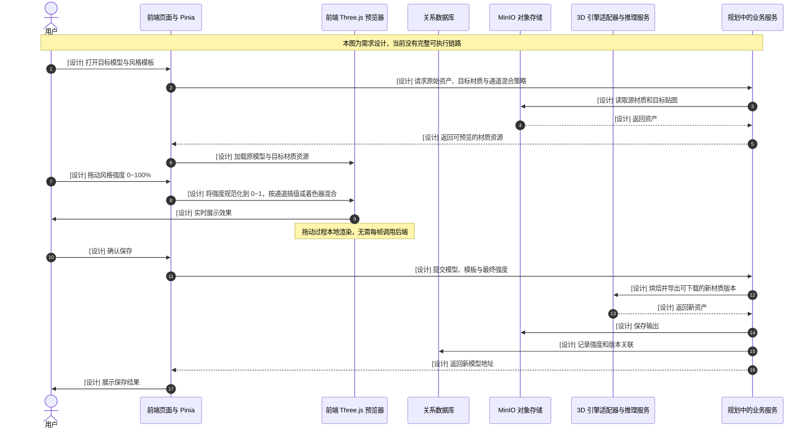

# M13-F3 风格强度调节

| 项目 | 内容 |
| --- | --- |
| 所属模块 | 13 · 风格迁移 |
| 清单来源 | PRD 详细功能清单 |
| 优先级 | P2 |
| 当前状态 | **未实现（需求设计）** |
| 分析基准 | 工作区根目录 frontend / backend / services 当前源码；2026-10-18 |

## 功能范围与实现边界

需求：调节风格迁移的强度（0-100%）

当前边界：0~100% 的风格混合强度、预览和保存未实现。

图中全部业务步骤均为需求设计；沿用的现有读取/上传接口只说明可复用边界，不表示整个功能已实现。

关键差异与限制：现有 roughness / metalness 滑块没有风格模板、通道混合或保存机制，不能视为风格强度功能。

## 参与方、调用与数据

U=用户、F=前端页面与 Pinia、V=前端 Three.js 预览器、D=关系数据库、S=MinIO 对象存储、T=3D 引擎适配器与推理服务、P=规划中的业务服务。

输入、输出与存储由下列两张图中的箭头逐步标注。`A` 表示 FastAPI；`W` 表示 Worker/Agent；两者属于不同进程。图中 `F → F`、`V → V` 表示前端内部处理，`W → W` 表示后端内部处理。

该功能没有独立 HTTP 接口；所需前置资产获取或规划中的服务调用已在图中完整标出。

## 业务流程图

节点直接标注前端、后端、服务或存储角色；箭头上的缩写表示调用方与接收方，具体请求、返回数据写在目标节点内。蓝色为前端、绿色为后端、紫色为存储；设计补充使用橙色虚线。

```mermaid
flowchart TB
    n1(["[设计] 功能开始"])
    n2["[设计] 前端页面与 Pinia：打开目标模型与风格模板"]
    n3["[设计] 规划中的业务服务：请求原始资产、目标材质与通道混合策略"]
    n4["[设计] MinIO 对象存储：读取源材质和目标贴图"]
    n5["[设计] 规划中的业务服务：返回资产"]
    n6["[设计] 前端页面与 Pinia：返回可预览的材质资源"]
    n7["[设计] 前端 Three.js 预览器：加载原模型与目标材质资源"]
    n8["[设计] 前端页面与 Pinia：拖动风格强度 0~100%"]
    n9["[设计] 前端 Three.js 预览器：将强度规范化到 0~1，按通道插值或着色器混合"]
    n10["[设计] 用户：实时展示效果"]
    n11["[设计] 说明：拖动过程本地渲染，无需每帧调用后端"]
    n12["[设计] 前端页面与 Pinia：确认保存"]
    n13["[设计] 规划中的业务服务：提交模型、模板与最终强度"]
    n14["[设计] 3D 引擎适配器与推理服务：烘焙并导出可下载的新材质版本"]
    n15["[设计] 规划中的业务服务：返回新资产"]
    n16["[设计] MinIO 对象存储：保存输出"]
    n17["[设计] 关系数据库：记录强度和版本关联"]
    n18["[设计] 前端页面与 Pinia：返回新模型地址"]
    n19["[设计] 用户：展示保存结果"]
    n20(["[设计] 本次操作结束或等待后续任务"])
  n1 -.->|"U → F"| n2
  n2 -.->|"F → P"| n3
  n3 -.->|"P → S"| n4
  n4 -.->|"S → P"| n5
  n5 -.->|"P → F"| n6
  n6 -.->|"F → V"| n7
  n7 -.->|"U → F"| n8
  n8 -.->|"F → V"| n9
  n9 -.->|"V → U"| n10
  n10 -.->|"边界说明"| n11
  n11 -.->|"U → F"| n12
  n12 -.->|"F → P"| n13
  n13 -.->|"P → T"| n14
  n14 -.->|"T → P"| n15
  n15 -.->|"P → S"| n16
  n16 -.->|"P → D"| n17
  n17 -.->|"P → F"| n18
  n18 -.->|"F → U"| n19
  n19 -.->|"结果 / 状态"| n20
  classDef user fill:#f8fafc,stroke:#64748b
  class n1,n10,n19,n20 user
  classDef frontend fill:#eff6ff,stroke:#2563eb
  class n2,n6,n7,n8,n9,n11,n12,n18 frontend
  classDef planned fill:#fff7ed,stroke:#c2410c
  class n3,n5,n13,n15 planned
  classDef storage fill:#f5f3ff,stroke:#7c3aed
  class n4,n16,n17 storage
  classDef model fill:#fdf2f8,stroke:#db2777
  class n14 model
  classDef design fill:#fff7ed,stroke:#c2410c,stroke-dasharray:5 5
  class n1,n2,n3,n4,n5,n6,n7,n8,n9,n10,n11,n12,n13,n14,n15,n16,n17,n18,n19,n20 design
```

## 时序图

## 异常与结束条件

这是待实现设计：需覆盖图中权限、参数、资源缺失和下游失败分支；成功返回应与实际落库及资产可读性一致。图中接口复用不表示新增业务已完成。

需求验收目标（来自 PRD，不代表本次已验证达标）：调节实时预览

## 源码依据

- [frontend/src/views/ModelView.vue](D:/灵境造物/frontend/src/views/ModelView.vue:1)
- [frontend/src/components/ThreePreview.vue](D:/灵境造物/frontend/src/components/ThreePreview.vue:1)

需求来源：[docs/AI_3D数字人开发工具链_PRD文档.md](D:/灵境造物/docs/AI_3D数字人开发工具链_PRD文档.md:1)。业务请求的通用边界参考 [frontend/src/services/api.ts](D:/灵境造物/frontend/src/services/api.ts:1) 与 [backend/app/exceptions.py](D:/灵境造物/backend/app/exceptions.py:1)。

[返回总目录](../README.md) · [返回本模块](README.md)
